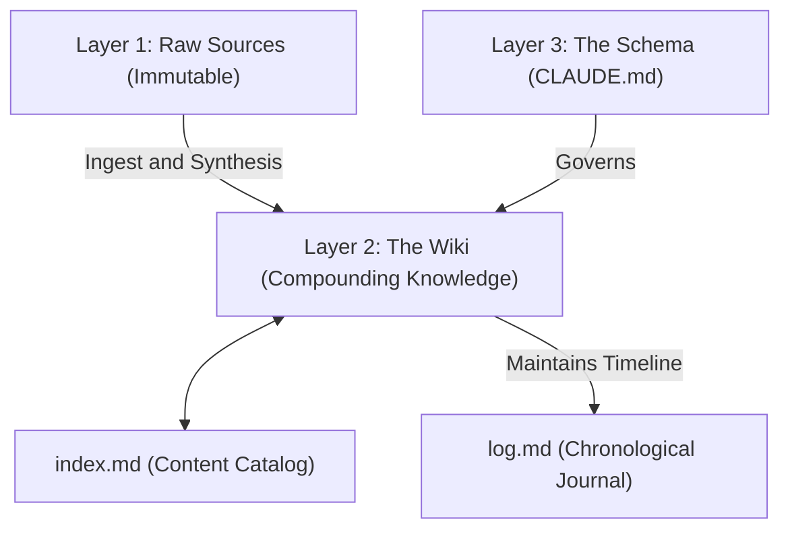

# Minishell LLM Wiki Schema & Engineering Guide

> **Project Identity**: 42 Minishell Knowledge Base & System Architecture Wiki  
> **Hub**: [[index|Minishell LLM Wiki Index]]  
> **Wiki Local Path**: `/Users/yong/Projects/gdtknight/42/minishell-wiki`  
> **Wiki Remote Repository**: `git@github.com:42GS/minishell-wiki.git`  
> **Implementation Local Path**: `~/Projects/gdtknight/42/minishell`  
> **Implementation Remote Repository**: `git@github.com:42GS/minishell.git`  
> **Legacy Repository (Archive Only)**: `git@github.com:42GS/minishell-old.git`  
> **Official Evaluation Source**: [[raw/evalhub/minishell_eval_scale|42 EvalHub Minishell Scale]]  
> **Reference Shell**: GNU Bash (`bash --posix` / POSIX.1-2017)

---

## 0. Quick Navigation & Architecture Map

- **Process & Roadmap**: [[wiki/process/github_engineering_standards|GitHub Engineering Standards]] | [[wiki/process/roadmap_and_issues|Dual-Repo Roadmap & Issues]]
- **Requirements**: [[wiki/requirements/mandatory|Mandatory Spec]] | [[wiki/requirements/bonus|Bonus Spec]] | [[wiki/requirements/evaluation_matrix|Evaluation Matrix]]
- **System Architecture**: [[wiki/architecture/01_parser_and_ast|Phase 1 Parser & AST]] | [[wiki/architecture/02_execution_engine_and_ipc|Phase 2 Execution Engine]] | [[wiki/architecture/03_signal_dispatcher_and_state_machine|Phase 3 Signal Dispatcher]] | [[wiki/architecture/04_builtins_and_env_table|Phase 4 Builtins & Env]]
- **Deep Dive Concepts**: [[wiki/concepts/deep_dive_lexer_parser_ast|Compiler Theory]] | [[wiki/concepts/deep_dive_process_ipc_and_fd|Process & IPC]] | [[wiki/concepts/deep_dive_signals_and_concurrency|Signals & Concurrency]] | [[wiki/concepts/deep_dive_builtins_and_environment|Builtins & Env]] | [[wiki/concepts/allowed_functions_matrix|Allowed Functions]]

---

## 1. Core Principles & Strict Constraints

### 1.1 Legacy Code Sealing Rule (절대 원칙)
- `minishell-old.git`의 기존 구현 코드는 **설계 및 구현 단계에서 절대 열람하거나 참조하지 않는다.**
- 프로젝트가 100% 완성되고 보너스 및 모든 테스트를 통과한 이후, **최종 회고 단계에서만** 이전 구현 대비 정량적/정성적 개선점(아키텍처 구조 개선, 버그 수정, 안정성 향상, 성능 측정)을 분석하는 용도로만 제한적으로 비교한다.

### 1.2 Backend Portfolio Standard (백엔드 포트폴리오 엔지니어링 표준)
- 단순한 과제 통과를 넘어, 시스템 소프트웨어 및 백엔드 엔지니어링의 핵심 역량을 증명하는 레퍼런스 프로젝트로 구축한다.
  1. **OS & System Architecture**: 프로세스 생명주기(`fork`/`execve`/`waitpid`), IPC 파이프라인(`pipe`/`dup2`), 가상 파일 시스템 및 리다이렉션 테이블 라이프사이클을 명확히 추상화.
  2. **Parser & Execution Engine 분리**: Bash 문법 구조(Lexer -> Tokenizer -> AST / Command Table -> Executor)의 모듈식 아키텍처.
  3. **Robust Signal Handling**: 비동기 시그널 핸들러의 재진입성(Async-Signal-Safe) 보장 및 전역 변수(서브젝트 제한: 1개의 시그널 번호 전용 단일 변수) 제약의 완벽한 격리.
  4. **Leak-Free Resource Management**: 단 하나의 힙 메모리 릭, 단 하나의 파일 디스크립터(FD) 누수도 허용하지 않는 엄격한 RAII 스타일 리소스 클린업.
  5. **Traceable Git Workflow**: Conventional Commits, 이슈 연동 커밋 접두어(`[#이슈번호]`), 명확한 이슈/PR 분기, 아키텍처 결정 기록(ADR) 문서화.

### 1.3 Dual-Repository Isolation & Git Workflow (이중 저장소 분리 및 PR 원칙)
- **역할 엄격 분리**:
  - `42GS/minishell-wiki`: 요구사항 분석, OS/컴파일러 이론 딥다이브, 아키텍처 설계, 엔지니어링 표준 및 회고록 관리. **위키 전용 이슈**만 등록 및 추적한다.
  - `42GS/minishell`: C 언어 프로덕션 코드, Makefile, CI 워크플로우, 자동화 테스트 슈트 관리. **구현 및 QA 전용 이슈**만 등록 및 추적한다.
- **GitHub Flow & PR-Only 브랜치 전략 (`main` 직접 작업 금지)**:
  - 모든 개별 이슈 작업은 `main` 브랜치에서 직접 커밋·푸시하지 않고, 반드시 이슈 번호 기반 작업 브랜치(`feat/<issue>-<desc>`, `fix/<issue>-<desc>`, `docs/<issue>-<desc>`)를 분기하여 진행한다.
  - 작업 완료 후 표준 PR 템플릿에 맞춰 Pull Request를 작성하고, CI 품질 게이트(Norminette, Strict Build, Relink, Valgrind) 통과 후 `main`으로 머지한다.
- **이슈 연동 커밋 규칙**:
  - 모든 커밋 타이틀 맨 앞에 해당 리포지토리의 연관 이슈 번호를 `[#이슈번호]` 형태로 명시하여 추적성을 보장한다. (예: `[#25] feat(lexer): ...`)
  - 위키 저장소의 커밋은 반드시 `minishell-wiki`의 이슈 번호와 연결하고, 구현 저장소의 커밋은 반드시 `minishell`의 이슈 번호와 연결한다.
- **CLI 스크립트 안전 수칙**:
  - `gh` CLI 등으로 마크다운 본문을 자동 등록/수정할 때는 백틱 기호(Backtick) 명령어 치환 및 셸 변수 오염을 방지하기 위해 `shell=False` 인자 리스트와 `--body-file` 옵션을 반드시 사용한다.

---

## 2. LLM Wiki Architecture (3-Layer Pattern)

### Layer 1: Raw Sources (`raw/`)
- 외부에서 유입된 변경 불가능한(immutable) 원본 자료를 보관한다.
- `raw/subject/`: 공식 서브젝트 PDF (`en.subject.pdf`) 및 무손실 텍스트 (`en.subject.md`)
- `raw/evalhub/`: 42evalhub 평가 시트 원본 (`minishell_eval_scale.html`, `minishell_eval_scale.md`)
- `raw/manpages/`: 허용된 외부 함수 53종의 공식 시스템 매뉴얼 (`raw/manpages/*.txt`)
- `raw/specs/`: GNU Bash 및 POSIX Shell Command Language 원문 발췌 (`raw/specs/*.md`)

### Layer 2: The Wiki & Templates (`wiki/`, `templates/`)
- LLM이 작성하고 지속적으로 관리하는 마크다운 지식 베이스 및 프로젝트 표준 템플릿.
- 사용자는 읽고 탐색하며, LLM이 문서를 작성·교차참조·갱신한다.
- 디렉토리 구조:
  - `wiki/process/`: GitHub 엔지니어링 표준, 듀얼 리포지토리 로드맵 및 이슈 트래킹 매트릭스
  - `wiki/requirements/`: 필수(Mandatory), 보너스(Bonus), 평가 매트릭스(Evaluation Matrix)
  - `wiki/concepts/`: 시스템 콜 매트릭스, 컴파일러/OS/시그널 심화 학습(Deep Dive) 문서
  - `wiki/architecture/`: 파서/렉서 문법 설계, AST 구조, 실행 엔진, 시그널 상태 머신, 빌트인 설계
  - `templates/github/`: 구현 저장소(`.github/`)에 이식할 표준 Issue/PR 템플릿 및 CI 워크플로우
  - *(예정)* `wiki/adr/` (아키텍처 결정 기록), `wiki/eval/` (방어 및 회귀 테스트 시나리오)

### Layer 3: The Schema (`CLAUDE.md`)
- 위키의 규칙, 디렉토리 규격, 운영 워크플로우를 정의한 단일 진실 공급원.

### Special Navigation Files
- `index.md`: 위키 내 모든 페이지의 카테고리별 목록, 상호 링크 및 한 줄 요약 카탈로그.
- `log.md`: 시계열 작업 일지 (`## [YYYY-MM-DD] <작업형태> | <작업명>`).

---

## 3. Operations Protocol

### 3.1 Ingest (원문 소화 및 지식 합성)
1. 새로운 소스를 `raw/`에 배치.
2. 원문을 정밀 분석하여 핵심 기술 요구사항 및 제약조건 추출.
3. 관련 `wiki/` 문서 생성 또는 갱신 (교차 링크 및 일관성 유지).
4. `index.md`에 신규/수정 문서 반영.
5. `log.md`에 작업 내역 추가.

### 3.2 Query (지식 인출 및 환류)
1. 질문이나 설계 이슈 발생 시 `index.md` 및 `wiki/` 문서를 먼저 탐색.
2. 근거(원문/스펙 링크)를 바탕으로 답변 및 아키텍처 다이어그램 제시.
3. 도출된 중요한 설계 결정이나 분석 결과는 새로운 wiki 문서(`wiki/adr/` 등)로 환류(File Back).

### 3.3 Lint (위키 건전성 점검)
1. 주기적으로 고아 페이지(orphan page) 및 미해결 링크(unresolved link) 확인.
2. 문서 간 모순(contradiction) 및 구버전 정보 점검.
3. 마크다운 테이블 파이프 충돌, LaTeX 수식 충돌, Mermaid 다이어그램 문법 오류 자동 감사.
4. 구현 진행 중 발견된 엣지 케이스와 스펙 간의 불일치 여부 검증.

---

## 4. Obsidian Graph & Markdown Formatting Conventions

- **Obsidian 네이티브 위키링크(Native Wikilinks)**:
  - 본문에서 위키 내부 문서를 참조할 때는 Obsidian Graph View 연결을 위해 `[[target|alias]]` 또는 `[[target]]` 형식을 사용한다. (`file:///` 절대 URL 사용 금지)
- **마크다운 테이블 파이프 충돌 방지**:
  - 마크다운 테이블(`| ... |`) 내부에서는 `[[target|alias]]`의 `|` 문자가 테이블 열 구분자로 오인식되므로 절대 사용하지 않는다.
  - 테이블 내부 링크는 표준 상대 경로 마크다운 링크(`[label](path.md)`) 또는 별칭 없는 `[[target]]`만 허용하며, 내용 중 파이프 연산자(`|`, `||`)는 반드시 `&#124;`로 이스케이프한다.
- **LaTeX 수식 파서 충돌 방지**:
  - 백틱 코드 스팬 외부의 일반 텍스트에서 `&#36;?`, `&#36;VAR` 등 `$` 기호가 2회 이상 등장하면 LaTeX 수식으로 오인식되므로, 코드 스팬 밖에서는 반드시 HTML 엔티티 `&#36;`를 사용한다.
- **Mermaid 다이어그램 무결성**:
  - 다이어그램은 `graph TD`/`LR`, `flowchart TD`/`LR`, `sequenceDiagram`, `stateDiagram-v2` 표준을 따른다.
  - 노드/엣지 라벨 내부에 HTML ` ` 태그, `->`, `|`, `<>`, `$?`, 따옴표 충돌 등 파서 오류를 유발하는 문자를 포함하지 않는다.
- **언어 및 문체**:
  - 한국어 존댓말을 기본으로 하되, 기술 용어 및 POSIX 식별자는 영문 원형을 유지한다.
