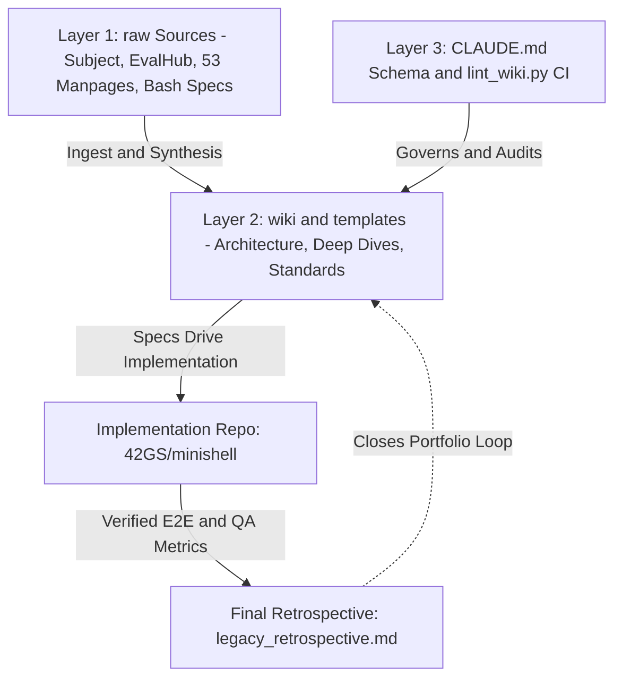

# Minishell Architecture Knowledge Base & Engineering Wiki

[](https://github.com/42GS/minishell-wiki/actions/workflows/wiki-lint.yml)
[](https://github.com/42GS/minishell-wiki/releases/tag/v1.0.0)
[](https://github.com/42GS/minishell)
[](raw/specs/bash_builtins.md)

> **42 Minishell System Design, CS Deep Dives & Engineering Retrospective**  
> **구현 저장소**: [42GS/minishell](https://github.com/42GS/minishell) · **GitHub Wiki (요약본)**: [42GS/minishell Wiki](https://github.com/42GS/minishell/wiki)  
> **전체 카탈로그**: [index.md](index.md) · **작업 저널**: [log.md](log.md)

---

## 1. 저장소 개요 및 3-Layer LLM Wiki 아키텍처

이 저장소는 [`42GS/minishell`](https://github.com/42GS/minishell) 프로젝트의 **요구사항 분석, 컴파일러·OS 이론 딥다이브, 4단계 시스템 아키텍처 명세, 42evalhub 평가 방어 매트릭스, 구버전 비교 회고록**을 구현 코드와 분리해 관리하는 지식 베이스입니다.

설계 명세를 먼저 확정한 뒤 C 구현 저장소의 이슈·PR을 진행하는 **Dual-Repository 전략**을 따랐으며, 모든 문서는 불변 원문(`raw/`), 합성 지식(`wiki/`), 운영 스키마(`CLAUDE.md`)의 3계층 구조와 자동 린터(`scripts/lint_wiki.py`)로 일관성을 유지합니다.



---

## 2. 추천 열람 순서 (Reviewer & Portfolio Guide)

프로젝트의 설계 의도와 엔지니어링 품질을 가장 빠르게 파악하시려면 아래 순서대로 열람하는 것을 권장합니다.

1. **[아키텍처 4대 명세](wiki/architecture/01_parser_and_ast.md)**: [Parser & AST](wiki/architecture/01_parser_and_ast.md) -> [Execution Engine & IPC](wiki/architecture/02_execution_engine_and_ipc.md) -> [Signal Dispatcher](wiki/architecture/03_signal_dispatcher_and_state_machine.md) -> [Builtins & Env](wiki/architecture/04_builtins_and_env_table.md)
2. **[최종 비교 회고록](wiki/eval/legacy_retrospective.md)**: 구현 완료 후 봉인을 해제해 과거 구현(`42GS/minishell-old`)과 정량·정성 비교한 [Legacy Comparison Retrospective](wiki/eval/legacy_retrospective.md)
3. **[OS · 컴파일러 CS 심화](wiki/concepts/deep_dive_lexer_parser_ast.md)**: [DFA & CFG 파싱 이론](wiki/concepts/deep_dive_lexer_parser_ast.md) · [CoW & Pipe Deadlock](wiki/concepts/deep_dive_process_ipc_and_fd.md) · [Async-Signal-Safe 원리](wiki/concepts/deep_dive_signals_and_concurrency.md) · [Environ & 64비트 방어](wiki/concepts/deep_dive_builtins_and_environment.md)
4. **[요구사항 & 평가 방어](wiki/requirements/evaluation_matrix.md)**: [Mandatory Spec](wiki/requirements/mandatory.md) · [Bonus Spec](wiki/requirements/bonus.md) · [42evalhub 1:1 Evaluation Matrix](wiki/requirements/evaluation_matrix.md) · [53종 허용 함수 매트릭스](wiki/concepts/allowed_functions_matrix.md)
5. **[엔지니어링 프로세스](wiki/process/github_engineering_standards.md)**: [GitHub Flow & CI 표준](wiki/process/github_engineering_standards.md) · [듀얼 리포지토리 로드맵 & 이슈 매트릭스](wiki/process/roadmap_and_issues.md)

---

## 3. 문서 구성 카탈로그

전체 문서는 [index.md](index.md)에서 1:1 상호 참조 링크와 함께 탐색할 수 있습니다.

| 디렉터리 | 분류 | 주요 내용 | 진입 문서 |
| :--- | :--- | :--- | :--- |
| `/` | Hub & Schema | 지식 베이스 카탈로그, 운영 규격, 시계열 작업 로그 | [index.md](index.md) · [CLAUDE.md](CLAUDE.md) · [log.md](log.md) |
| `wiki/architecture/` | System Specs | 렉서/AST EBNF, 파이프라인 IPC, 4-상태 시그널, 환경변수·빌트인 명세 | [01_parser_and_ast.md](wiki/architecture/01_parser_and_ast.md) |
| `wiki/concepts/` | Deep Dives | 오토마타·FD 테이블·시그널 재진입성·`environ` 레이아웃·허용 함수 53종 | [allowed_functions_matrix.md](wiki/concepts/allowed_functions_matrix.md) |
| `wiki/requirements/` | Specs & QA | 42 서브젝트 v7.1 필수·보너스 분석 및 42evalhub 평가 매트릭스 | [evaluation_matrix.md](wiki/requirements/evaluation_matrix.md) |
| `wiki/process/` | Process & CI | 브랜치·PR 메타데이터 표준, 듀얼 리포지토리 마일스톤(M1~M5) 추적 | [roadmap_and_issues.md](wiki/process/roadmap_and_issues.md) |
| `wiki/eval/` | Retrospective | `minishell-old` vs `minishell` 정량 지표 및 5대 아키텍처 개선 회고 | [legacy_retrospective.md](wiki/eval/legacy_retrospective.md) |
| `templates/github/` | Templates | 구현 저장소(`.github/`)로 이식한 Issue/PR 템플릿 및 CI 워크플로우 | [PULL_REQUEST_TEMPLATE.md](templates/github/PULL_REQUEST_TEMPLATE.md) |
| `raw/` | Raw Sources | 공식 PDF/텍스트 서브젝트, 42evalhub 원본, 53종 manpage, GNU Bash 발췌 | [en.subject.md](raw/subject/en.subject.md) |

---

## 4. 설계 선행 아키텍처의 정량 성과

아키텍처 명세와 평가 엣지 케이스를 사전에 정의한 뒤 구현한 결과, 동일 머신·동일 벤치마크(`LC_ALL=C`, Bash 1:1 차등 비교) 기준으로 구버전(`42GS/minishell-old`) 대비 아래와 같은 개선을 달성했습니다. 상세 계측 근거는 [legacy_retrospective.md](wiki/eval/legacy_retrospective.md)에 기록되어 있습니다.

| 지표 | `minishell-old` (구버전) | `minishell` (재설계) | 변화 |
| :--- | :--- | :--- | :--- |
| **코어 코드 (`libft` 제외)** | `7,883` LOC | `3,896` LOC | **-50.6% LOC 축소** |
| **전체 함수 수** | 263개 | 189개 | **-28.1% (42 Norm 0 errors)** |
| **전역 상태 (`nm -g`)** | 숨겨진 `static` 싱글턴 2개 | 단일 `g_signal_num` 1개 | 서브젝트 제약 100% 준수 |
| **외부 심볼 (`nm -u`)** | 금지 심볼(`_getpid`, `_strcmp`) 포함 | 허용 심볼 33종 (금지 0건) | 실격 요인 완전 제거 |
| **42evalhub 5대 E2E** | 20 / 37 (54.1%, 3 timeouts) | **37 / 37 (100.0%, 0 timeouts)** | **+45.9%p 향상** |
| **자동화 테스트 / CI** | 테스트 0개 / CI 없음 | 테스트 18개 / 5계층 CI | Valgrind 0 heap & 0 FD leaks |

---

## 5. 문서 품질 게이트 및 로컬 검증

이 저장소는 Obsidian Graph View 호환 네이티브 위키링크(`[[target&#124;alias]]`)와 GitHub 마크다운 렌더링을 동시에 유지하기 위해, `main` 브랜치 푸시와 모든 PR마다 `.github/workflows/wiki-lint.yml`의 **`Wiki Health Lint`**가 자동 실행됩니다.

```bash
# 전체 마크다운 문서(미해결 링크, file:/// 금지, 고아 페이지, 테이블 파이프, LaTeX $ 충돌, Mermaid 문법) 검증
python3 scripts/lint_wiki.py
```

- **검증 범위**: 미해결 위키링크/상대 경로 링크, 금지 `file:///` URL, `wiki/` 고아 페이지, `index.md` 카탈로그 누락, 마크다운 테이블 열 수 불일치, LaTeX 수식(`&#36;`) 파서 충돌, Mermaid 다이어그램 문법 오류
