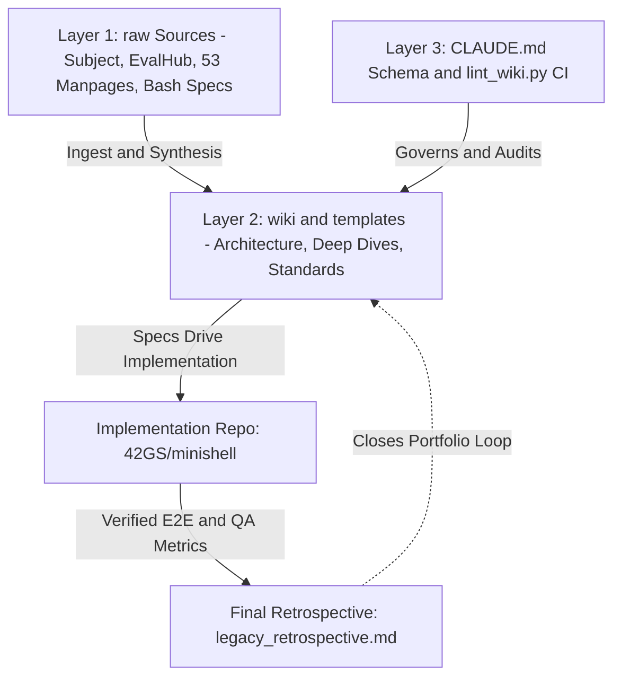

# Minishell System Architecture & Engineering Knowledge Base

[](https://github.com/42GS/minishell-wiki/actions/workflows/wiki-lint.yml)
[](https://github.com/42GS/minishell-wiki/releases/latest)
[](https://github.com/42GS/minishell)
[](raw/specs/bash_builtins.md)

[`42GS/minishell`](https://github.com/42GS/minishell) C 구현에 앞서 확정한 아키텍처 명세, CS 원리 정리, 평가 방어 매트릭스, 구버전 비교 회고록을 분리 관리하는 저장소입니다.  
모든 문서는 PR 단위 리뷰와 7단계 자동 린터(`scripts/lint_wiki.py`)를 거쳐 일관성을 유지합니다.

- **구현 저장소**: [42GS/minishell](https://github.com/42GS/minishell)
- **요약 GitHub Wiki**: [42GS/minishell Wiki](https://github.com/42GS/minishell/wiki)
- **전체 카탈로그**: [index.md](index.md)
- **작업 저널**: [log.md](log.md)

### 핵심 현황 한눈에 보기

| 문서 규모 | 선설계 구현 성과 | 자동 품질 게이트 | 이슈 · 이력 추적 |
| :---: | :---: | :---: | :---: |
| **`33개` 마크다운** | **코어 `-50.6%` LOC** | **`0 Errors`** (`4~6s`) | **`100%` 상호 추적** |
| 아키텍처 4 · CS 5 · 스펙 원문 | `7,883 -> 3,896` LOC · E2E `37/37` | 링크·고아·Mermaid·표 CI | 설계·구현·회고 1:1 연결 |

---

## 1. 추천 열람 순서 (면접관 · 리뷰어 3분 가이드)

아래 순서대로 보면 설계 의도와 검증 결과를 가장 빠르게 확인할 수 있습니다.

1. **시스템 아키텍처 4대 명세**
   - [Phase 1: Parser & AST](wiki/architecture/01_parser_and_ast.md) — DFA Lexer, EBNF 우선순위, AST 구조체
   - [Phase 2: Execution Engine & IPC](wiki/architecture/02_execution_engine_and_ipc.md) — 파이프라인 Strict Pipe-Close, Here-doc, `waitpid`
   - [Phase 3: Signal Dispatcher](wiki/architecture/03_signal_dispatcher_and_state_machine.md) — 단일 `g_signal_num`, 3-상태 머신, `termios`
   - [Phase 4: Builtins & Env](wiki/architecture/04_builtins_and_env_table.md) — `t_env_node` 엔진, 7대 빌트인 엣지 케이스
2. **구버전 비교 회고록**
   - [Legacy Comparison Retrospective](wiki/eval/legacy_retrospective.md) — `minishell-old` vs `minishell` 정량·정성 비교 보고서
3. **OS · 컴파일러 CS 심화 4부작**
   - [Lexer & Parser Theory](wiki/concepts/deep_dive_lexer_parser_ast.md) — 오토마타(DFA)와 문맥 자유 문법(CFG)
   - [Process, FD & IPC](wiki/concepts/deep_dive_process_ipc_and_fd.md) — `fork()` CoW, FD 3단계 테이블, EOF 법칙
   - [Signals & Concurrency](wiki/concepts/deep_dive_signals_and_concurrency.md) — Self-Deadlock, `volatile sig_atomic_t`, `EINTR`
   - [Builtins & Environment](wiki/concepts/deep_dive_builtins_and_environment.md) — 유저 스택 `environ` 레이아웃, 64비트 오버플로 방어
4. **요구사항 & 평가 매트릭스**
   - [Mandatory Spec](wiki/requirements/mandatory.md) · [Bonus Spec](wiki/requirements/bonus.md) — 과제 v7.1 필수·보너스 명세
   - [42evalhub Evaluation Matrix](wiki/requirements/evaluation_matrix.md) — 평가 시트 1:1 검증 체크리스트
   - [Allowed Functions Matrix](wiki/concepts/allowed_functions_matrix.md) — 허용 외부 함수 53종 안전성 분석
5. **엔지니어링 프로세스**
   - [GitHub Engineering Standards](wiki/process/github_engineering_standards.md) — 브랜치·커밋·PR·CI 게이트 표준
   - [Roadmap & Issue Tracking](wiki/process/roadmap_and_issues.md) — 이중 저장소 마일스톤(M1~M5) 및 이슈 추적표

---

## 2. 이중 저장소 설계-구현 파이프라인

원문 스펙(`raw/`)에서 아키텍처(`wiki/`)를 먼저 설계한 뒤 `42GS/minishell`을 구현하고, 검증 결과를 회고록으로 환류했습니다.



---

## 3. 디렉터리별 문서 카탈로그

전체 상호 참조 목록은 [index.md](index.md)에서 확인할 수 있습니다.

| 디렉터리 | 분류 | 주요 내용 | 진입 문서 |
| :--- | :--- | :--- | :--- |
| `/` | Hub & Schema | 카탈로그, 운영 규격, 작업 로그 | [index.md](index.md) · [CLAUDE.md](CLAUDE.md) |
| `wiki/architecture/` | System Specs | 렉서/AST, 파이프라인 IPC, 시그널, 빌트인 설계 | [01_parser_and_ast.md](wiki/architecture/01_parser_and_ast.md) |
| `wiki/concepts/` | Deep Dives | DFA/CFG, FD 테이블, 재진입성, 허용 함수 53종 | [allowed_functions_matrix.md](wiki/concepts/allowed_functions_matrix.md) |
| `wiki/requirements/` | Specs & QA | 필수·보너스 명세 및 42evalhub 1:1 체크리스트 | [evaluation_matrix.md](wiki/requirements/evaluation_matrix.md) |
| `wiki/process/` | Process & CI | GitHub 표준, 마일스톤(M1~M5) 이슈 추적 | [roadmap_and_issues.md](wiki/process/roadmap_and_issues.md) |
| `wiki/eval/` | Retrospective | `minishell-old` 대비 정량·정성 개선 회고 | [legacy_retrospective.md](wiki/eval/legacy_retrospective.md) |
| `templates/github/` | Templates | 구현 저장소 Issue/PR 템플릿 및 CI 스펙 | [PULL_REQUEST_TEMPLATE.md](templates/github/PULL_REQUEST_TEMPLATE.md) |
| `raw/` | Raw Sources | 서브젝트 PDF/텍스트, 42evalhub, 53종 manpage | [en.subject.md](raw/subject/en.subject.md) |

---

## 4. 설계 선행 성과 & 문서 품질 자동 검증 (`scripts/lint_wiki.py`)

동일 머신(`LC_ALL=C`, Bash 1:1 차등 비교) 기준으로 구버전(`42GS/minishell-old`)과 비교한 수치입니다. ([계측 원문](wiki/eval/legacy_retrospective.md))

| 지표 | `minishell-old` (구버전) | `minishell` (재설계) | 개선 결과 |
| :--- | :--- | :--- | :--- |
| **코어 코드 (`libft` 제외)** | `7,883` LOC | `3,896` LOC | **-50.6% LOC 축소** |
| **전역 · 외부 심볼** | 싱글턴 2개 / 금지 2종 | `g_signal_num` 1개 / 금지 0건 | **서브젝트 제약 100% 준수** |
| **42evalhub 5대 E2E (`01~05`)** | 20 / 37 (54.1%, 3 timeouts) | **37 / 37 (100.0%, 0 timeouts)** | **+45.9%p 향상** |
| **테스트 / CI 속도** | 테스트 0개 / CI 없음 | 테스트 18개 / **`29 ~ 36s` CI** | **Valgrind 0 heap & 0 FD leaks** |

```bash
# 미해결 링크, 고아 페이지, index.md 누락, 테이블, LaTeX $, Mermaid 문법 검증
python3 scripts/lint_wiki.py
```
