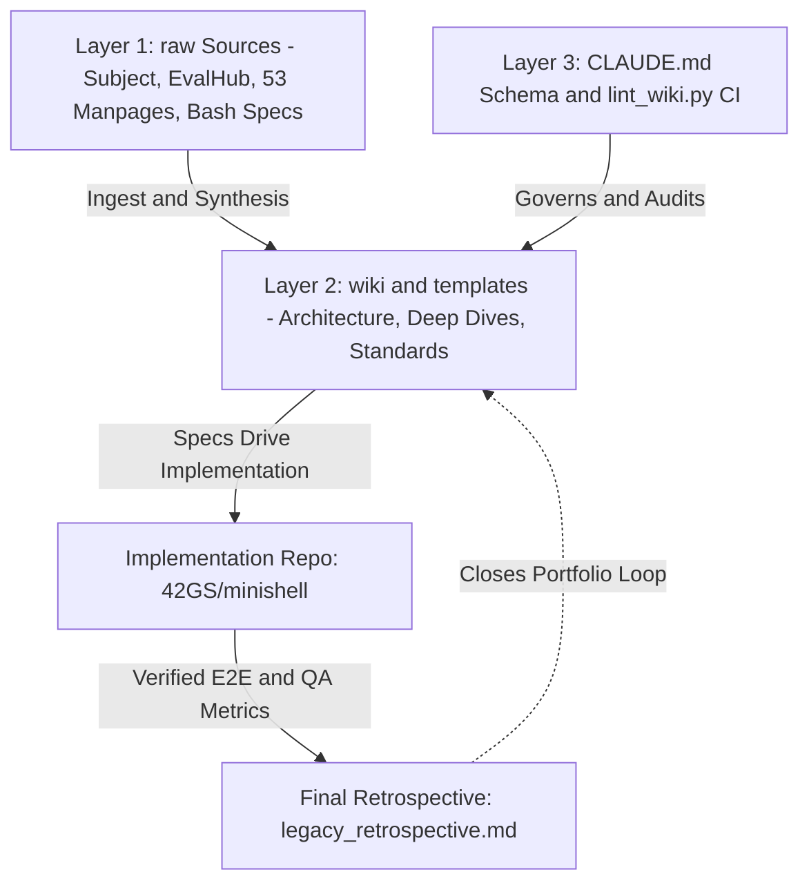

# Minishell System Architecture & Engineering Knowledge Base

[](https://github.com/42GS/minishell-wiki/actions/workflows/wiki-lint.yml)
[](https://github.com/42GS/minishell-wiki/releases/latest)
[](https://github.com/42GS/minishell)
[](raw/specs/bash_builtins.md)

이 저장소는 [`42GS/minishell`](https://github.com/42GS/minishell) C 구현에 앞서 작성한 **4단계 시스템 아키텍처 청사진, OS·컴파일러 원리 정리, 42evalhub 1:1 평가 방어 매트릭스, 구버전 비교 회고록**을 분리 관리하는 엔지니어링 지식 베이스입니다.  
모든 문서 변경은 PR 단위 리뷰와 자체 7단계 마크다운·다이어그램 린터(`scripts/lint_wiki.py`)를 통과해야 병합됩니다.

- **구현 저장소**: [42GS/minishell](https://github.com/42GS/minishell) · **요약 GitHub Wiki**: [42GS/minishell Wiki](https://github.com/42GS/minishell/wiki)
- **전체 색인**: [index.md](index.md) · **작업 저널**: [log.md](log.md)

### 핵심 현황 한눈에 보기

| 문서 규모 | 선설계 기반 구현 성과 | 자동 품질 게이트 | 이슈 · 이력 추적 |
| :---: | :---: | :---: | :---: |
| **`33개` 마크다운** | **코어 `-50.6%` LOC** | **`0 Errors`** (`4~6s`) | **`100%` 상호 추적** |
| 아키텍처 4부작 · CS 심화 5종 · 원문 스펙 | `7,883 -> 3,896` LOC, E2E `37/37` (100%) | 미해결 링크·고아 페이지·Mermaid·표 린트 CI | 설계·구현·회고 이슈 및 PR 체크박스 동기화 |

---

## 1. 추천 열람 순서 (면접관 · 리뷰어 3분 가이드)

설계 의도와 시스템적 완성도를 가장 빠르게 확인하시려면 아래 순서대로 열람하는 것을 권장합니다.

1. **[시스템 아키텍처 4대 명세](wiki/architecture/01_parser_and_ast.md)**: [Parser & AST](wiki/architecture/01_parser_and_ast.md) -> [Execution Engine & IPC](wiki/architecture/02_execution_engine_and_ipc.md) -> [Signal Dispatcher](wiki/architecture/03_signal_dispatcher_and_state_machine.md) -> [Builtins & Env](wiki/architecture/04_builtins_and_env_table.md)
2. **[구버전 비교 회고록](wiki/eval/legacy_retrospective.md)**: 구현 100% 완료 후 봉인을 해제해 과거 구현(`42GS/minishell-old`)과 정량·정성 대조한 [Legacy Comparison Retrospective](wiki/eval/legacy_retrospective.md)
3. **[OS · 컴파일러 CS 심화 4부작](wiki/concepts/deep_dive_lexer_parser_ast.md)**: [DFA & CFG 파싱 이론](wiki/concepts/deep_dive_lexer_parser_ast.md) · [CoW & Pipe Deadlock](wiki/concepts/deep_dive_process_ipc_and_fd.md) · [Async-Signal-Safe 원리](wiki/concepts/deep_dive_signals_and_concurrency.md) · [Environ & 64비트 방어](wiki/concepts/deep_dive_builtins_and_environment.md)
4. **[요구사항 & 평가 매트릭스](wiki/requirements/evaluation_matrix.md)**: [Mandatory Spec](wiki/requirements/mandatory.md) · [Bonus Spec](wiki/requirements/bonus.md) · [42evalhub Evaluation Matrix](wiki/requirements/evaluation_matrix.md) · [53종 허용 함수 분석](wiki/concepts/allowed_functions_matrix.md)
5. **[엔지니어링 프로세스](wiki/process/github_engineering_standards.md)**: [GitHub Flow & CI 표준](wiki/process/github_engineering_standards.md) · [이중 저장소 로드맵 & 이슈 매트릭스](wiki/process/roadmap_and_issues.md)

---

## 2. 이중 저장소 설계-구현 파이프라인

요구사항과 원문 스펙(`raw/`)에서 아키텍처 명세(`wiki/`)를 먼저 확정한 뒤 C 코드 구현(`42GS/minishell`)을 진행하고, 최종 실측 결과를 회고록으로 환류해 **설계-코드-검증 간 일관성**을 유지했습니다.



---

## 3. 디렉터리별 문서 카탈로그

전체 문서는 [index.md](index.md)에서 1:1 상호 참조 링크와 함께 확인할 수 있습니다.

| 디렉터리 | 분류 | 주요 내용 | 진입 문서 |
| :--- | :--- | :--- | :--- |
| `/` | Hub & Schema | 지식 베이스 카탈로그, 운영 규격, 시계열 작업 로그 | [index.md](index.md) · [CLAUDE.md](CLAUDE.md) · [log.md](log.md) |
| `wiki/architecture/` | System Specs | 렉서/AST EBNF, 파이프라인 IPC, 4-상태 시그널, 환경변수·빌트인 명세 | [01_parser_and_ast.md](wiki/architecture/01_parser_and_ast.md) |
| `wiki/concepts/` | Deep Dives | 오토마타·FD 테이블·시그널 재진입성·`environ` 레이아웃·허용 함수 53종 | [allowed_functions_matrix.md](wiki/concepts/allowed_functions_matrix.md) |
| `wiki/requirements/` | Specs & QA | 42 서브젝트 v7.1 필수·보너스 분석 및 42evalhub 평가 매트릭스 | [evaluation_matrix.md](wiki/requirements/evaluation_matrix.md) |
| `wiki/process/` | Process & CI | 브랜치·PR 메타데이터 표준, 듀얼 리포지토리 마일스톤(M1~M5) 추적 | [roadmap_and_issues.md](wiki/process/roadmap_and_issues.md) |
| `wiki/eval/` | Retrospective | `minishell-old` vs `minishell` 정량 지표 및 5대 아키텍처 개선 회고 | [legacy_retrospective.md](wiki/eval/legacy_retrospective.md) |
| `templates/github/` | Templates | 구현 저장소(`.github/`)로 이식한 Issue/PR 템플릿 및 CI 워크플로우 | [PULL_REQUEST_TEMPLATE.md](templates/github/PULL_REQUEST_TEMPLATE.md) |
| `raw/` | Raw Sources | 공식 PDF/텍스트 서브젝트, 42evalhub 원본, 53종 manpage, GNU Bash 발췌 | [en.subject.md](raw/subject/en.subject.md) |

---

## 4. 설계 선행 성과 & 문서 품질 자동 검증 (`scripts/lint_wiki.py`)

동일 머신·동일 벤치마크(`LC_ALL=C`, Bash 1:1 차등 비교) 기준으로 구버전(`42GS/minishell-old`) 대비 달성한 결과입니다. ([상세 계측 근거](wiki/eval/legacy_retrospective.md))

| 지표 | `minishell-old` (구버전) | `minishell` (재설계) | 변화 |
| :--- | :--- | :--- | :--- |
| **코어 코드 (`libft` 제외)** | `7,883` LOC | `3,896` LOC | **-50.6% LOC 축소** |
| **전역 상태 (`nm -g`) / 외부 심볼 (`nm -u`)** | 숨겨진 싱글턴 2개 / 금지 심볼 2종 | `g_signal_num` 1개 / 금지 0건 | **서브젝트 제약 100% 준수** |
| **42evalhub 5대 E2E (`01~05`)** | 20 / 37 (54.1%, 3 timeouts) | **37 / 37 (100.0%, 0 timeouts)** | **+45.9%p 향상** |
| **자동화 테스트 / CI 속도** | 테스트 0개 / CI 없음 | 테스트 18개 / **`29 ~ 36s` CI** | **Valgrind 0 heap & 0 FD leaks** |

```bash
# 모든 마크다운 문서(미해결 링크, file:/// 금지, 고아 페이지, index.md 누락, 테이블, LaTeX $, Mermaid 문법) 검증
python3 scripts/lint_wiki.py
```
