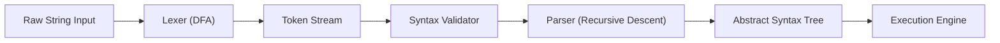
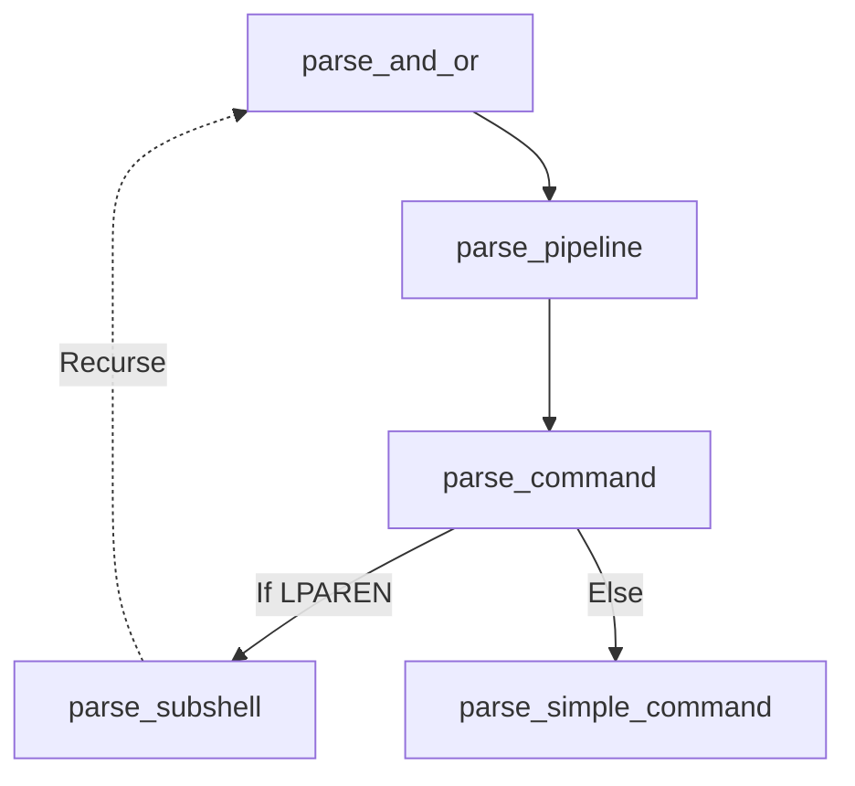

# Parser & AST Architecture Specification

> **Navigation**: [[index|Hub: Index]] | [[wiki/architecture/02_execution_engine_and_ipc|Next: Phase 2 Execution Engine]]  
> **Requirements**: [[wiki/requirements/mandatory|Mandatory Requirements]] | [[wiki/requirements/bonus|Bonus Requirements]]  
> **Deep Dive Concept**: [[wiki/concepts/deep_dive_lexer_parser_ast|Compiler Theory, DFA & AST Deep Dive]]  
> **Raw Specs**: [[raw/specs/bash_quoting|Bash Quoting]] | [[raw/specs/bash_pipelines|Bash Pipelines]] | [[raw/specs/bash_lists|Bash Lists]] | [[raw/specs/bash_compound_commands|Bash Compound Commands]]

---

## 1. Architectural Pipeline Overview

사용자의 원시 입력 라인(`char *line`)은 실행 엔진([[wiki/architecture/02_execution_engine_and_ipc|Phase 2 Execution Engine]])에 도달하기 전 4단계의 명확한 데이터 변환 파이프라인을 거친다.



1. **Lexical Analysis (Lexer/Tokenizer)**: 원시 문자열을 의미 있는 최소 단위인 토큰(`WORD`, `PIPE`, `AND`, `OR`, `LPAREN`, `RPAREN`, `REDIR_*`)으로 분해. (상세 상태 머신: [[wiki/concepts/deep_dive_lexer_parser_ast|DFA 상태 전이도]])
2. **Syntax Validation**: 문법 규칙에 어긋나는 토큰 배열(예: `echo a | | cat`, `(cmd &&)`) 사전 검증 및 Bash 호환 구문 에러 반환.
3. **Syntactic Analysis (Parser)**: 연산자 우선순위(Precedence)와 결합 법칙(Associativity)에 따라 토큰 스트림을 계층적 트리 구조(AST)로 조립.
4. **Tree Traversal (Executor)**: 완성된 AST를 [[wiki/architecture/02_execution_engine_and_ipc|실행 엔진]]으로 전달하여 후위/중위 순회하며 조건부 실행 및 IPC 파이프라인 구동.

---

## 2. Formal Grammar Definition (EBNF)

Minishell의 문법은 POSIX Shell 문법의 하위 집합으로, 상위 우선순위 연산자가 파서 트리의 하위 노드로 내려가는 하향식 계층 구조를 갖는다.

```ebnf
complete_command ::= and_or_list EOF

and_or_list      ::= pipeline ( ( "&&" | "||" ) pipeline )*

pipeline         ::= command ( "|" command )*

command          ::= simple_command
                   | subshell_command

subshell_command ::= "(" and_or_list ")" redirection*

simple_command   ::= ( cmd_word | redirection )+

redirection      ::= ( "<" | ">" | ">>" | "<<" ) cmd_word

cmd_word         ::= [^ \t\n|<>&()]+  (* with quote support *)
```

### 연산자 우선순위 및 결합성
| 레벨 | 문법 요소 | 기호 | 결합성 (Associativity) | 관련 명세 |
| :---: | :--- | :---: | :---: | :--- |
| **1 (최상위)** | 괄호 서브셸 그룹핑 | `( )` | 괄호 내부 우선 평가 | [[wiki/requirements/bonus]] |
| **2** | 리다이렉션 | `<`, `>`, `>>`, `<<` | 왼쪽에서 오른쪽으로 (Left-to-right) | [[wiki/requirements/mandatory]] |
| **3** | 파이프라인 | `&#124;` | 왼쪽에서 오른쪽으로 (Left-to-right) | [[raw/specs/bash_pipelines]] |
| **4 (최하위)** | 논리 리스트 | `&&`, `&#124;&#124;` | 왼쪽에서 오른쪽으로 (동등 우선순위) | [[wiki/requirements/bonus]] |

---

## 3. Core Data Structures (C Implementation)

### 3.1 Token Types & Stream
```c
typedef enum e_token_type {
    TOKEN_WORD,         /* 명령어, 인자, 파일 경로 */
    TOKEN_PIPE,         /* | */
    TOKEN_AND,          /* && (Bonus) */
    TOKEN_OR,           /* || (Bonus) */
    TOKEN_LPAREN,       /* ( (Bonus) */
    TOKEN_RPAREN,       /* ) (Bonus) */
    TOKEN_REDIR_IN,     /* < */
    TOKEN_REDIR_OUT,    /* > */
    TOKEN_REDIR_APPEND, /* >> */
    TOKEN_REDIR_HEREDOC,/* << */
    TOKEN_EOF
}   t_token_type;

typedef struct s_token {
    t_token_type    type;
    char            *value;     /* 원본 문자열 (동적 할당) */
    int             quoted;     /* 쿼트 포함 여부 비트마스크 (단어분할/와일드카드 억제용) */
    struct s_token  *next;
    struct s_token  *prev;
}   t_token;
```

### 3.2 Redirection Node
리다이렉션은 명령어 실행 전 파일 디스크립터(FD)를 재배치하는 메타데이터이므로, 명령어 노드에 연결 리스트로 첨부된다. (실행 상세: [[wiki/architecture/02_execution_engine_and_ipc|리다이렉션 엔진]])
```c
typedef enum e_redir_type {
    REDIR_IN,           /* < */
    REDIR_OUT,          /* > */
    REDIR_APPEND,       /* >> */
    REDIR_HEREDOC       /* << */
}   t_redir_type;

typedef struct s_redir {
    t_redir_type    type;
    char            *target;    /* 파일명 또는 Here-doc 구분자(Delimiter) */
    int             heredoc_fd; /* Here-doc 수집 후 열린 읽기 전용 FD */
    int             is_quoted;  /* Delimiter에 따옴표가 있었는지 여부 (환경변수 확장 억제용) */
    struct s_redir  *next;
}   t_redir;
```

### 3.3 Abstract Syntax Tree (AST) Node
트리의 노드는 명령어 단독 실행 노드일 수도 있고, 논리 연산자/파이프 노드일 수도 있다.
```c
typedef enum e_node_type {
    NODE_COMMAND,       /* 단순 명령어 (argv, redirs) */
    NODE_PIPE,          /* | (좌측/우측 파이프라인) */
    NODE_AND,           /* && (좌측 성공 시 우측 실행) */
    NODE_OR,            /* || (좌측 실패 시 우측 실행) */
    NODE_SUBSHELL       /* ( ) (좌측 자식으로 서브셸 서브트리 보유) */
}   t_node_type;

typedef struct s_ast_node {
    t_node_type         type;
    struct s_ast_node   *left;      /* 좌측 피연산자 / 서브셸 대상 */
    struct s_ast_node   *right;     /* 우측 피연산자 (NODE_SUBSHELL은 NULL) */
    
    /* NODE_COMMAND 전용 필드 (연산자 노드일 때는 NULL) */
    char                **argv;     /* 토큰에서 추출된 인자 배열 (NULL-terminated) */
    t_redir             *redirs;    /* 리다이렉션 연결 리스트 */
}   t_ast_node;
```

---

## 4. Parser Implementation Logic (Recursive Descent)

재귀 하향 파서는 EBNF 문법 규칙과 1:1로 대응되는 파싱 함수를 갖는다:



1. **`parse_and_or(t_token **curr)`**:
   - `left = parse_pipeline(curr)` 호출.
   - 현재 토큰이 `&&` 또는 `||`인 동안 루프:
     - 연산자 타입 기록, 토큰 진행.
     - `right = parse_pipeline(curr)`.
     - 새 부모 노드 `node(type, left, right)` 생성 후 `left = node`.
   - `return left`.

2. **`parse_pipeline(t_token **curr)`**:
   - `left = parse_command(curr)` 호출.
   - 현재 토큰이 `|`인 동안 루프:
     - 토큰 진행.
     - `right = parse_command(curr)`.
     - 새 부모 노드 `node(NODE_PIPE, left, right)` 생성 후 `left = node`.
   - `return left`.

3. **`parse_command(t_token **curr)`**:
   - 만약 `curr->type == TOKEN_LPAREN`:
     - 토큰 진행 (`(` 소비).
     - `sub_tree = parse_and_or(curr)`.
     - `curr->type == TOKEN_RPAREN` 검증 및 소비.
     - 뒤따라오는 리다이렉션 파싱 (`<`, `>` 등 첨부).
     - `return create_subshell_node(sub_tree, redirs)`.
   - 아니라면 `parse_simple_command(curr)` 호출.

4. **`parse_simple_command(t_token **curr)`**:
   - `WORD` 및 `REDIR_*` 토큰들을 수집하여 `argv` 배열과 `t_redir` 리스트를 구성.
   - `return create_command_node(argv, redirs)`.

---

## 5. Syntax Error Rules & Bash Compatibility

파싱 도중 문법 오류가 발견되면, 즉시 파싱을 중단하고 트리를 정리한 뒤 Bash 표준 에러 메시지를 출력하고 종료 상태 코드를 `2`로 설정한다. (평가 검증: [[wiki/requirements/evaluation_matrix|평가 매트릭스 Syntax Error 방어]])

| 상황 | 입력 예시 | Bash 표준 에러 메시지 | 종료 상태 (`$?`) |
| :--- | :--- | :--- | :---: |
| **연속 파이프** | `cat &#124; &#124; grep a` | `minishell: syntax error near unexpected token '&#124;'` | `2` (또는 258) |
| **닫히지 않은 괄호** | `(cd /tmp && ls` | `minishell: syntax error: unexpected end of file` | `2` |
| **빈 괄호** | `( )` | `minishell: syntax error near unexpected token ')'` | `2` |
| **리다이렉션 타겟 누락** | `cat <` | `minishell: syntax error near unexpected token 'newline'` | `2` |
| **리다이렉션 뒤 연산자** | `cat < &#124;` | `minishell: syntax error near unexpected token '&#124;'` | `2` |
| **닫히지 않은 따옴표** | `echo "hello` | `minishell: unexpected EOF while looking for matching '"'` | `2` (미해석 처리) |

---

## 6. Memory Lifecycle Management

AST는 동적 메모리를 깊은 트리 구조로 점유하므로, 메모리 릭(Leak)과 이중 해제(Double Free)를 원천 차단하는 재귀적 클린업 함수가 필수적이다.

```c
void free_ast(t_ast_node *node)
{
    if (!node)
        return;
    free_ast(node->left);
    free_ast(node->right);
    if (node->argv)
        free_char_array(node->argv);
    if (node->redirs)
        free_redirs(node->redirs);
    free(node);
}
```
- **성공 시**: 트리를 순회하여 [[wiki/architecture/02_execution_engine_and_ipc|실행 완료]] 후 루트 노드에서 `free_ast(root)` 호출.
- **파싱 실패(Syntax Error) 시**: 파싱 도중 생성된 부분 트리를 즉시 `free_ast(partial_tree)`로 일괄 해제하고 토큰 리스트 해제.
- **Here-doc 중단 시**: [[wiki/architecture/03_signal_dispatcher_and_state_machine|시그널 핸들러]] 개입 시 임시로 열려있는 모든 `heredoc_fd`를 `close`한 후 트리 해제.
