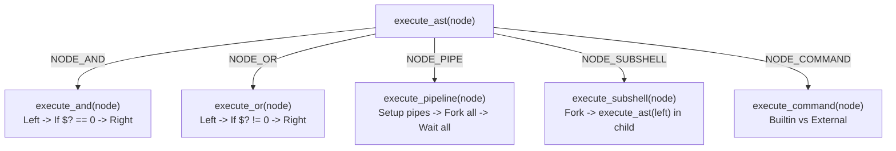
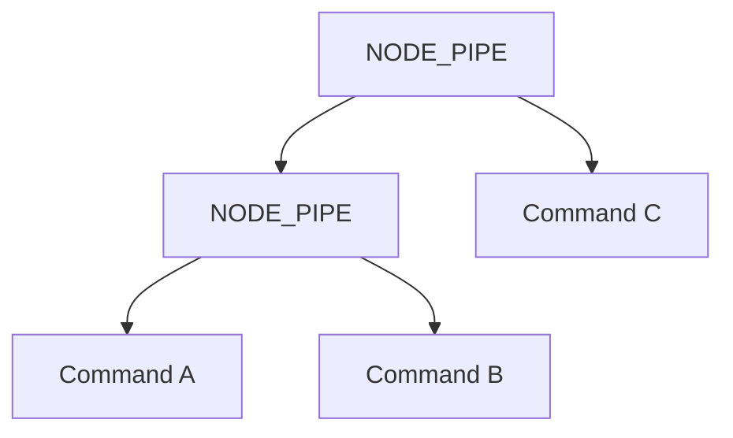

# Execution Engine & IPC Pipeline Architecture Specification

> **Module**: Execution Engine, Process Lifecycle & IPC Pipeline  
> **Target**: Mandatory (Pipes, Redirections, Builtins, Execve) + Bonus (`&&`, `||`, Subshells)  
> **References**: [bash_pipelines.md](file:///Users/yong/Projects/gdtknight/42/minishell-wiki/raw/specs/bash_pipelines.md), [bash_redirections.md](file:///Users/yong/Projects/gdtknight/42/minishell-wiki/raw/specs/bash_redirections.md), [bash_lists.md](file:///Users/yong/Projects/gdtknight/42/minishell-wiki/raw/specs/bash_lists.md), [bash_exit_status.md](file:///Users/yong/Projects/gdtknight/42/minishell-wiki/raw/specs/bash_exit_status.md)

---

## 1. Engine Architecture & Node Dispatcher

실행 엔진은 파서가 완성한 AST의 루트 노드를 인자로 받아 트리를 재귀 순회(Recursive Traversal)하며 노드 타입에 따라 적절한 실행 전략으로 디스패치한다.



### 1.1 노드별 실행 규격 요약
| 노드 타입 | 실행 동시성 | 서브셸 포크 여부 | 종료 상태 (`$?`) 전파 규칙 |
| :--- | :---: | :---: | :--- |
| `NODE_COMMAND` (단일 빌트인) | 순차 (동기) | **포크 안 함** (부모 직접 실행) | 빌트인 함수의 리턴값 (0~255) |
| `NODE_COMMAND` (외부 바이너리) | 순차 (동기) | 자식 1개 포크 | `waitpid` 종료 상태 또는 시그널(128+N) |
| `NODE_PIPE` | **병렬 (비동기)** | 파이프라인 내 모든 커맨드 자식 포크 | **마지막(가장 우측) 커맨드의 종료 상태** |
| `NODE_AND` | 순차 (단락) | 연산자 자체는 포크 안 함 | 마지막으로 실행된 자식 노드의 종료 상태 |
| `NODE_OR` | 순차 (단락) | 연산자 자체는 포크 안 함 | 마지막으로 실행된 자식 노드의 종료 상태 |
| `NODE_SUBSHELL` | 순차 (동기) | **자식 1개 포크** (환경 격리) | 괄호 내부 서브트리 최종 실행 상태 |

---

## 2. Process Lifecycle & Execution Flow

### 2.1 단일 명령어 실행 (`execute_simple_command`)
명령어가 파이프라인 내부가 아닌 단독 명령어일 때:

```mermaid
flowchart TD
    Start["execute_simple_command()"] --> Expand["1. Parameter Expansion & Quote Removal"]
    Expand --> CheckBuiltin{"2. Is Builtin?"}
    
    CheckBuiltin -->|Yes (cd, export, unset, exit, ...)| ParentExec["3. Backup Std FDs<br/>4. Apply Redirections<br/>5. Run Builtin in Parent<br/>6. Restore Std FDs"]
    CheckBuiltin -->|No (External binary or subshell)| ForkChild["3. fork()<br/>4. Child: Apply Redirs & execve()<br/>5. Parent: waitpid()"]
    
    ParentExec --> End["Set ctx->last_exit_status"]
    ForkChild --> End
```

> [!IMPORTANT]
> **부모 셸에서 빌트인을 실행할 때의 FD 보존 원칙**:  
> `cd`, `export`, `unset`, `exit` 등 부모 셸의 상태를 변경해야 하는 빌트인이 리다이렉션과 함께 호출될 때(예: `export TEST=1 > out.txt`), 부모의 `stdin(0)`과 `stdout(1)`이 영구적으로 손상되지 않도록 **반드시 `dup`으로 원본 FD를 백업하고 실행 후 `dup2`로 원복**해야 합니다.

---

## 3. IPC Pipeline Engine Architecture (`NODE_PIPE`)

파이프라인은 복수의 명령어가 파이프를 통해 데이터를 스트리밍하는 구조이므로, 모든 프로세스가 동시에 동작해야 합니다.

### 3.1 파이프라인 수집 및 평탄화 (Flattening)
`a | b | c`는 AST 상에서 다음과 같이 표현됩니다:

실행 엔진은 파이프 서브트리를 재귀 순회하여 $N$개의 커맨드 리스트(`[A, B, C]`)를 수집하고, $N-1$개의 파이프(`int fds[N-1][2]`)를 일괄 생성합니다.

### 3.2 Pipe End 관리 및 FD 생명주기 (Strict Closing Protocol)

파이프라인에서 가장 흔하게 발생하는 **무한 행(Hang)** 결함은 사용하지 않는 파이프의 쓰기 끝(`write-end`)을 프로세스 어딘가에서 열어두었을 때 발생합니다.

```
[Command 1] -- pipe_fd[0][1] --> | === Pipe 0 === | -- pipe_fd[0][0] --> [Command 2]
```

1. **파이프 생성**:
   - $N$개의 명령어를 위해 $N-1$개의 `pipe(pipe_fd[i])`를 부모에서 미리 생성.
2. **자식 프로세스 ($i$번째 프로세스, $0 \le i < N$) 내부**:
   - **입력 연결**: $i > 0$이면 `dup2(pipe_fd[i-1][0], STDIN_FILENO)` 연결.
   - **출력 연결**: $i < N - 1$이면 `dup2(pipe_fd[i][1], STDOUT_FILENO)` 연결.
   - **자식 내부 모든 파이프 닫기**: 루프를 돌며 부모로부터 상속받은 $N-1$개 파이프의 양쪽 끝(`[0]`, `[1]`)을 **모두 `close`**합니다.
   - **로컬 리다이렉션 적용**: 명령어 노드 자체의 리다이렉션(`<`, `>`)이 있다면 파이프 연결 위에 덮어씌웁니다(`dup2`).
   - `execve` 호출 (실패 시 즉시 `exit`).
3. **부모 프로세스 내부**:
   - 자식 포크가 끝나는 즉시, 부모가 가진 $N-1$개 파이프의 양쪽 끝을 **전부 즉시 `close`**합니다.
   - 부모가 쓰기 끝을 닫아야만, 1번 프로세스가 종료되었을 때 2번 프로세스가 정상적으로 `EOF(0)`를 수신할 수 있습니다.

---

## 4. Redirection Engine Architecture

리다이렉션 노드는 실행 직전 자식 프로세스(또는 부모 빌트인)의 FD 테이블을 변경합니다.

```mermaid
graph LR
    RedirList["Redirection List<br/>(< in, >> log, > out)"]
    Eval["Left-to-Right Evaluation"]
    FDTable["Process FD Table (0, 1, 2)"]

    RedirList --> Eval
    Eval -->|open() & dup2()| FDTable
```

### 4.1 리다이렉션 타입별 처리
1. **`REDIR_IN` (`< file`)**:
   - `fd = open(target, O_RDONLY)`
   - 실패 시: `perror(target)`, 에러 상태 `1` 설정 후 중단.
   - 성공 시: `dup2(fd, STDIN_FILENO)`, `close(fd)`.
2. **`REDIR_OUT` (`> file`)**:
   - `fd = open(target, O_WRONLY | O_CREAT | O_TRUNC, 0644)`
   - 성공 시: `dup2(fd, STDOUT_FILENO)`, `close(fd)`.
3. **`REDIR_APPEND` (`>> file`)**:
   - `fd = open(target, O_WRONLY | O_CREAT | O_APPEND, 0644)`
   - 성공 시: `dup2(fd, STDOUT_FILENO)`, `close(fd)`.
4. **`REDIR_HEREDOC` (`<< delimiter`)**:
   - **파싱 직후/실행 전 단계**에서 임시 파이프 또는 임시 파일에 사용자의 Here-doc 입력을 미리 수집 완료해 둠.
   - 실행 단계에서는 열려있는 `heredoc_fd`를 단순히 `dup2(heredoc_fd, STDIN_FILENO)`로 연결하고 `close(heredoc_fd)`.

---

## 5. Exit Status Normalization & Wait Protocol

모든 자식 프로세스가 포크된 후, 부모 프로세스는 모든 자식을 수거해야 좀비(Zombie) 프로세스를 방지할 수 있습니다.

```c
int wait_pipeline(pid_t *pids, int count)
{
    int i;
    int status;
    int last_exit_status;

    last_exit_status = 0;
    i = 0;
    while (i < count)
    {
        if (waitpid(pids[i], &status, 0) == -1)
            return (1);
        if (i == count - 1)
        {
            if (WIFEXITED(status))
                last_exit_status = WEXITSTATUS(status);
            else if (WIFSIGNALED(status))
                last_exit_status = 128 + WTERMSIG(status);
        }
        i++;
    }
    return (last_exit_status);
}
```

### 상태 코드 정규화 규칙
- **정상 종료 (`WIFEXITED`)**: 프로세스가 `exit(code)`로 종료한 값 (0~255).
- **시그널 종료 (`WIFSIGNALED`)**: 프로세스가 처리되지 않은 시그널에 의해 강제 종료된 경우:
  - `SIGINT` (Ctrl+C, 시그널 2) -> $128 + 2 = \mathbf{130}$
  - `SIGQUIT` (Ctrl+\, 시그널 3) -> $128 + 3 = \mathbf{131}$
  - `SIGSEGV` (세그폴트, 시그널 11) -> $128 + 11 = \mathbf{139}$
- **명령어 실행 실패**:
  - `command not found` -> **127**
  - `permission denied` 또는 `is a directory` -> **126**
  - 문법 에러 (Syntax Error) -> **2**
