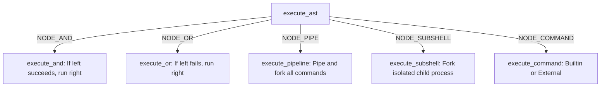
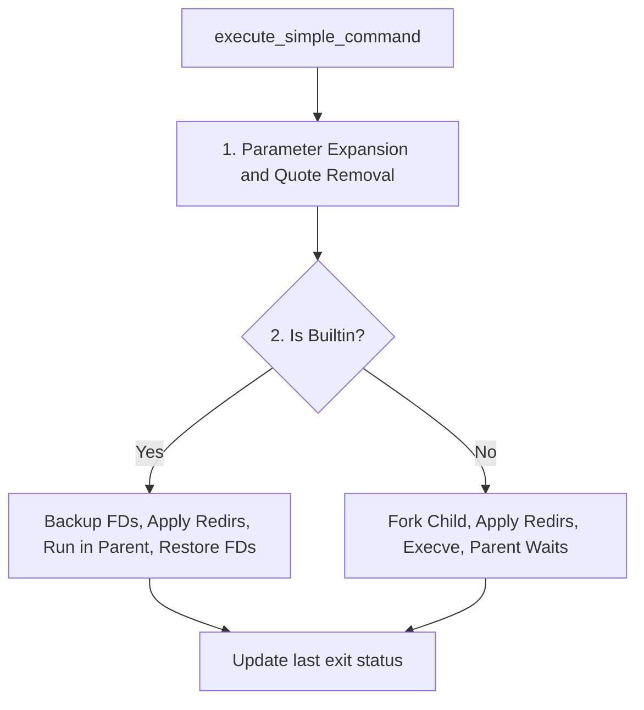
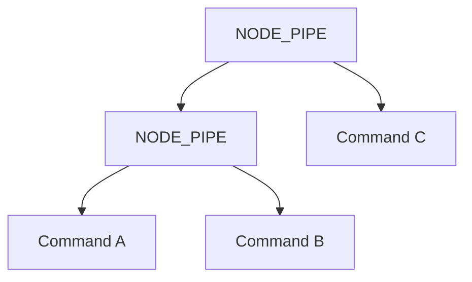
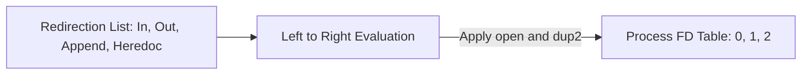

# Execution Engine & IPC Pipeline Architecture Specification

> **Navigation**: [[index|Hub: Index]] | [[wiki/architecture/01_parser_and_ast|Prev: Phase 1 Parser & AST]] | [[wiki/architecture/03_signal_dispatcher_and_state_machine|Next: Phase 3 Signal Dispatcher]]  
> **Requirements**: [[wiki/requirements/mandatory|Mandatory Spec]] | [[wiki/requirements/bonus|Bonus Spec]]  
> **Deep Dive Concept**: [[wiki/concepts/deep_dive_process_ipc_and_fd|Process Lifecycle, FD Table & Deadlock Deep Dive]]  
> **Allowed Functions**: [[wiki/concepts/allowed_functions_matrix|Allowed Functions Matrix]]  
> **Raw Specs**: [[raw/specs/bash_pipelines|Bash Pipelines]] | [[raw/specs/bash_redirections|Bash Redirections]] | [[raw/specs/bash_exit_status|Bash Exit Status]]

---

## 1. Engine Architecture & Node Dispatcher

파서([[wiki/architecture/01_parser_and_ast|01_parser_and_ast.md]])가 생성한 AST 루트 노드를 재귀 순회(Recursive Traversal)하며 노드 타입별 실행 전략 디스패치



### 1.1 노드별 실행 규격 요약
| 노드 타입 | 실행 동시성 | 서브셸 포크 여부 | 종료 상태 (`$?`) 전파 규칙 |
| :--- | :---: | :---: | :--- |
| `NODE_COMMAND` (단일 빌트인) | 순차 (동기) | **포크 안 함** (부모 직접 실행) | 빌트인 함수의 리턴값 (0~255) |
| `NODE_COMMAND` (외부 바이너리) | 순차 (동기) | 자식 1개 포크 | `waitpid` 종료 상태 또는 시그널(128+N) |
| `NODE_PIPE` | **병렬 (비동기)** | 파이프라인 내 모든 커맨드 자식 포크 | **마지막(가장 우측) 커맨드의 종료 상태** |
| `NODE_AND` | 순차 (단락) | 연산자 자체는 포크 안 함 | 마지막으로 실행된 자식 노드의 종료 상태 |
| `NODE_OR` | 순차 (단락) | 연산자 자체는 포크 안 함 | 마지막으로 실행된 자식 노드의 종료 상태 |
| `NODE_SUBSHELL` | 순차 (동기) | **자식 1개 포크** (환경 격리) | 괄호 내부 서브트리 최종 실행 상태 |

---

## 2. Process Lifecycle & Execution Flow

### 2.1 단일 명령어 실행 (`execute_simple_command`)
파이프라인 외부 단독 명령어 실행 흐름:



> [!IMPORTANT]
> **부모 셸에서 빌트인을 실행할 때의 FD 보존 원칙**:  
> `cd`, `export`, `unset`, `exit` 등 부모 상태를 변경하는 빌트인에 리다이렉션이 동반될 경우(예: `export TEST=1 > out.txt`), 부모 `stdin(0)`·`stdout(1)` 손상 방지를 위해 **`dup` 백업 및 실행 후 `dup2` 원복 필수** (이론: [[wiki/concepts/deep_dive_process_ipc_and_fd|FD 테이블 3단계 구조]])

---

## 3. IPC Pipeline Engine Architecture (`NODE_PIPE`)

복수 명령어의 파이프 데이터 스트리밍 구조상 모든 프로세스 동시 실행 필수

### 3.1 파이프라인 수집 및 평탄화 (Flattening)
`a | b | c`의 AST 표현:

실행 엔진은 파이프 서브트리 재귀 순회로 N개 커맨드 리스트(`[A, B, C]`) 수집 및 (N - 1)개 파이프(`int fds[N-1][2]`) 일괄 생성

### 3.2 Pipe End 관리 및 FD 생명주기 (Strict Closing Protocol)

파이프라인 **무한 행(Hang)**의 주원인은 미사용 파이프 쓰기 끝(`write-end`) 미해제 잔존 (수학적 증명: [[wiki/concepts/deep_dive_process_ipc_and_fd|파이프라인 무한 행의 원인과 EOF 도달 조건]])

```
[Command 1] -- pipe_fd[0][1] --> | === Pipe 0 === | -- pipe_fd[0][0] --> [Command 2]
```

1. **파이프 생성**:
   - (N - 1)개 명령어용 `pipe(pipe_fd[i])` 부모 사전 생성 ([[wiki/concepts/allowed_functions_matrix|pipe 시스템 콜]])
2. **자식 프로세스 (i번째 프로세스, 0 <= i < N) 내부**:
   - **입력 연결**: `i > 0` 조건 시 `dup2(pipe_fd[i-1][0], STDIN_FILENO)` 연결
   - **출력 연결**: `i < N - 1` 조건 시 `dup2(pipe_fd[i][1], STDOUT_FILENO)` 연결
   - **자식 내부 모든 파이프 닫기**: 루프로 상속받은 (N - 1)개 파이프 양쪽 끝(`[0]`, `[1]`) 전부 `close`
   - **로컬 리다이렉션 적용**: 명령어 자체 리다이렉션(`<`, `>`) 존재 시 파이프 연결 위에 덮어쓰기(`dup2`)
   - `execve` 호출 (실패 시 즉시 `exit`)
3. **부모 프로세스 내부**:
   - 자식 포크 완료 즉시 부모 측 (N - 1)개 파이프 양쪽 끝 전부 `close`
   - 부모 쓰기 끝 종료 완료 시점에 1번 프로세스 종료 후 2번 프로세스 정상 `EOF(0)` 수신

---

## 4. Redirection Engine Architecture

실행 직전 자식 프로세스(또는 부모 빌트인)의 FD 테이블 재배치:



### 4.1 리다이렉션 타입별 처리
1. **`REDIR_IN` (`< file`)**:
   - `fd = open(target, O_RDONLY)` 호출
   - 실패 시 `perror(target)`, 에러 상태 `1` 설정 후 중단
   - 성공 시 `dup2(fd, STDIN_FILENO)` 및 `close(fd)` 호출
2. **`REDIR_OUT` (`> file`)**:
   - `fd = open(target, O_WRONLY | O_CREAT | O_TRUNC, 0644)` 호출
   - 성공 시 `dup2(fd, STDOUT_FILENO)` 및 `close(fd)` 호출
3. **`REDIR_APPEND` (`>> file`)**:
   - `fd = open(target, O_WRONLY | O_CREAT | O_APPEND, 0644)` 호출
   - 성공 시 `dup2(fd, STDOUT_FILENO)` 및 `close(fd)` 호출
4. **`REDIR_HEREDOC` (`<< delimiter`)**:
   - **파싱 직후/실행 전 단계**에서 임시 파이프/파일에 Here-doc 입력 사전 수집 완료 ([[wiki/architecture/03_signal_dispatcher_and_state_machine|Here-doc 시그널 처리 연동]])
   - 실행 단계에서는 열린 `heredoc_fd`를 `dup2(heredoc_fd, STDIN_FILENO)`로 연결 후 `close(heredoc_fd)` 호출

---

## 5. Exit Status Normalization & Wait Protocol

모든 자식 프로세스 포크 후 좀비(Zombie) 프로세스 방지를 위한 전수 수거 필수 (이론: [[wiki/concepts/deep_dive_process_ipc_and_fd|좀비 방지와 Concurrency의 본질]])

```c
int wait_pipeline(pid_t *pids, int count)
{
    int i;
    int status;
    int last_exit_status;

    last_exit_status = 0;
    i = 0;
    while (i < count)
    {
        if (waitpid(pids[i], &status, 0) == -1)
            return (1);
        if (i == count - 1)
        {
            if (WIFEXITED(status))
                last_exit_status = WEXITSTATUS(status);
            else if (WIFSIGNALED(status))
                last_exit_status = 128 + WTERMSIG(status);
        }
        i++;
    }
    return (last_exit_status);
}
```

### 상태 코드 정규화 규칙 (연계: [[wiki/architecture/03_signal_dispatcher_and_state_machine|시그널 상태 동기화]])
- **정상 종료 (`WIFEXITED`)**: 프로세스 `exit(code)` 반환값(`0`~`255`) 사용
- **시그널 종료 (`WIFSIGNALED`)**: 미처리 시그널에 의한 강제 종료:
  - `SIGINT` (Ctrl+C, 시그널 2) -> `128 + 2 = 130`
  - `SIGQUIT` (Ctrl+\, 시그널 3) -> `128 + 3 = 131`
  - `SIGSEGV` (세그폴트, 시그널 11) -> `128 + 11 = 139`
- **명령어 실행 실패**:
  - `command not found` -> **127**
  - `permission denied` 또는 `is a directory` -> **126**
  - 문법 에러 (Syntax Error) -> **2**
