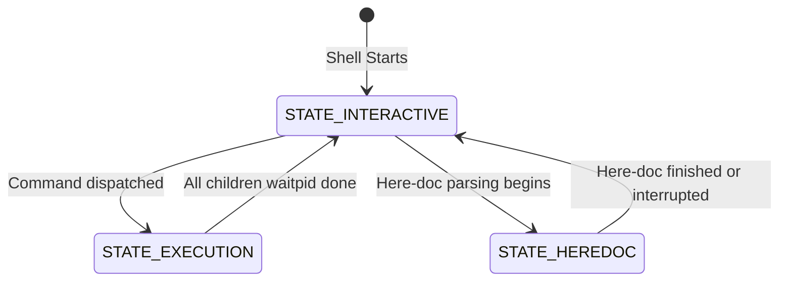

# Signal Dispatcher & State Machine Architecture Specification

> **Navigation**: [[index|Hub: Index]] | [[wiki/architecture/02_execution_engine_and_ipc|Prev: Phase 2 Execution Engine]]  
> **Requirements**: [[wiki/requirements/mandatory|Mandatory Spec (Global Variable Restriction)]]  
> **Deep Dive Concept**: [[wiki/concepts/deep_dive_signals_and_concurrency|Signals, Reentrancy & Process Groups Deep Dive]]  
> **Allowed Functions**: [[wiki/concepts/allowed_functions_matrix|Allowed Functions Matrix]]  
> **Raw Specs**: [[raw/specs/bash_signals|Bash Signals Spec]]

---

## 1. Architectural Philosophy & Global Variable Isolation

42 Minishell 서브젝트([[wiki/requirements/mandatory|Mandatory Spec]])의 엄격한 시그널 전역 변수 제약:

> [!CAUTION]
> **"Avoid using more than one global variable to indicate a received signal... This global variable cannot provide any other information or data access than the number of a received signal."**

규정 100% 준수를 위한 단일 정수 전역 변수 선언:
```c
/* 전역 변수는 오직 수신된 시그널 번호(int)만을 원자적으로 기록 */
volatile sig_atomic_t g_signal_num = 0;
```
데이터 구조체 포인터(`t_shell*`), 셸 상태값, 카운터 일체 배제. 메인 루프와 실행 엔진([[wiki/architecture/02_execution_engine_and_ipc|Phase 2 Execution Engine]])이 `g_signal_num` 감지 및 소비 후 `ctx->last_exit_status` 갱신 (이론: [[wiki/concepts/deep_dive_signals_and_concurrency|volatile sig_atomic_t의 하드웨어/컴파일러적 의미]])

---

## 2. Shell Signal State Machine

셸 생명주기 3가지 상태(State)별 `SIGINT`(Ctrl+C) 및 `SIGQUIT`(Ctrl+\) 반응 규칙 구분:



### 2.1 상태별 시그널 동작 매트릭스

| 셸 상태 (State) | `SIGINT` (Ctrl+C) 동작 | `SIGQUIT` (Ctrl+\) 동작 | `Ctrl+D` (EOF) 동작 |
| :--- | :--- | :--- | :--- |
| **`STATE_INTERACTIVE`**<br/>(Prompt 대기 중) | 새 줄 출력 (`\n`)<br/>버퍼 초기화 (`rl_replace_line("", 0)`)<br/>새 프롬프트 표시 (`rl_on_new_line`, `rl_redisplay`)<br/>`g_signal_num = SIGINT` | **완전 무시 (`SIG_IGN`)** | `readline()` `NULL` 반환<br/>-> `"exit\n"` 출력 후 셸 정상 종료 (`exit(0)`) |
| **`STATE_EXECUTION`**<br/>(자식 프로세스 실행 중) | **부모**: 무시 또는 시그널 대기<br/>**자식**: 기본 동작(`SIG_DFL`)으로 `SIGINT` 종료<br/>종료 코드: $128 + 2 = \mathbf{130}$ | **부모**: 무시 또는 시그널 대기<br/>**자식**: 기본 동작(`SIG_DFL`) 코어덤프 종료<br/>`"Quit (core dumped)\n"` 출력<br/>종료 코드: $128 + 3 = \mathbf{131}$ | 자식 `stdin`에 EOF 전달 (프로세스 입력 종료) |
| **`STATE_HEREDOC`**<br/>(Here-doc 입력 대기) | 즉시 입력 중단<br/>Here-doc 임시 파일/파이프 정리<br/>대화형 모드 복귀<br/>`&#36;? = 130` 세팅 | **완전 무시 (`SIG_IGN`)** | 경고 메시지 출력:<br/>`warning: here-document delimited by end-of-file (wanted 'DELIM')`<br/>누적 입력 내용으로 Here-doc 마감 |

---

## 3. Signal Handler Implementation

신뢰성 있는 시그널 처리를 위한 POSIX 표준 `sigaction()` 사용 (시스템 콜: [[wiki/concepts/allowed_functions_matrix|sigaction 및 시그널 함수]])

### 3.1 대화형 모드 핸들러 (`setup_interactive_signals`)
```c
static void handle_sigint_interactive(int signo)
{
    g_signal_num = signo;
    write(STDOUT_FILENO, "\n", 1);
    rl_on_new_line();
    rl_replace_line("", 0);
    rl_redisplay();
}

void setup_interactive_signals(void)
{
    struct sigaction sa_int;
    struct sigaction sa_quit;

    sa_int.sa_handler = handle_sigint_interactive;
    sigemptyset(&sa_int.sa_mask);
    sa_int.sa_flags = 0; /* SA_RESTART를 주지 않아 대기 중인 블로킹 호출 즉시 인터럽트 */
    sigaction(SIGINT, &sa_int, NULL);

    sa_quit.sa_handler = SIG_IGN; /* Ctrl+\ 완전 무시 */
    sigemptyset(&sa_quit.sa_mask);
    sa_quit.sa_flags = 0;
    sigaction(SIGQUIT, &sa_quit, NULL);
}
```

### 3.2 자식 프로세스 실행 모드 핸들러 (`setup_execution_signals`)
부모 포크 후 `waitpid` 루프([[wiki/architecture/02_execution_engine_and_ipc|Phase 2 wait_pipeline]]) 진입 직전 설정:
```c
void setup_parent_execution_signals(void)
{
    struct sigaction sa;

    sa.sa_handler = SIG_IGN;
    sigemptyset(&sa.sa_mask);
    sa.sa_flags = 0;
    /* 부모 셸은 시그널을 무시하고 자식들의 종료를 waitpid로 감지 */
    sigaction(SIGINT, &sa, NULL);
    sigaction(SIGQUIT, &sa, NULL);
}

void setup_child_execution_signals(void)
{
    struct sigaction sa;

    sa.sa_handler = SIG_DFL; /* 자식 프로세스는 OS 기본 동작(종료/코어덤프)으로 복원 */
    sigemptyset(&sa.sa_mask);
    sa.sa_flags = 0;
    sigaction(SIGINT, &sa, NULL);
    sigaction(SIGQUIT, &sa, NULL);
}
```
- 배경 설명: [[wiki/concepts/deep_dive_signals_and_concurrency|포그라운드 프로세스 그룹 시그널 브로드캐스팅 방어 전략]]

### 3.3 Here-doc 모드 핸들러 (`setup_heredoc_signals`)
Here-doc 도중 `Ctrl+C` 입력 시 `g_signal_num = SIGINT` 세팅 및 `read` 중단

---

## 4. Terminal Attribute Configuration (`termios`)

대화형 `Ctrl+C` 입력 시 터미널 드라이버의 기본 `^C` 에코 출력 억제용 `termios` API 제어:

```c
void set_terminal_echoctl(int enable)
{
    struct termios term;

    if (!isatty(STDIN_FILENO))
        return;
    tcgetattr(STDIN_FILENO, &term);
    if (enable)
        term.c_lflag |= ECHOCTL;
    else
        term.c_lflag &= ~ECHOCTL;
    tcsetattr(STDIN_FILENO, TCSANOW, &term);
}
```
- 셸 시작 시 `set_terminal_echoctl(0)` 호출로 터미널 에코 제어 문자 비활성화
- 셸 종료 직전 원래 속성 복원
- 관련 함수: [[wiki/concepts/allowed_functions_matrix|termios 함수군]]

---

## 5. Signal State Synchronization Protocol (동기화 프로토콜)

`g_signal_num` 비동기 시그널 번호와 셸 메인 컨텍스트(`t_shell_context`) 동기화 로직:

```c
void sync_signal_status(t_shell_context *ctx)
{
    if (g_signal_num == SIGINT)
    {
        ctx->last_exit_status = 130;
        g_signal_num = 0;
    }
    else if (g_signal_num == SIGQUIT)
    {
        ctx->last_exit_status = 131;
        g_signal_num = 0;
    }
}
```
- `readline()` 반환 직후 매번 `sync_signal_status(ctx)` 실행 -> 프롬프트 `Ctrl+C` 후 `echo &#36;?` 실행 시 **130** 정확 출력 보장 (평가 검증: [[wiki/requirements/evaluation_matrix|평가 매트릭스 시그널 항목]])
