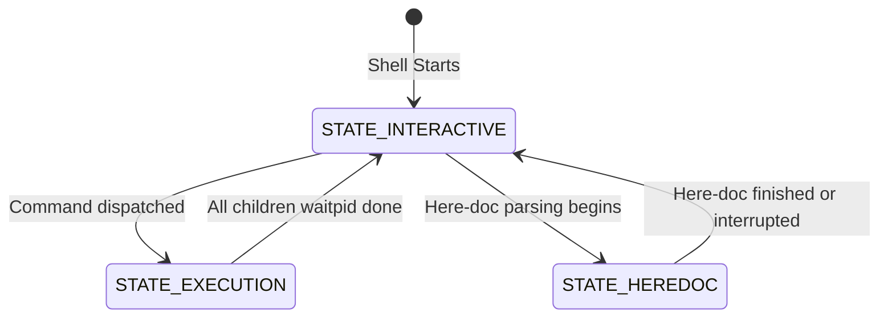

# Signal Dispatcher & State Machine Architecture Specification

> **Module**: Signal Handling, State Machine & Terminal Attributes Control  
> **Target**: Mandatory (Ctrl+C, Ctrl+D, Ctrl+\ in interactive & non-interactive) + Here-doc Signal  
> **References**: [bash_signals.md](file:///Users/yong/Projects/gdtknight/42/minishell-wiki/raw/specs/bash_signals.md), [allowed_functions_matrix.md](file:///Users/yong/Projects/gdtknight/42/minishell-wiki/wiki/concepts/allowed_functions_matrix.md)

---

## 1. Architectural Philosophy & Global Variable Isolation

42 Minishell 서브젝트는 시그널 처리에 대해 매우 강력하고 엄격한 제약을 부여합니다:

> [!CAUTION]
> **"Avoid using more than one global variable to indicate a received signal... This global variable cannot provide any other information or data access than the number of a received signal."**

본 아키텍처는 이 규정을 100% 준수하기 위해 다음과 같은 단일 정수 전역 변수만을 선언합니다:
```c
/* 전역 변수는 오직 수신된 시그널 번호(int)만을 원자적으로 기록 */
volatile sig_atomic_t g_signal_num = 0;
```
그 어떤 데이터 구조체 포인터(`t_shell*`), 셸 상태값, 카운터도 전역 변수에 포함하지 않으며, 메인 루프와 실행 엔진이 `g_signal_num`의 값을 감지하고 소비(Consume)하여 셸의 내부 상태(`ctx->last_exit_status`)를 갱신합니다.

---

## 2. Shell Signal State Machine

셸의 생명주기는 3가지 뚜렷한 상태(State)로 구분되며, 각 상태마다 `SIGINT`(Ctrl+C)와 `SIGQUIT`(Ctrl+\)의 반응 규칙이 완전히 달라집니다.



### 2.1 상태별 시그널 동작 매트릭스

| 셸 상태 (State) | `SIGINT` (Ctrl+C) 동작 | `SIGQUIT` (Ctrl+\) 동작 | `Ctrl+D` (EOF) 동작 |
| :--- | :--- | :--- | :--- |
| **`STATE_INTERACTIVE`**<br/>(Prompt 대기 중) | 새 줄 출력 (`\n`)<br/>버퍼 초기화 (`rl_replace_line("", 0)`)<br/>새 프롬프트 표시 (`rl_on_new_line`, `rl_redisplay`)<br/>`g_signal_num = SIGINT` | **완전 무시 (`SIG_IGN`)** | `readline()`이 `NULL` 반환<br/>-> `"exit\n"` 출력 후 셸 정상 종료 (`exit(0)`) |
| **`STATE_EXECUTION`**<br/>(자식 프로세스 실행 중) | **부모**: 무시 또는 시그널 대기<br/>**자식**: 기본 동작(`SIG_DFL`)으로 `SIGINT` 수신 시 종료<br/>종료 코드: $128 + 2 = \mathbf{130}$ | **부모**: 무시 또는 시그널 대기<br/>**자식**: 기본 동작(`SIG_DFL`)으로 코어덤프 종료<br/>`"Quit (core dumped)\n"` 출력<br/>종료 코드: $128 + 3 = \mathbf{131}$ | 자식의 `stdin`에 EOF 전달 (일반 파이프라인/프로세스 입력 종료) |
| **`STATE_HEREDOC`**<br/>(Here-doc 입력 대기) | 즉시 입력 중단<br/>Here-doc 임시 파일/파이프 정리<br/>대화형 모드로 복귀<br/>`$? = 130` 세팅 | **완전 무시 (`SIG_IGN`)** | 경고 메시지 출력:<br/>`warning: here-document delimited by end-of-file (wanted 'DELIM')`<br/>지금까지 입력된 내용으로 Here-doc 정상 마감 |

---

## 3. Signal Handler Implementation

신뢰성 있는 시그널 처리를 위해 `signal()` 대신 POSIX 표준 `sigaction()`을 사용합니다.

### 3.1 대화형 모드 핸들러 (`setup_interactive_signals`)
```c
static void handle_sigint_interactive(int signo)
{
    g_signal_num = signo;
    write(STDOUT_FILENO, "\n", 1);
    rl_on_new_line();
    rl_replace_line("", 0);
    rl_redisplay();
}

void setup_interactive_signals(void)
{
    struct sigaction sa_int;
    struct sigaction sa_quit;

    sa_int.sa_handler = handle_sigint_interactive;
    sigemptyset(&sa_int.sa_mask);
    sa_int.sa_flags = 0; /* SA_RESTART를 주지 않아 대기 중인 블로킹 호출 즉시 인터럽트 */
    sigaction(SIGINT, &sa_int, NULL);

    sa_quit.sa_handler = SIG_IGN; /* Ctrl+\ 완전 무시 */
    sigemptyset(&sa_quit.sa_mask);
    sa_quit.sa_flags = 0;
    sigaction(SIGQUIT, &sa_quit, NULL);
}
```

### 3.2 자식 프로세스 실행 모드 핸들러 (`setup_execution_signals`)
부모가 자식들을 포크한 후 `waitpid` 루프에 들어가기 직전에 설정합니다:
```c
void setup_parent_execution_signals(void)
{
    struct sigaction sa;

    sa.sa_handler = SIG_IGN;
    sigemptyset(&sa.sa_mask);
    sa.sa_flags = 0;
    /* 부모 셸은 시그널을 무시하고 자식들의 종료를 waitpid로 감지 */
    sigaction(SIGINT, &sa, NULL);
    sigaction(SIGQUIT, &sa, NULL);
}

void setup_child_execution_signals(void)
{
    struct sigaction sa;

    sa.sa_handler = SIG_DFL; /* 자식 프로세스는 OS 기본 동작(종료/코어덤프)으로 복원 */
    sigemptyset(&sa.sa_mask);
    sa.sa_flags = 0;
    sigaction(SIGINT, &sa, NULL);
    sigaction(SIGQUIT, &sa, NULL);
}
```

### 3.3 Here-doc 모드 핸들러 (`setup_heredoc_signals`)
Here-doc 도중 `Ctrl+C`가 눌리면 `g_signal_num = SIGINT`로 세팅하고 `read`를 중단시킵니다.

---

## 4. Terminal Attribute Configuration (`termios`)

대화형 셸에서 사용자가 `Ctrl+C`를 누를 때, 터미널 드라이버가 기본적으로 `^C`라는 에코 문자를 화면에 출력하는 경우가 있습니다. Bash처럼 깔끔한 화면을 유지하고 싶다면 `termios` API를 통해 제어합니다:

```c
void set_terminal_echoctl(int enable)
{
    struct termios term;

    if (!isatty(STDIN_FILENO))
        return;
    tcgetattr(STDIN_FILENO, &term);
    if (enable)
        term.c_lflag |= ECHOCTL;
    else
        term.c_lflag &= ~ECHOCTL;
    tcsetattr(STDIN_FILENO, TCSANOW, &term);
}
```
- 셸 시작 시 `set_terminal_echoctl(0)`을 호출하여 터미널 에코 제어 문자를 끄고,
- 셸 종료 직전에 원래 속성으로 복원합니다.

---

## 5. Signal State Synchronization Protocol (동기화 프로토콜)

`g_signal_num`에 기록된 비동기 시그널 번호를 셸 메인 컨텍스트(`t_shell_context`)와 동기화하는 로직:

```c
void sync_signal_status(t_shell_context *ctx)
{
    if (g_signal_num == SIGINT)
    {
        ctx->last_exit_status = 130;
        g_signal_num = 0;
    }
    else if (g_signal_num == SIGQUIT)
    {
        ctx->last_exit_status = 131;
        g_signal_num = 0;
    }
}
```
- `readline()` 호출이 끝난 직후 매번 `sync_signal_status(ctx)`를 실행하여, 사용자가 프롬프트에서 `Ctrl+C`를 눌러 새 줄을 띄운 직후 `echo $?`를 실행하면 정확히 **130**이 출력되도록 보장합니다.
