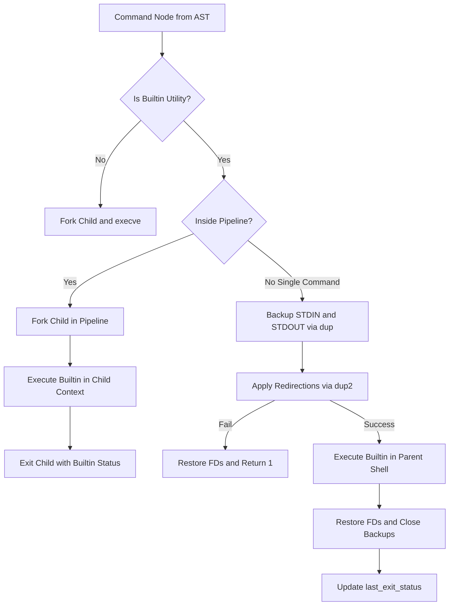
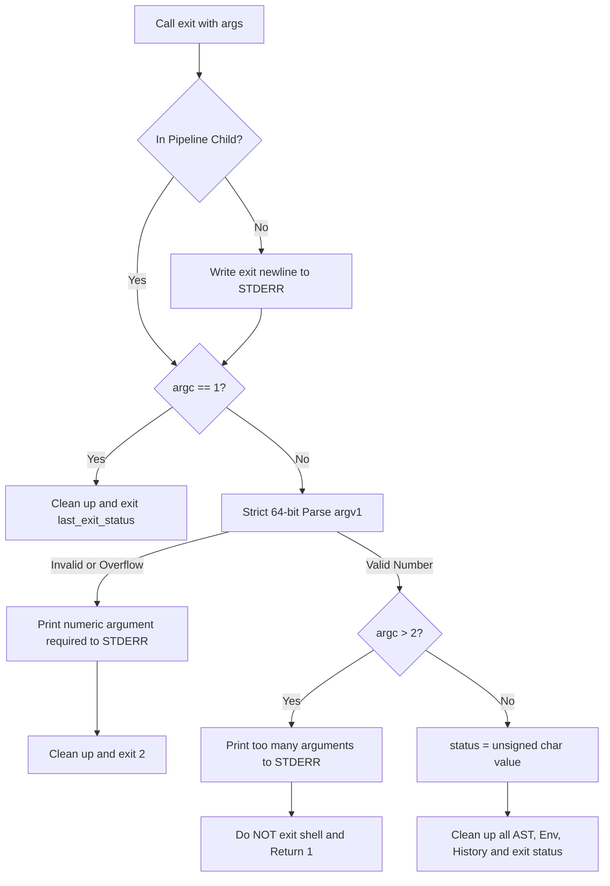

# Builtin Utilities & Environment Variable Engine Architecture Specification

> **Navigation**: [[index|Hub: Index]] | [[wiki/architecture/03_signal_dispatcher_and_state_machine|Prev: Phase 3 Signal Dispatcher]]  
> **Related Architecture**: [[wiki/architecture/02_execution_engine_and_ipc|Phase 2: Execution Engine & FD Backup]]  
> **Requirements**: [[wiki/requirements/mandatory|Mandatory Spec]] | [[wiki/requirements/evaluation_matrix|Evaluation Matrix]]  
> **Deep Dive Concept**: [[wiki/concepts/deep_dive_builtins_and_environment|Builtins, Environ Layout & OS Isolation Deep Dive]]  
> **Allowed Functions**: [[wiki/concepts/allowed_functions_matrix|Allowed Functions Matrix]]  
> **Raw Specs**: [[raw/specs/bash_builtins|Bash Builtins Spec]] | [[raw/evalhub/minishell_eval_scale|42 EvalHub Scale]]

---

## 1. Architectural Overview: Builtin vs External Execution

셸의 명령어는 OS가 새 프로세스로 띄워 실행하는 외부 프로그램(`ls`, `grep`)과, 셸 프로세스 자기 자신의 내부 상태(CWD, 환경변수, 종료 여부)를 직접 조작해야 하는 **내장 유틸리티(Builtin Utilities)**로 구분됩니다. (이론적 배경: [[wiki/concepts/deep_dive_builtins_and_environment|왜 빌트인은 부모 프로세스에서 실행되어야 하는가]])



---

## 2. Environment Variable Dictionary Engine (`t_env_node`)

C 런타임의 `extern char **environ` 또는 `main`의 `char **envp` 배열은 정적 크기이거나 추가/삭제 시 전체 배열을 `malloc`/`realloc` 해야 하는 비효율과 포인터 소유권 혼란을 유발합니다. 본 아키텍처는 이를 추상화한 **전용 환경변수 연결 리스트(Linked List Dictionary)**를 구축합니다.

### 2.1 Data Structure (`t_env_node`)

```c
typedef struct s_env_node
{
	char				*key;
	char				*value;
	struct s_env_node	*next;
}	t_env_node;
```

- **값 없음(`value == NULL`) vs 빈 값(`value == ""`)의 엄격한 분리**:
  - `export FOO` 실행 시: `key = "FOO"`, `value = NULL`로 저장됩니다. 이 노드는 `env` 명령어 출력에서는 **생략**되지만, 인자 없는 `export` 출력에서는 `declare -x FOO`로 출력됩니다.
  - `export FOO=` 실행 시: `key = "FOO"`, `value = ""`로 저장됩니다. `env`에서는 `FOO=`로, `export`에서는 `declare -x FOO=""`로 출력됩니다.

### 2.2 Shell Initialization (`envp` Ingestion & `SHLVL`)
셸이 시작될 때 부모 프로세스로부터 물려받은 `char **envp`를 순회하며 깊은 복사(Deep Copy)로 `t_env_node` 리스트를 생성합니다.

1. **`SHLVL` 갱신 규칙 (Bash 호환)**:
   - 기존 `SHLVL`이 존재하면 정수로 파싱하여 `1`을 더합니다.
   - 값이 음수이면 `0`으로 초기화합니다.
   - 값이 `999` 이상이 되면 Bash 경고(`warning: shell level (1000) too high, resetting to 1`) 출력 후 `1`로 재설정합니다.
   - 숫자가 아니거나 `SHLVL`이 없으면 `1`로 새로 생성합니다.
2. **`OLDPWD` 및 `PWD` 초기 정합성**:
   - `PWD`가 없으면 `getcwd()`를 호출해 현재 작업 경로를 등록합니다.
   - 시작 시 `OLDPWD`가 존재하지 않으면 `value = NULL` 상태로 등록하여 `export` 목록에는 보이되 `env`에는 노출되지 않도록 Bash와 동일하게 맞춥니다.

### 2.3 `execve` 직렬화 계층 (`env_list_to_array`)
외부 명령어를 실행하기 위해 `execve(path, argv, envp)`([[wiki/architecture/02_execution_engine_and_ipc|Phase 2 Execution Engine]])를 호출하기 직전에만 동적 `char **` 배열로 직렬화합니다.
- `value != NULL`인 노드만 `"KEY=VALUE"` 문자열로 결합하여 NULL-terminated 배열을 생성합니다.
- 자식 프로세스에서 `execve` 실패 시, 또는 부모/자식 컨텍스트 정리 시 반드시 이 직렬화 배열 전체를 `free_str_array()`로 해제합니다.

---

## 3. Single Builtin FD Backup & Restore Protocol

단일 빌트인 명령어가 리다이렉션을 동반할 때(예: `echo hello > out.txt`, `export A=1 > /dev/null`), 부모 프로세스 자체가 `dup2()`로 표준 입출력을 덮어쓰면 이후 프롬프트(`readline`)의 입출력이 영구적으로 손상됩니다.

```c
/* 단일 빌트인 실행 전 표준 입출력 보존 패턴 */
int	execute_single_builtin(t_ast_node *cmd, t_shell *ctx)
{
	int	saved_stdin;
	int	saved_stdout;
	int	status;

	saved_stdin = dup(STDIN_FILENO);
	saved_stdout = dup(STDOUT_FILENO);
	if (saved_stdin == -1 || saved_stdout == -1)
		return (close_safe(saved_stdin), close_safe(saved_stdout), 1);
	if (apply_redirections(cmd->redirs, ctx) != 0)
	{
		restore_std_fds(saved_stdin, saved_stdout);
		return (1);
	}
	status = dispatch_builtin(cmd->argv, ctx, FALSE);
	restore_std_fds(saved_stdin, saved_stdout);
	return (status);
}
```
- **원자적 FD 복원**: `restore_std_fds()`는 `dup2(saved_stdin, STDIN_FILENO)` 및 `dup2(saved_stdout, STDOUT_FILENO)`를 수행한 뒤 **반드시 `close(saved_stdin)`과 `close(saved_stdout)`를 호출**하여 백업용 FD가 누수되지 않도록 닫습니다.
- **예외: `exit` 빌트인의 선제 클린업**: `exit` 빌트인은 프로세스를 즉시 종료하므로, 종료 직전 `saved_stdin`과 `saved_stdout`까지 포함해 모든 열린 FD를 닫고 `exit()`를 호출해야 Valgrind `--track-fds=yes` 검사에서 0 누수를 달성합니다.

---

## 4. 7 Builtin Utilities Specification & Edge Cases

서브젝트([[wiki/requirements/mandatory|Mandatory Spec]])와 평가 시트([[wiki/requirements/evaluation_matrix|Evaluation Matrix]])가 요구하는 7대 빌트인의 정밀 규격입니다.

| Builtin | Subject 제약 및 옵션 | 부모 직접 실행 여부 | 핵심 엣지 케이스 |
| :--- | :--- | :---: | :--- |
| **`echo`** | `-n` 옵션만 지원 | 무관 (백업 후 실행) | `-nnnnn`, `-n -n`, `-na` 구분, `--` 미해석 |
| **`cd`** | 상대/절대 경로 (옵션 없음) | **필수 (단일 실행 시)** | 인자 없음(`HOME`), 인자 2개 이상, `PWD`/`OLDPWD` 갱신 |
| **`pwd`** | 옵션 없음 | 무관 | 삭제된 디렉토리 내에서의 `getcwd` NULL 폴백 |
| **`export`** | 옵션 없음 | **필수 (단일 실행 시)** | 인자 없음(ASCII 정렬), 식별자 검증, `=` 유무 구분 |
| **`unset`** | 옵션 없음 | **필수 (단일 실행 시)** | 존재하지 않는 키 무시, `PATH` 삭제 시 즉시 반영 |
| **`env`** | 옵션 및 인자 없음 | 무관 | `value == NULL` 항목 제외, 인자 입력 시 에러 처리 |
| **`exit`** | 옵션 없음 | **필수 (단일 실행 시)** | 64비트 오버플로, 비수치 인자(2), 다중 인자(미종료) |

### 4.1 `echo [-n] [arg ...]`
- **연속 `-n` 플래그 파싱**: 첫 번째 인자부터 순회하며 `arg[0] == '-'`이고 나머지 문자가 **모두 `'n'`으로만 구성된 경우**(`-n`, `-nnn`, `-n -nn`)만 개행 억제 플래그로 인정합니다.
- **비옵션 폴백**: `-na`, `-`, `--` 등은 옵션이 아닌 **일반 출력 문자열**로 간주하고 그 지점부터 옵션 파싱을 즉시 중단하여 그대로 출력합니다. ([[raw/specs/bash_builtins|Bash Builtins Spec]]: *"echo does not interpret -- to mean the end of options."*)
- **원자적 출력**: 공백으로 구분해 출력한 뒤, 플래그가 꺼져 있으면 `\n`을 출력합니다. `write` 시스템 콜 에러(예: 닫힌 stdout) 시 1을 반환합니다.

### 4.2 `cd [path]`
- **인자 개수 검증**:
  - `argc == 1` (`cd`): `env_get(ctx->env, "HOME")` 값을 타겟 경로로 설정합니다. `HOME`이 설정되지 않았으면 `minishell: cd: HOME not set\n` 출력 후 1을 반환합니다.
  - `argc == 2`: `argv[1]`을 타겟 경로로 설정합니다. 단, `argv[1]`이 빈 문자열 `""`인 경우 Bash는 현재 디렉토리를 유지한 채 0을 반환합니다.
  - `argc > 2`: `minishell: cd: too many arguments\n` 출력 후 1을 반환합니다.
- **`chdir()` 및 환경변수 동기화**:
  - `chdir(target) != 0` 시 `perror("minishell: cd: <target>")` 형식의 에러를 출력하고 1을 반환합니다.
  - 성공 시 `old_pwd = env_get(ctx->env, "PWD")` (또는 사전 저장된 `ctx->cwd`)를 `OLDPWD`로 업데이트합니다.
  - `getcwd(NULL, 0)`으로 새 절대 경로를 획득해 `PWD` 및 `ctx->cwd`를 업데이트합니다. (`getcwd` 실패 시 기존 경로 문자열 조합 또는 에러 경고를 출력합니다.)

### 4.3 `pwd`
- **동작**: `getcwd(NULL, 0)`을 호출하여 현재 물리적 작업 디렉토리의 절대 경로를 획득하고 `stdout`에 개행과 함께 출력한 뒤 할당된 버퍼를 `free()`합니다.
- **디렉토리 삭제 엣지 케이스 방어**: 현재 쉘이 머물던 디렉토리가 다른 프로세스에 의해 삭제(`rm -rf`)된 상태에서 `pwd`를 호출하면 `getcwd()`가 `NULL`(`ENOENT`)을 반환합니다. 이때 크래시하지 않고 내부적으로 캐싱해 둔 `ctx->cwd` 또는 `PWD` 값을 출력하여 Bash 호환성을 유지합니다.

### 4.4 `export [name[=value] ...]`
- **인자 없는 `export` (Sorted View)**:
  - `t_env_node` 리스트의 포인터 배열을 임시 생성해 ASCII 사전순(Bubble/Quick Sort)으로 정렬합니다. (원본 리스트의 순서 자체를 바꾸면 `env` 출력 순서가 변할 수 있으므로 포인터 배열만 정렬 후 즉시 해제!)
  - 출력 형식은 `value != NULL`이면 `declare -x KEY="VALUE"\n`, `value == NULL`이면 `declare -x KEY\n`입니다.
  - 만약 `value` 내부에 `"`, `$`, `\` 등이 있을 경우 Bash는 이스케이프 처리를 추가합니다.
- **식별자(Identifier) 검증 규칙 (`is_valid_identifier`)**:
  - `=` 기호 앞부분(키 이름)이 비어 있거나(`=val`), 첫 글자가 영문자/언더스코어(`isalpha(c) || c == '_'`)가 아니면 무효로 판정합니다.
  - 두 번째 글자부터 `=`(또는 `+=`) 전까지 영숫자/언더스코어(`isalnum(c) || c == '_'`)가 아니면 무효로 판정합니다.
  - 무효한 인자가 발견되면 `minishell: export: '<arg>': not a valid identifier\n`를 `stderr`에 출력하고 **루프를 중단하지 않고 다음 인자를 계속 처리**한 뒤, 최종 반환값을 `1`로 설정합니다.
- **기존 변수 덮어쓰기 규칙**:
  - `export A=1` 후 `export A` (값 없음) 호출 시: 기존 값 `"1"`을 지우지 않고 **그대로 보존**합니다.
  - `export A=1` 후 `export A=2` 호출 시: 기존 값을 `"2"`로 교체합니다.

### 4.5 `unset [name ...]`
- 인자가 없으면 아무 작업 없이 0을 반환합니다.
- 각 인자 `name`을 리스트에서 탐색하여 일치하는 `t_env_node`의 `key`, `value`, 노드 메모리를 모두 해제하고 연결 리스트 포인터를 재연결합니다.
- `PATH` 변수가 `unset`되면 즉시 외부 명령어 탐색이 불가능해지며 `No such file or directory` 또는 `command not found` 에러가 발생해야 합니다. ([[raw/evalhub/minishell_eval_scale|42 EvalHub Environment path]])

### 4.6 `env`
- Subject 명세는 *"env with no options or arguments"*입니다.
- 인자(`argv[1]`)가 들어온 경우 `env: '<arg>': No such file or directory` 또는 사용법 오류를 출력한 뒤 127(또는 1)을 반환합니다.
- 리스트를 순회하며 **`node->value != NULL`인 노드만** `KEY=VALUE\n` 형식으로 출력합니다.

### 4.7 `exit [n]`
`exit`는 42 평가 시트와 Bash 호환성에서 가장 엣지 케이스가 많은 빌트인입니다. (이론적 배경: [[wiki/concepts/deep_dive_builtins_and_environment|64비트 정수 오버플로 방어 수학]])



- **엄격한 64비트 수치 파서 (`ft_parse_exit_code`)**:
  1. 앞뒤 공백(`' '`, `'\t'`, `'\n'`, `'\v'`, `'\f'`, `'\r'`) 스킵을 허용합니다. 단, 내부 공백 `"1 2"`는 비수치 에러로 처리합니다.
  2. 선택적 단일 부호 `'+'` 또는 `'-'`를 처리하며, 부호만 있고 숫자가 없으면 에러로 판정합니다.
  3. C 표준 Signed Overflow Undefined Behavior를 피하기 위해 `unsigned long long` 누산기 `acc`를 사용하고, 다음 자리 `d`를 더하기 전에 컷오프 검증을 수행합니다:
     - 양수 한계: `LLONG_MAX` (`9223372036854775807ULL`)
     - 음수 절대값 한계: `(unsigned long long)LLONG_MAX + 1ULL` (`9223372036854775808ULL`)
  4. 숫자 뒤에 공백 외의 문자(`42abc`)가 존재하면 실패로 판정합니다.
- **종료 전 완전 리소스 클린업**:
  - `exit` 실행 직전 `free_ast()`, `free_tokens()`, `free_env_list()`, `rl_clear_history()`, 백업 FD 닫기를 모두 실행하여 0 바이트 힙 누수를 보장합니다.

---

## 5. Cross References (상호 참조)
- **이전 설계**: [[wiki/architecture/03_signal_dispatcher_and_state_machine|Phase 3: Signal Dispatcher & State Machine]]
- **연관 설계**: [[wiki/architecture/02_execution_engine_and_ipc|Phase 2: Execution Engine & IPC Pipeline]]
- **심화 개념**: [[wiki/concepts/deep_dive_builtins_and_environment|Builtins, Environ Layout & 64-bit Overflow Deep Dive]]
- **평가 매트릭스**: [[wiki/requirements/evaluation_matrix|Evaluation Matrix]]
- **로드맵 이슈**: [[wiki/process/roadmap_and_issues|Dual-Repo Roadmap & Issues]]
