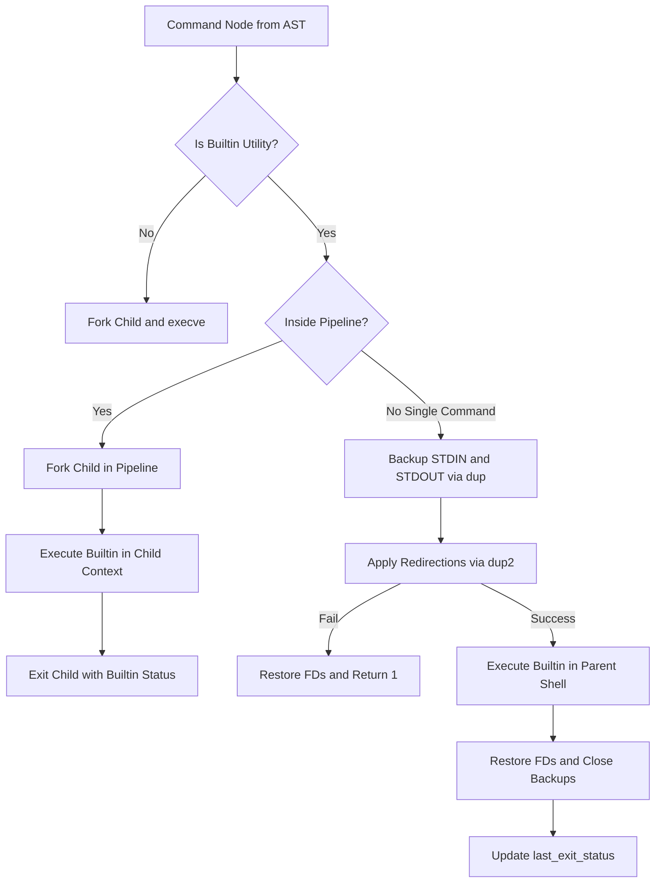
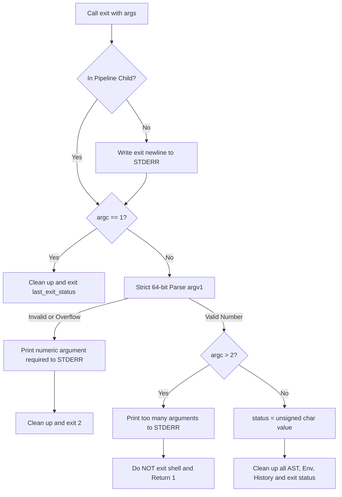

# Builtin Utilities & Environment Variable Engine Architecture Specification

> **Navigation**: [[index|Hub: Index]] | [[wiki/architecture/03_signal_dispatcher_and_state_machine|Prev: Phase 3 Signal Dispatcher]]  
> **Related Architecture**: [[wiki/architecture/02_execution_engine_and_ipc|Phase 2: Execution Engine & FD Backup]]  
> **Requirements**: [[wiki/requirements/mandatory|Mandatory Spec]] | [[wiki/requirements/evaluation_matrix|Evaluation Matrix]]  
> **Deep Dive Concept**: [[wiki/concepts/deep_dive_builtins_and_environment|Builtins, Environ Layout & OS Isolation Deep Dive]]  
> **Allowed Functions**: [[wiki/concepts/allowed_functions_matrix|Allowed Functions Matrix]]  
> **Raw Specs**: [[raw/specs/bash_builtins|Bash Builtins Spec]] | [[raw/evalhub/minishell_eval_scale|42 EvalHub Scale]]

---

## 1. Architectural Overview: Builtin vs External Execution

OS 새 프로세스 기반 외부 프로그램(`ls`, `grep`)과 달리, 셸 자체 상태(CWD, 환경변수, 종료 여부) 조작 목적의 **내장 유틸리티(Builtin Utilities)** 구분 (이론적 배경: [[wiki/concepts/deep_dive_builtins_and_environment|왜 빌트인은 부모 프로세스에서 실행되어야 하는가]])



---

## 2. Environment Variable Dictionary Engine (`t_env_node`)

C 런타임 `extern char **environ` / `main`의 `char **envp` 배열 직접 수정 시 `realloc` 필요성 및 포인터 소유권 혼란 방지 목적의 **전용 환경변수 연결 리스트(Linked List Dictionary)** 구축

### 2.1 Data Structure (`t_env_node`)

```c
typedef struct s_env_node
{
	char				*key;
	char				*value;
	struct s_env_node	*next;
}	t_env_node;
```

- **값 없음(`value == NULL`) vs 빈 값(`value == ""`) 분리**:
  - `export FOO`: `key = "FOO"`, `value = NULL` 저장 (`env` 생략, 무인자 `export`에서 `declare -x FOO` 출력)
  - `export FOO=`: `key = "FOO"`, `value = ""` 저장 (`env`에서 `FOO=`, `export`에서 `declare -x FOO=""` 출력)

### 2.2 Shell Initialization (`envp` Ingestion & `SHLVL`)
셸 시작 시 부모 `char **envp` 순회 및 깊은 복사(Deep Copy)로 `t_env_node` 리스트 생성

1. **`SHLVL` 갱신 규칙 (Bash 호환)**:
   - 기존 `SHLVL` 존재 시 정수 파싱 후 `1` 가산
   - 음수 값일 경우 `0` 초기화
   - `999` 이상 시 Bash 경고(`warning: shell level (1000) too high, resetting to 1`) 출력 후 `1` 재설정
   - 비수치 또는 `SHLVL` 부재 시 `1` 신규 생성
2. **`OLDPWD` 및 `PWD` 초기 정합성**:
   - `PWD` 부재 시 `getcwd()`로 현재 작업 경로 등록
   - 시작 시 `OLDPWD` 부재 시 `value = NULL` 상태로 등록 (`export` 노출, `env` 비노출 — Bash 호환)

### 2.3 `execve` 직렬화 계층 (`env_list_to_array`)
외부 명령어 `execve(path, argv, envp)`([[wiki/architecture/02_execution_engine_and_ipc|Phase 2 Execution Engine]]) 호출 직전에만 동적 `char **` 배열 직렬화
- `value != NULL` 노드만 `"KEY=VALUE"` 결합 -> NULL-terminated 배열 생성
- `execve` 실패 또는 컨텍스트 정리 시 `free_str_array()`로 직렬화 배열 일괄 해제

---

## 3. Single Builtin FD Backup & Restore Protocol

단일 빌트인 리다이렉션 동반 실행(예: `echo hello > out.txt`, `export A=1 > /dev/null`) 시 부모 `readline` 표준 입출력 영구 훼손 방지를 위한 백업·원복 패턴:

```c
/* 단일 빌트인 실행 전 표준 입출력 보존 패턴 */
int	execute_single_builtin(t_ast_node *cmd, t_shell *ctx)
{
	int	saved_stdin;
	int	saved_stdout;
	int	status;

	saved_stdin = dup(STDIN_FILENO);
	saved_stdout = dup(STDOUT_FILENO);
	if (saved_stdin == -1 || saved_stdout == -1)
		return (close_safe(saved_stdin), close_safe(saved_stdout), 1);
	if (apply_redirections(cmd->redirs, ctx) != 0)
	{
		restore_std_fds(saved_stdin, saved_stdout);
		return (1);
	}
	status = dispatch_builtin(cmd->argv, ctx, FALSE);
	restore_std_fds(saved_stdin, saved_stdout);
	return (status);
}
```
- **원자적 FD 복원**: `restore_std_fds()` 내 `dup2(saved_stdin, STDIN_FILENO)` 및 `dup2(saved_stdout, STDOUT_FILENO)` 수행 직후 **`close(saved_stdin)` 및 `close(saved_stdout)` 필수 호출**
- **예외: `exit` 빌트인의 선제 클린업**: `exit` 호출 시 즉시 종료되므로 `saved_stdin`·`saved_stdout` 포함 모든 열린 FD 닫기 후 `exit()` 호출 (Valgrind `--track-fds=yes` 0 누수 보장)

---

## 4. 7 Builtin Utilities Specification & Edge Cases

서브젝트([[wiki/requirements/mandatory|Mandatory Spec]])와 평가 시트([[wiki/requirements/evaluation_matrix|Evaluation Matrix]]) 기준 7대 빌트인 정밀 규격

| Builtin | Subject 제약 및 옵션 | 부모 직접 실행 여부 | 핵심 엣지 케이스 |
| :--- | :--- | :---: | :--- |
| **`echo`** | `-n` 옵션만 지원 | 무관 (백업 후 실행) | `-nnnnn`, `-n -n`, `-na` 구분, `--` 미해석 |
| **`cd`** | 상대/절대 경로 (옵션 없음) | **필수 (단일 실행 시)** | 인자 없음(`HOME`), 인자 2개 이상, `PWD`/`OLDPWD` 갱신 |
| **`pwd`** | 옵션 없음 | 무관 | 삭제된 디렉토리 내에서의 `getcwd` NULL 폴백 |
| **`export`** | 옵션 없음 | **필수 (단일 실행 시)** | 인자 없음(ASCII 정렬), 식별자 검증, `=` 유무 구분 |
| **`unset`** | 옵션 없음 | **필수 (단일 실행 시)** | 존재하지 않는 키 무시, `PATH` 삭제 시 즉시 반영 |
| **`env`** | 옵션 및 인자 없음 | 무관 | `value == NULL` 항목 제외, 인자 입력 시 에러 처리 |
| **`exit`** | 옵션 없음 | **필수 (단일 실행 시)** | 64비트 오버플로, 비수치 인자(2), 다중 인자(미종료) |

### 4.1 `echo [-n] [arg ...]`
- **연속 `-n` 플래그 파싱**: 첫 인자부터 순회하며 `arg[0] == '-'`이고 나머지가 **모두 `'n'`으로 구성된 경우**(`-n`, `-nnn`, `-n -nn`)만 개행 억제 플래그 인정
- **비옵션 폴백**: `-na`, `-`, `--` 등은 일반 출력 문자열로 간주하고 그 지점부터 옵션 파싱 즉시 중단 및 원문 출력 ([[raw/specs/bash_builtins|Bash Builtins Spec]]: *"echo does not interpret -- to mean the end of options."*)
- **원자적 출력**: 공백 구분 출력 후 플래그 비활성 시 `\n` 출력. `write` 시스템 콜 에러(예: 닫힌 stdout) 시 1 반환

### 4.2 `cd [path]`
- **인자 개수 검증**:
  - `argc == 1` (`cd`): `env_get(ctx->env, "HOME")` 값을 타겟 경로로 설정. `HOME` 미설정 시 `minishell: cd: HOME not set\n` 출력 후 1 반환
  - `argc == 2`: `argv[1]` 타겟 경로 설정 (`""` 빈 문자열 시 Bash와 동일하게 현재 디렉토리 유지 후 0 반환)
  - `argc > 2`: `minishell: cd: too many arguments\n` 출력 후 1 반환
- **`chdir()` 및 환경변수 동기화**:
  - `chdir(target) != 0` 시 `perror("minishell: cd: <target>")` 출력 후 1 반환
  - 성공 시 `old_pwd = env_get(ctx->env, "PWD")` (또는 사전 저장 `ctx->cwd`)를 `OLDPWD`로 업데이트
  - `getcwd(NULL, 0)`으로 새 절대 경로 획득 후 `PWD` 및 `ctx->cwd` 갱신 (`getcwd` 실패 시 기존 경로 문자열 조합 또는 경고 출력)

### 4.3 `pwd`
- **동작**: `getcwd(NULL, 0)`으로 물리적 작업 디렉토리 절대 경로 획득, `stdout` 개행 출력 후 버퍼 `free()`
- **디렉토리 삭제 엣지 케이스 방어**: 현재 작업 디렉토리가 외부에서 삭제(`rm -rf`)되어 `getcwd()`가 `NULL`(`ENOENT`) 반환 시 크래시 없이 내부 캐시 `ctx->cwd` / `PWD` 출력

### 4.4 `export [name[=value] ...]`
- **인자 없는 `export` (Sorted View)**:
  - 원본 리스트(`env` 출력 순서) 보존을 위해 `t_env_node` 포인터 배열만 임시 생성 -> ASCII 사전순 정렬·출력 후 즉시 `free`
  - 출력 형식: `value != NULL`이면 `declare -x KEY="VALUE"\n`, `value == NULL`이면 `declare -x KEY\n`
  - `value` 내부 `"`, `$`, `\` 포함 시 Bash 이스케이프 처리 추가
- **식별자(Identifier) 검증 규칙 (`is_valid_identifier`)**:
  - `=` 앞부분(키)이 비어 있거나(`=val`), 첫 글자가 영문자/언더스코어(`isalpha(c) || c == '_'`)가 아니면 무효
  - 두 번째 글자부터 `=`(또는 `+=`) 전까지 영숫자/언더스코어(`isalnum(c) || c == '_'`)가 아니면 무효
  - 무효 인자 발견 시 `minishell: export: '<arg>': not a valid identifier\n`를 `stderr` 출력 후 **루프 중단 없이 후속 인자 계속 처리**, 최종 반환값 `1` 설정
- **기존 변수 덮어쓰기 규칙**:
  - `export A=1` 후 `export A` (값 없음) 호출 시 기존 값 `"1"` 보존
  - `export A=1` 후 `export A=2` 호출 시 기존 값 `"2"` 교체

### 4.5 `unset [name ...]`
- 인자 없을 시 0 반환
- 각 `name` 탐색 후 일치하는 `t_env_node`의 `key`, `value`, 노드 메모리 일괄 해제 및 리스트 재연결
- `PATH` 변수 `unset` 즉시 외부 명령어 탐색 불가 -> `No such file or directory` 또는 `command not found` 에러 발생 ([[raw/evalhub/minishell_eval_scale|42 EvalHub Environment path]])

### 4.6 `env`
- Subject 명세: *"env with no options or arguments"*
- 인자(`argv[1]`) 유입 시 `env: '<arg>': No such file or directory` 또는 사용법 오류 출력 후 127(또는 1) 반환
- 리스트 순회하며 **`node->value != NULL`인 노드만** `KEY=VALUE\n` 형식 출력

### 4.7 `exit [n]`
42 평가 시트와 Bash 호환성상 엣지 케이스가 가장 많은 빌트인 (이론적 배경: [[wiki/concepts/deep_dive_builtins_and_environment|64비트 정수 오버플로 방어 수학]])



- **엄격한 64비트 수치 파서 (`ft_parse_exit_code`)**:
  1. 앞뒤 공백(`' '`, `'\t'`, `'\n'`, `'\v'`, `'\f'`, `'\r'`) 스킵 허용 (내부 공백 `"1 2"`는 비수치 에러)
  2. 선택적 단일 부호 `'+'` 또는 `'-'` 처리 (부호만 존재 시 에러)
  3. C 표준 Signed Overflow Undefined Behavior 회피용 `unsigned long long` 누산기 `acc` 사용, 다음 자리 `d` 덧셈 전 컷오프 검증:
     - 양수 한계: `LLONG_MAX` (`9223372036854775807ULL`)
     - 음수 절대값 한계: `(unsigned long long)LLONG_MAX + 1ULL` (`9223372036854775808ULL`)
  4. 숫자 뒤 공백 외 문자(`42abc`) 존재 시 실패 판정
- **종료 전 완전 리소스 클린업**:
  - `exit` 실행 직전 `free_ast()`, `free_tokens()`, `free_env_list()`, `rl_clear_history()`, 백업 FD 닫기 일괄 수행 -> 0바이트 힙 누수 보장

---

## 5. Cross References (상호 참조)
- **이전 설계**: [[wiki/architecture/03_signal_dispatcher_and_state_machine|Phase 3: Signal Dispatcher & State Machine]]
- **연관 설계**: [[wiki/architecture/02_execution_engine_and_ipc|Phase 2: Execution Engine & IPC Pipeline]]
- **심화 개념**: [[wiki/concepts/deep_dive_builtins_and_environment|Builtins, Environ Layout & 64-bit Overflow Deep Dive]]
- **평가 매트릭스**: [[wiki/requirements/evaluation_matrix|Evaluation Matrix]]
- **로드맵 이슈**: [[wiki/process/roadmap_and_issues|Dual-Repo Roadmap & Issues]]
