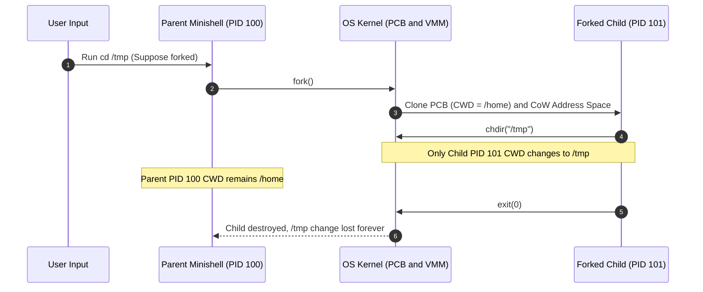
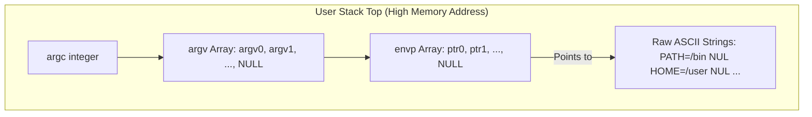

# Deep Dive: 빌트인(Builtin), 가상 메모리 `environ` 레이아웃, 그리고 64비트 정수 오버플로 방어

> **Navigation**: [[index|Hub: Index]] | **Architecture**: [[wiki/architecture/04_builtins_and_env_table|Phase 4 Builtins & Env Engine Architecture]]  
> **Related Architecture**: [[wiki/architecture/02_execution_engine_and_ipc|Phase 2 Execution Engine]]  
> **Related Deep Dive**: [[wiki/concepts/deep_dive_process_ipc_and_fd|Process Fork, CoW & FD Table Deep Dive]]  
> **Target Audience**: 시스템 프로그래머, 백엔드 및 OS 인프라 엔지니어  
> **Topic**: 프로세스 유저 스택 환경변수 배치, CoW 격리와 부모 실행의 필연성, POSIX 8비트 종료 코드 마스킹과 UB 없는 정수 파싱

---

## 1. 왜 빌트인(Builtin)은 외부 실행 파일이 될 수 없는가?

리눅스나 macOS의 `/bin` 또는 `/usr/bin` 디렉토리를 보면 `echo`, `pwd`, `env` 같은 실행 파일이 실제로 존재함에도, 셸이 이를 굳이 내부 함수(Builtin)로 구현하고 특히 `cd`, `export`, `unset`, `exit`는 `fork()` 없이 **부모 셸 프로세스 자기 자신**에서 실행하는 이유가 무엇일까요?

그 해답은 운영체제 커널이 프로세스에게 제공하는 **두 가지 강력한 격리(Isolation)**에 있습니다.

### 1.1 커널 PCB와 가상 메모리(CoW) 격리 메커니즘



1. **커널 레벨 CWD(Current Working Directory) 격리**:
   - 각 프로세스는 커널의 PCB(Process Control Block, 리눅스의 `task_struct -> fs -> pwd`) 안에 자신만의 현재 작업 디렉토리 VFS Vnode/Inode 포인터를 가집니다.
   - 자식 프로세스가 `chdir("/tmp")` 시스템 콜을 호출하더라도 커널은 오직 **자식 프로세스(PID 101)의 `fs_struct`**만 변경합니다. 부모 프로세스(PID 100)의 작업 디렉토리는 절대 영향을 받지 않습니다.
2. **유저 공간 가상 메모리(Copy-on-Write) 격리**:
   - `export`나 `unset`이 조작하는 환경변수 테이블은 힙(Heap)과 스택(Stack)이라는 프로세스의 가상 주소 공간에 존재합니다. (이론: [[wiki/concepts/deep_dive_process_ipc_and_fd|CoW 메모리 모델]])
   - 자식 프로세스가 `export VAR=1`을 위해 힙 메모리에 새 노드를 쓰면, CPU MMU가 Page Fault를 발생시켜 자식만의 독립된 물리 메모리 페이지를 복제합니다. 자식이 종료되는 순간 그 변경사항은 흔적도 없이 소멸합니다.
3. **파이프라인 안에서의 예외적 역전 현상**:
   - 반대로 `export A=1 | cat` 또는 `cd /tmp | ls`처럼 **파이프라인(`|`) 내부**에 빌트인이 포함되면, Bash 사양상 파이프라인의 모든 세그먼트는 서브셸(자식 프로세스)에서 실행되어야 합니다.
   - 따라서 이때는 **의도적으로 `fork()`된 자식 프로세스 내부에서 빌트인을 실행**하여, `cd`나 `export`의 효과가 부모 셸로 역전파되지 않고 격리되도록 제어해야 합니다.

---

## 2. 프로세스 가상 메모리와 `environ`의 물리적 구조

프로그램이 `execve(pathname, argv, envp)` 시스템 콜을 통해 새 바이너리를 적재할 때, 운영체제 커널의 ELF/Mach-O 로더는 프로세스 **유저 스택(User Stack)의 최상단(High Address)**에 `argv`와 `envp` 문자열 데이터 및 포인터 테이블을 배치합니다.



### 2.1 왜 셸은 `environ` 포인터 배열을 직접 수정하지 않는가?
- C 런타임의 `envp` 배열은 스택 최상단에 연속된 포인터 배열로 고정되어 있어, 변수를 추가(`export`)하거나 제거(`unset`)할 때마다 전체 배열을 재할당하고 문자열 수명(Lifetime)을 추적해야 합니다.
- 만약 스택 포인터(원본 `envp[i]`)와 힙에 새로 `malloc`한 포인터가 하나의 배열에 섞여 있다면, `unset`이나 종료 시 어떤 포인터를 `free()`해야 하는지 구분할 수 없어 **Double Free 또는 Invalid Free 크래시**가 발생합니다.
- **해결책 (Deep Copy Ownership Pattern)**:
  - `main()` 진입 즉시 모든 `envp` 문자열을 `ft_strdup`으로 힙(Heap)에 **완전 복제**하여 셸 소유의 연결 리스트(`t_env_node`)로 변환합니다. ([[wiki/architecture/04_builtins_and_env_table|Phase 4: t_env_node 아키텍처]])
  - 이로써 모든 키/값 문자열은 100% 동일한 **단일 소유권(Single Ownership)**을 가지므로, 수정/삭제/종료 시 단 하나의 예외 없이 일관되게 `free()`할 수 있습니다.

---

## 3. `exit` 상태 코드의 8비트 모듈러 연산과 64비트 오버플로 방어

### 3.1 왜 `exit 256`은 `0`이 되고, `exit -1`은 `255`가 되는가?

POSIX 표준에서 프로세스의 종료 상태는 32비트 정수(`int status`)에 담겨 `waitpid()`로 반환되지만, 실제 종료 코드(Exit Code)를 위해 할당된 공간은 **오직 하위 8비트(1 Byte, `0 ~ 255`)**뿐입니다.

- 커널은 자식 프로세스가 `exit(n)`을 호출할 때 `n & 0xFF` (즉, `unsigned char` 캐스팅 또는 `n mod 256`) 연산을 수행해 상위 24비트를 잘라냅니다.
- 나머지 비트는 시그널 종료 번호(`WTERMSIG`), 코어 덤프 플래그(`WCOREDUMP`), 중단 상태(`WIFSTOPPED`)를 기록하는 비트 필드로 예약되어 있습니다. (참조: [[wiki/architecture/02_execution_engine_and_ipc|waitpid 종료 상태 비트 추출]])
- 따라서 `exit 256` -> `256 & 0xFF == 0`, `exit -1` (2의 보수 `0xFFFFFFFF`) -> `0xFF == 255`가 됩니다.

### 3.2 C 표준 Undefined Behavior(UB) 없는 64비트 오버플로 검증

Bash의 `exit` 명령은 64비트 부호 있는 정수(`int64_t`: `-9223372036854775808` ~ `9223372036854775807`) 범위 내의 값만 유효한 숫자로 인정하며, 이를 1이라도 초과(`9223372036854775808` 또는 `-9223372036854775809`)하면 `numeric argument required` 에러와 함께 종료 코드 `2`를 반환합니다.

C 언어에서 `long long` 타입 변수에 `acc = acc * 10 + digit`을 그대로 수행해 오버플로가 나면 **Signed Integer Overflow는 C 표준상 미정의 동작(Undefined Behavior)**이므로 컴파일러 최적화(`-O2` 등)에 의해 비교 조건문 자체가 제거될 위험이 있습니다.

**안전한 사전 컷오프(Pre-Overflow Cutoff) 수학**:
1. 부호(`sign`)는 별도로 `+1` 또는 `-1`로 저장하고, 누적 계산은 **반드시 부호 없는 64비트 정수(`unsigned long long`)**로 수행합니다.
2. 부호에 따라 허용되는 최대 절대값 `limit`를 설정합니다:
   - `sign == 1`인 경우: `limit = (unsigned long long)LLONG_MAX` (`9223372036854775807`)
   - `sign == -1`인 경우: `limit = (unsigned long long)LLONG_MAX + 1ULL` (`9223372036854775808`)
3. 다음 숫자 `digit`을 곱하고 더하기 **직전**에 아래 조건을 검사합니다:
   ```c
   cutoff = limit / 10;
   cutlim = limit % 10;
   if (acc > cutoff || (acc == cutoff && (unsigned long long)digit > cutlim))
       return (OVERFLOW_ERROR);
   acc = acc * 10 + digit;
   ```
4. 이 불등식은 단 한 번의 정수 래핑(Wrap-around)이나 UB 없이 64비트 전 범위의 경계값(`LLONG_MAX`, `LLONG_MIN`)을 수학적으로 완벽히 판별합니다.

---

## 4. `export` 정렬 출력과 알파벳 순서의 함정

1. **원본 리스트 불변성 유지**:
   - 사용자가 `env`를 실행하면 변수가 등록/상속된 순서 그대로 출력되는 반면, 인자 없이 `export`를 실행하면 **ASCII 알파벳 순으로 정렬**되어 출력됩니다.
   - 만약 정렬을 위해 연결 리스트(`t_env_node`) 자체의 링크 순서를 바꿔버리면 이후 `env` 출력 순서가 훼손됩니다.
   - 따라서 `t_env_node *` 포인터들만 담은 임시 포인터 배열(`t_env_node **arr`)을 `malloc`하여 포인터만 정렬·출력하고 즉시 `free(arr)`하는 **비파괴적 View 정렬**을 사용해야 합니다.
2. **공백 값 및 특수문자 처리**:
   - `export A="hello"` 처럼 셸은 값을 큰따옴표로 감싸 `declare -x A="hello"` 형태로 출력하며, `value == NULL`인 경우(`export B`) `=` 없이 `declare -x B`만 출력합니다.

---

## 5. Cross References (상호 참조)
- **아키텍처 설계**: [[wiki/architecture/04_builtins_and_env_table|Phase 4: 7 Builtins & Env Table Architecture]]
- **프로세스 및 FD 모델**: [[wiki/concepts/deep_dive_process_ipc_and_fd|Process Fork, CoW & FD Table Deep Dive]]
- **실행 엔진**: [[wiki/architecture/02_execution_engine_and_ipc|Phase 2: Execution Engine & IPC Pipeline]]
- **요구사항 규격**: [[wiki/requirements/mandatory|Mandatory Spec]]
