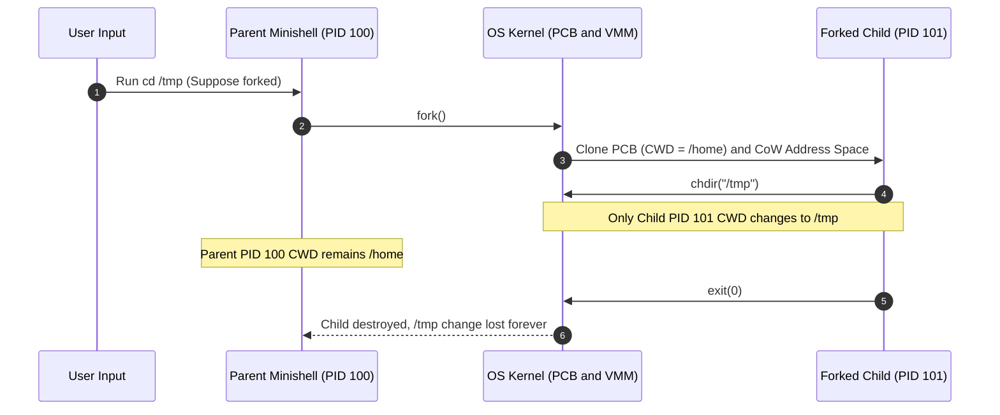
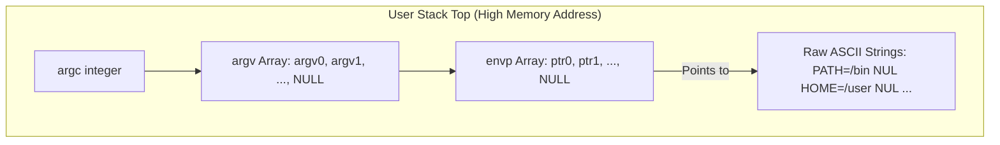

# Deep Dive: 빌트인(Builtin), 가상 메모리 `environ` 레이아웃, 64비트 정수 오버플로 방어

> **Navigation**: [[index|Hub: Index]] | **Architecture**: [[wiki/architecture/04_builtins_and_env_table|Phase 4 Builtins & Env Engine Architecture]]  
> **Related Architecture**: [[wiki/architecture/02_execution_engine_and_ipc|Phase 2 Execution Engine]]  
> **Related Deep Dive**: [[wiki/concepts/deep_dive_process_ipc_and_fd|Process Fork, CoW & FD Table Deep Dive]]  
> **Target Audience**: 시스템 프로그래머, 백엔드 및 OS 인프라 엔지니어  
> **Topic**: 프로세스 유저 스택 환경변수 배치, CoW 격리와 부모 실행 필연성, POSIX 8비트 종료 코드 마스킹 및 UB 없는 정수 파싱

---

## 1. 빌트인(Builtin)의 외부 실행 파일 대체 불가 이유

리눅스/macOS `/bin`, `/usr/bin` 디렉토리에 `echo`, `pwd`, `env` 실행 파일이 존재함에도, 셸 내부 함수(Builtin) 구현 및 특히 `cd`, `export`, `unset`, `exit`의 `fork()` 없는 **부모 셸 프로세스 실행** 이유:  
운영체제 커널이 프로세스에 강제하는 **두 가지 격리(Isolation)** 구조 때문

### 1.1 커널 PCB와 가상 메모리(CoW) 격리 메커니즘



1. **커널 레벨 CWD(Current Working Directory) 격리**:
   - 각 프로세스별 커널 PCB(Process Control Block, 리눅스 `task_struct -> fs -> pwd`) 내 독립적인 현재 작업 디렉토리 VFS Vnode/Inode 포인터 보유
   - 자식 프로세스의 `chdir("/tmp")` 호출 시 커널은 오직 **자식 프로세스(PID 101)의 `fs_struct`**만 변경 (부모 PID 100 작업 디렉토리 불변)
2. **유저 공간 가상 메모리(Copy-on-Write) 격리**:
   - `export`/`unset` 조작 대상 환경변수 테이블은 프로세스 가상 주소 공간(Heap/Stack)에 위치 (이론: [[wiki/concepts/deep_dive_process_ipc_and_fd|CoW 메모리 모델]])
   - 자식의 `export VAR=1` 힙 쓰기 시 CPU MMU의 Page Fault 처리로 자식 전용 물리 페이지 복제 -> 자식 종료 즉시 변경사항 소멸
3. **파이프라인 내부 예외적 역전 현상**:
   - `export A=1 | cat`, `cd /tmp | ls` 등 **파이프라인(`|`) 내부** 빌트인은 Bash 사양상 서브셸(자식 프로세스) 실행 대상
   - **`fork()`된 자식 프로세스 내부 실행**을 통해 `cd`/`export` 부수효과가 부모 셸로 역전파되지 않도록 격리

---

## 2. 프로세스 가상 메모리와 `environ`의 물리적 구조

`execve(pathname, argv, envp)` 시스템 콜을 통한 바이너리 적재 시 OS 커널 ELF/Mach-O 로더가 프로세스 **유저 스택(User Stack) 최상단(High Address)**에 `argv`·`envp` 문자열 데이터 및 포인터 테이블 배치



### 2.1 셸의 `environ` 포인터 배열 비수정 이유
- C 런타임 `envp` 배열은 스택 최상단 연속 포인터 배열로 고정되어 `export`/`unset`마다 전체 배열 재할당 및 문자열 수명 추적 필요
- 스택 포인터(원본 `envp[i]`)와 힙 할당(`malloc`) 포인터 혼재 시 `unset`·종료 과정에서 `free()` 대상 판별 불가 -> **Double Free / Invalid Free 크래시** 위험
- **해결책 (Deep Copy Ownership Pattern)**:
  - `main()` 진입 즉시 모든 `envp` 문자열 `ft_strdup` 힙 복제 -> 셸 소유 연결 리스트(`t_env_node`) 변환 ([[wiki/architecture/04_builtins_and_env_table|Phase 4: t_env_node 아키텍처]])
  - 모든 키/값 문자열의 **단일 소유권(Single Ownership)** 확보로 수정/삭제/종료 시 일관된 `free()` 보장

---

## 3. `exit` 상태 코드의 8비트 모듈러 연산과 64비트 오버플로 방어

### 3.1 `exit 256 -> 0`, `exit -1 -> 255` 변환 원리

POSIX 표준 `waitpid()` 32비트 정수(`int status`) 반환 시 종료 코드(Exit Code) 할당 영역은 **하위 8비트(1 Byte, `0 ~ 255`)**로 제한

- 커널은 자식 `exit(n)` 호출 시 `n & 0xFF` (`unsigned char` 캐스팅 / `n mod 256`) 연산으로 상위 24비트 절사
- 나머지 비트는 시그널 종료 번호(`WTERMSIG`), 코어 덤프 플래그(`WCOREDUMP`), 중단 상태(`WIFSTOPPED`) 기록용으로 예약 (참조: [[wiki/architecture/02_execution_engine_and_ipc|waitpid 종료 상태 비트 추출]])
- `exit 256` -> `256 & 0xFF == 0`, `exit -1` (2의 보수 `0xFFFFFFFF`) -> `0xFF == 255` 도출

### 3.2 C 표준 Undefined Behavior(UB) 없는 64비트 오버플로 검증

Bash `exit` 명령은 64비트 부호 있는 정수(`int64_t`: `-9223372036854775808` ~ `9223372036854775807`) 범위 내 값만 유효 숫자로 인정. 초과 시(`9223372036854775808`, `-9223372036854775809`) `numeric argument required` 에러 및 종료 코드 `2` 반환

`long long` 변수 `acc = acc * 10 + digit` 직접 수행 시 **Signed Integer Overflow (C 표준 Undefined Behavior)** 발생 -> 컴파일러 최적화(`-O2`)에 의한 비교 조건문 제거 위험

**안전한 사전 컷오프(Pre-Overflow Cutoff) 수식**:
1. 부호(`sign`)를 `+1` / `-1` 별도 저장, 누적 계산은 **부호 없는 64비트 정수(`unsigned long long`)** 사용
2. 부호별 최대 절대값 `limit` 설정:
   - `sign == 1`: `limit = (unsigned long long)LLONG_MAX` (`9223372036854775807`)
   - `sign == -1`: `limit = (unsigned long long)LLONG_MAX + 1ULL` (`9223372036854775808`)
3. 다음 자리 `digit` 곱셈·덧셈 **직전** 경계 조건 검사:
   ```c
   cutoff = limit / 10;
   cutlim = limit % 10;
   if (acc > cutoff || (acc == cutoff && (unsigned long long)digit > cutlim))
       return (OVERFLOW_ERROR);
   acc = acc * 10 + digit;
   ```
4. 정수 래핑(Wrap-around) 및 UB 없는 64비트 전 범위 경계값(`LLONG_MAX`, `LLONG_MIN`) 판별

---

## 4. `export` 정렬 출력과 알파벳 순서의 함정

1. **원본 리스트 불변성 유지**:
   - `env`는 등록/상속 순서 그대로 출력, 무인자 `export`는 **ASCII 알파벳 순 정렬** 출력
   - 연결 리스트(`t_env_node`) 자체 링크 변경 시 후속 `env` 출력 순서 훼손 발생
   - `t_env_node *` 포인터 배열(`t_env_node **arr`) 임시 할당 -> 포인터만 정렬·출력 후 즉시 `free(arr)`하는 **비파괴적 View 정렬** 채택
2. **공백 값 및 특수문자 처리**:
   - `export A="hello"` -> `declare -x A="hello"` 형태 출력, `value == NULL` (`export B`) -> `=` 생략한 `declare -x B` 출력

---

## 5. Cross References (상호 참조)
- **아키텍처 설계**: [[wiki/architecture/04_builtins_and_env_table|Phase 4: 7 Builtins & Env Table Architecture]]
- **프로세스 및 FD 모델**: [[wiki/concepts/deep_dive_process_ipc_and_fd|Process Fork, CoW & FD Table Deep Dive]]
- **실행 엔진**: [[wiki/architecture/02_execution_engine_and_ipc|Phase 2: Execution Engine & IPC Pipeline]]
- **요구사항 규격**: [[wiki/requirements/mandatory|Mandatory Spec]]
