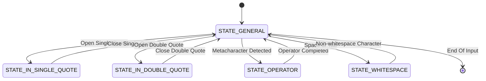
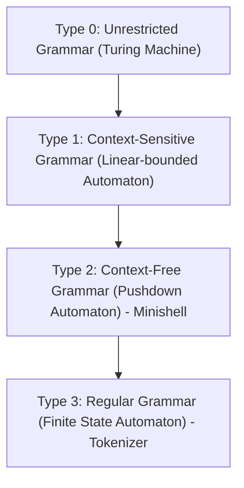
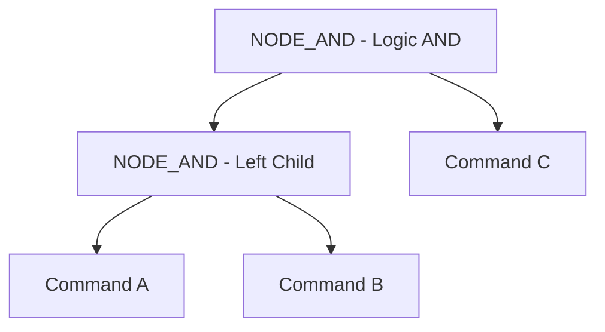

# Deep Dive: Lexer, Parser & AST 이론적 배경 및 논리 구조

> **Navigation**: [[index|Hub: Index]] | **Architecture**: [[wiki/architecture/01_parser_and_ast|Phase 1 Parser & AST Architecture]]  
> **Requirements**: [[wiki/requirements/mandatory|Mandatory Spec]] | [[wiki/requirements/bonus|Bonus Spec]]  
> **Evaluation Checklist**: [[wiki/requirements/evaluation_matrix|Evaluation Matrix]]  
> **Target Audience**: 시스템 프로그래머, 백엔드 엔지니어 지망생  
> **Topic**: 단순 분할(`split`)의 실패 원인과 오토마타·문맥 자유 문법(CFG)의 C 구현 원리

---

## 1. 근본 질문: `ft_split` 기반 셸 구현의 한계

단순 공백 분할 접근:
```c
char **tokens = ft_split(line, ' ');
```
다음 입력 패턴에서 즉시 실패:

1. **따옴표 내부 공백 보존 불가**:
   ```bash
   echo "hello      world"
   ```
   - 따옴표 내부 공백과 명령어 구분 공백 미구분 -> 다중 토큰 오분할
2. **연산자 주변 공백 가변성**:
   ```bash
   ls|grep a
   ls   |   grep a
   cat<file>out
   ```
   - 파이프(`|`), 리다이렉션(`<`, `>`)은 공백 부재 시에도 독립 연산자 토큰 분리 필수
3. **메타문자 문맥 의존성(Context-Sensitivity)**:
   ```bash
   echo "cat | cat" | grep cat
   ```
   - 앞의 `|`는 문자열 리터럴, 뒤의 `|`는 파이프라인 IPC 연산자 -> 단순 `strstr`/패턴 매칭으로 구분 불가
4. **중첩 및 재귀(Recursion) 표현 불가**:
   ```bash
   (ls && (cat file || grep a)) | wc -l
   ```
   - 괄호 중첩 우선순위는 1차원 선형 배열로 표현 불가 -> **트리(Tree)** 또는 **스택(Stack)** 구조 필수

셸 명령어 해석은 단순 문자열 처리가 아닌 **컴파일러 프론트엔드(Compiler Frontend)** 파이프라인([[wiki/architecture/01_parser_and_ast|아키텍처 파이프라인]]) 원리 적용 대상

---

## 2. 어휘 분석(Lexical Analysis) 원리: 결정적 유한 오토마타 (DFA)

어휘 분석기(Lexer / Tokenizer): **문자 스트림(Stream of Characters)** -> **토큰 스트림(Stream of Tokens)** 변환 단계. **결정적 유한 오토마타(DFA)** 상태 머신 기반 구현

### 2.1 Lexer 상태 전이도 (State Transition Diagram)



### 2.2 상태 머신 핵심 규칙 (구현: [[wiki/architecture/01_parser_and_ast|t_token_type 구조체]])
1. **일반 상태 (`STATE_GENERAL`)**:
   - 공백 도달 시 누적 문자를 `TOKEN_WORD`로 확정(Flush)
   - 연산자 메타문자(`|`, `<`, `>`, `&`, `(`, `)`) 도달 시 이전 단어 확정 및 메타문자 분리
   - `&&`, `||`, `>>`, `<<` 등 2글자 연산자는 다음 문자 Lookahead 기반 단일 토큰 결합
2. **싱글 쿼트 상태 (`STATE_IN_SINGLE_QUOTE`)**:
   - 닫는 싱글 쿼트(`'`) 도달 시에만 탈출
   - 내부 모든 문자(공백, `$`, `|`, `"` 등) 리터럴 취급, 토큰 분리 경계 비적용 (참조: [[raw/specs/bash_quoting|Bash Quoting Spec]])
3. **더블 쿼트 상태 (`STATE_IN_DOUBLE_QUOTE`)**:
   - 닫는 더블 쿼트(`"`) 도달 시에만 탈출
   - 공백·`|` 토큰 분리 비적용, **`$` 기호만 후속 확장 대상 마킹**

---

## 3. 문법 이론: 촘스키 계층과 문맥 자유 문법 (CFG)

컴퓨터 과학 **촘스키 계층(Chomsky Hierarchy)** 4단계 분류:



- **Type 3 (정규 문법, Regular Grammar)**:
  - 유한 상태만 기억 가능 (정규표현식, Lexer 해당)
  - **한계**: 유한 메모리로 인해 $a^n b^n$ 형태 짝 맞추기(예: `((( ... )))` 괄호 중첩 깊이) 카운팅 불가
- **Type 2 (문맥 자유 문법, Context-Free Grammar - CFG)**:
  - **스택(Stack)** 또는 **재귀 호출(Recursion)** 활용으로 중첩 구조·연산자 우선순위 처리 가능
  - 42 Minishell Mandatory(파이프라인)는 1차원 리스트 구현도 가능하나, **보너스(`&&`, `||`, `( )`)[[wiki/requirements/bonus|Bonus Spec]] 포함 시 순수 CFG 영역 진입** -> 트리/스택 필수

---

## 4. AST 구축 알고리즘 비교: 재귀 하향 파싱 채택 이유

토큰 스트림 -> 구문 트리(AST) 조립 알고리즘 비교:

### 4.1 다익스트라 셔팅야드 알고리즘 (Shunting-Yard)
- 연산자 스택 + 피연산자 큐 활용 -> 중위 표기법(Infix)을 후위 표기법(Postfix/RPN) 변환 후 트리 구성
- **장점**: 단순 사칙연산 수식 파싱 직관성
- **Minishell 적용 한계**:
  - 명령어 내부 **임의 개수 인자(`argv`)와 리다이렉션 리스트(`redirs`) 혼재**
  - 리다이렉션의 별도 연산자 취급 및 복잡 상태 플래그 추가로 인한 C 코드 복잡도 급증 (42 Norminette 함수 25줄 제한 준수 난이도 상승)

### 4.2 재귀 하향 파싱 (Recursive Descent Parsing)
- EBNF 비단말 기호(Non-terminal)와 C 함수 1:1 매핑 기반 하향식(Top-Down) 파싱
- **장점**:
  1. **문법과 코드 1:1 일치**: `parse_and_or`, `parse_pipeline`, `parse_command` 직접 매핑으로 가독성·유지보수성 확보 ([[wiki/architecture/01_parser_and_ast|파서 구현 로직]])
  2. **모듈성**: 함수당 20줄 내외 구성으로 42 Norminette 규정 충족
  3. **간결한 괄호 서브셸 처리**: `TOKEN_LPAREN`(`(`) 감지 시 최상위 `parse_and_or()` 재귀 호출로 완결
  4. **명확한 구문 오류 보고**: 실패 지점 토큰(`unexpected token`) 특정 용이

---

## 5. 트리의 연산자 결합성과 형상 (Tree Shape)

연산자 결합성에 따른 트리 성장 방향 결정:

### 왼쪽 결합성 (Left-Associativity): `A && B && C`
Bash `&&`, `||`는 왼쪽->오른쪽 결합, 즉 `(A && B) && C` 순서 평가 (참조: [[raw/specs/bash_lists|Bash Lists Spec]])  
트리 구성 시 **왼쪽으로 깊어지는 트리(Left-leaning Tree)** 형성:



- 루트에서 좌측 자식(`L1`) 우선 재귀 평가 ([[wiki/architecture/02_execution_engine_and_ipc|실행 엔진 AST 순회]])
- `L1` 내부 `A` 성공 시 `B` 실행 -> 결과 기반 루트 `C` 실행 여부 결정
- 오른쪽 결합(`A && (B && C)`) 오구성 시 조건부 평가 순서 및 종료 상태 전파 결함 유발

---

## 6. 핵심 함정: 환경변수 확장(Expansion) 타이밍 딜레마

**환경변수 확장의 조기 수행(토크나이징 이전 실행)** 시 발생하는 결함:

### 6.1 조기 확장(Premature Expansion) 예시
`CMD="echo hello | cat"` 환경에서 입력:
```bash
$CMD
```
- **정상 셸(Bash) 동작**:
  - `CMD` 값을 단일 명령어 이름으로 검색 -> `"echo hello | cat"` 실행 파일 탐색 실패 (`command not found`) **파이프라인 분리 금지**
- **조기 확장 셸 오작동**:
  - 문자열 치환 후 파싱 수행 -> `echo hello`와 `cat` 파이프 연결 실행 (Command Injection 보안 취약점 및 스펙 위반)

### 6.2 POSIX Shell 불변 3단계 파이프라인
셸 컴파일 파이프라인 필수 준수 순서:

$$\text{1. 문법 구조 확정 (Lexer/Parser)} \longrightarrow \text{2. 환경변수 확장 (Parameter Expansion)} \longrightarrow \text{3. 단어 분할 및 따옴표 제거 (Word Splitting \& Quote Removal)}$$

1. **파싱 단계**:
   - 문법 구조(파이프, 리다이렉션, 명령어 경계)를 **따옴표 포함 원본 토큰만으로 선행 확정** ([[wiki/architecture/01_parser_and_ast|AST 빌드]])
   - `&#36;VAR` 미치환 상태 유지
2. **실행 직전(Execution) 단계**:
   - 확정된 `NODE_COMMAND`의 `argv`, `redir` 타겟 대상 환경변수 확장 수행 ([[wiki/architecture/02_execution_engine_and_ipc|단일 명령어 실행 엔진]])
   - 확장 결과 내 공백 존재 시에도 파이프/리다이렉션 메타문자로 재해석되지 않음
3. **따옴표 제거**:
   - 확장 완료 후 바깥 따옴표(`'`, `"`) 제거 -> 순수 문자열 `execve` 전달 (평가 검증: [[wiki/requirements/evaluation_matrix|Surprise 따옴표 검증 항목]])
