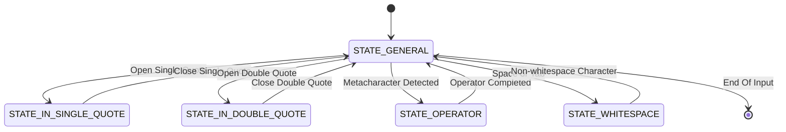
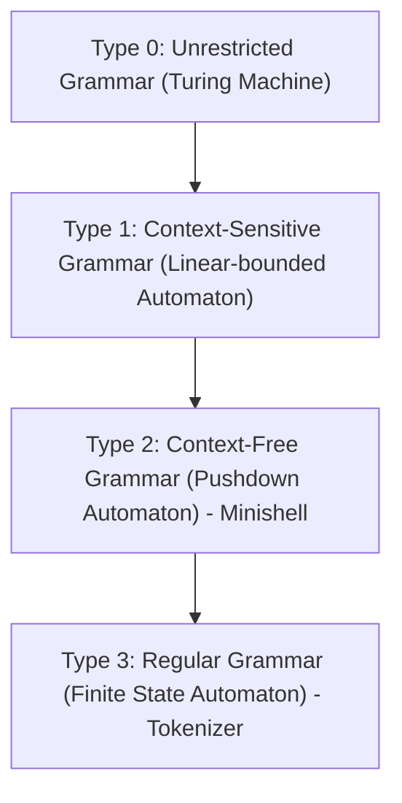
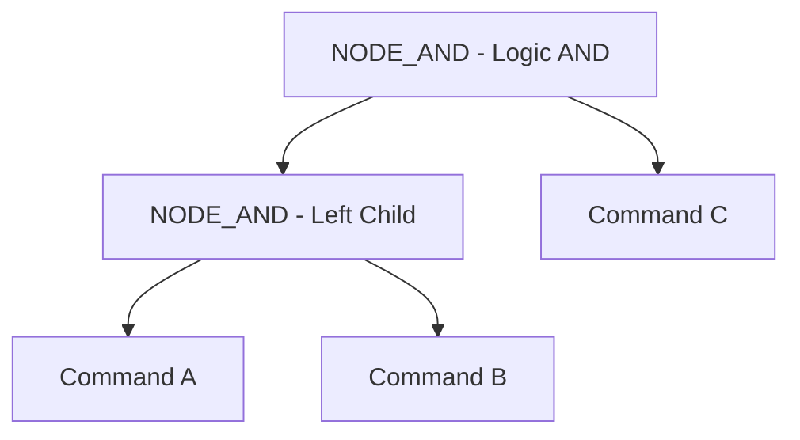

# Deep Dive: Lexer, Parser & AST의 이론적 배경과 논리 구조

> **Navigation**: [[index|Hub: Index]] | **Architecture**: [[wiki/architecture/01_parser_and_ast|Phase 1 Parser & AST Architecture]]  
> **Requirements**: [[wiki/requirements/mandatory|Mandatory Spec]] | [[wiki/requirements/bonus|Bonus Spec]]  
> **Evaluation Checklist**: [[wiki/requirements/evaluation_matrix|Evaluation Matrix]]  
> **Target Audience**: 시스템 프로그래머, 백엔드 엔지니어 지망생  
> **Topic**: 왜 단순 분할(split)은 실패하며, 오토마타와 문맥 자유 문법(CFG)을 어떻게 C 언어로 구현하는가?

---

## 1. 근본적인 질문: 왜 `ft_split`으로는 셸을 만들 수 없는가?

많은 초심자들이 셸 과제를 시작할 때 다음과 같은 나이브(naive)한 접근을 시도합니다:
```c
char **tokens = ft_split(line, ' ');
```
하지만 이 방식은 다음과 같은 입력에서 즉각 파탄에 이릅니다:

1. **따옴표 내부의 공백 보존 불가**:
   ```bash
   echo "hello      world"
   ```
   - `ft_split`은 따옴표 안의 공백과 명령어 구분 공백을 구별하지 못해 여러 토큰으로 찢어버립니다.
2. **연산자 주변 공백의 가변성**:
   ```bash
   ls|grep a
   ls   |   grep a
   cat<file>out
   ```
   - 파이프(`|`)나 리다이렉션(`<`, `>`)은 공백이 없어도 독립된 연산자 토큰으로 분리되어야 합니다.
3. **메타문자의 문맥 의존성(Context-Sensitivity)**:
   ```bash
   echo "cat | cat" | grep cat
   ```
   - 앞의 `|`는 문자열 리터럴이고, 뒤의 `|`는 프로세스 간 파이프라인 IPC 연산자입니다. 단순 패턴 매칭이나 `strstr`로는 둘을 구분할 수 없습니다.
4. **중첩과 재귀(Recursion)의 표현 불가**:
   ```bash
   (ls && (cat file || grep a)) | wc -l
   ```
   - 괄호의 중첩 우선순위는 1차원 선형 배열(Array)로는 표현할 수 없으며, **트리(Tree)** 또는 **스택(Stack)** 구조가 필연적으로 요구됩니다.

따라서 셸 명령어 해석은 단순한 문자열 처리가 아니라 **컴파일러 프론트엔드(Compiler Frontend)** 파이프라인([[wiki/architecture/01_parser_and_ast|아키텍처 파이프라인]])과 동일한 원리로 풀어야 합니다.

---

## 2. 어휘 분석(Lexical Analysis)의 원리: 결정적 유한 오토마타 (DFA)

어휘 분석기(Lexer / Tokenizer)의 목표는 **문자들의 연속(Stream of Characters)**을 의미 있는 **토큰(Stream of Tokens)**으로 변환하는 것입니다.

이 과정은 **결정적 유한 오토마타(Deterministic Finite Automaton, DFA)** 상태 머신으로 가장 안전하고 직관적으로 구현할 수 있습니다.

### 2.1 Lexer 상태 전이도 (State Transition Diagram)



### 2.2 상태 머신의 핵심 규칙 (구현: [[wiki/architecture/01_parser_and_ast|t_token_type 구조체]])
1. **일반 상태 (`STATE_GENERAL`)**:
   - 공백을 만나면 이전까지 누적된 글자들을 하나의 `TOKEN_WORD`로 확정(Flush)합니다.
   - 연산자 메타문자(`|`, `<`, `>`, `&`, `(`, `)`)를 만나면 즉시 이전 단어를 확정하고, 해당 메타문자를 분리합니다.
   - `&&`, `||`, `>>`, `<<`처럼 2글자 연산자는 바로 다음 글자를 미리 내다보는(Lookahead) 논리로 하나의 토큰으로 묶습니다.
2. **싱글 쿼트 상태 (`STATE_IN_SINGLE_QUOTE`)**:
   - 오직 닫는 싱글 쿼트(`'`)를 만났을 때만 빠져나옵니다.
   - 내부의 모든 글자(공백, `$`, `|`, `"` 등)는 순수한 리터럴 문자로 취급되며 토큰 분리 경계가 되지 않습니다. (참조: [[raw/specs/bash_quoting|Bash Quoting Spec]])
3. **더블 쿼트 상태 (`STATE_IN_DOUBLE_QUOTE`)**:
   - 오직 닫는 더블 쿼트(`"`)를 만났을 때만 빠져나옵니다.
   - 공백이나 `|`는 토큰 분리 경계가 되지 않지만, **`$` 기호는 향후 확장될 대상(Expandable)으로 마킹**되어야 합니다.

---

## 3. 문법 이론: 촘스키 계층과 문맥 자유 문법 (CFG)

컴퓨터 과학의 **촘스키 계층(Chomsky Hierarchy)**에 따르면 언어의 문법은 4단계로 분류됩니다:



- **Type 3 (정규 문법, Regular Grammar)**:
  - 유한한 상태만 기억할 수 있습니다.
  - 정규표현식이나 Lexer가 이에 해당합니다.
  - **한계**: $a^n b^n$ 형태의 짝 맞추기(예: `((( ... )))` 괄호의 중첩 깊이)를 카운팅할 수 없습니다. (메모리가 유한하므로)
- **Type 2 (문맥 자유 문법, Context-Free Grammar - CFG)**:
  - **스택(Stack)** 또는 **재귀 호출(Recursion)**을 사용할 수 있어 중첩 구조와 연산자 우선순위를 온전히 처리할 수 있습니다.
  - 42 Minishell의 Mandatory(파이프라인)는 사실상 1차원 리스트로도 편법 구현이 가능하지만, **보너스(`&&`, `||`, 괄호 `( )`)[[wiki/requirements/bonus|Bonus Spec]]가 들어오는 순간 순수한 문맥 자유 문법(CFG)**이 되므로 반드시 트리나 스택을 써야만 합니다.

---

## 4. AST 구축 알고리즘 비교: 왜 재귀 하향 파싱인가?

토큰 스트림을 구문 트리(AST)로 조립하는 대표적인 두 가지 알고리즘이 있습니다:

### 4.1 다익스트라 셔팅야드 알고리즘 (Shunting-Yard)
- 연산자 스택과 피연산자 큐를 사용해 중위 표기법(Infix)을 후위 표기법(Postfix / RPN)으로 변환한 뒤 트리를 구성하는 방식입니다.
- **장점**: 단순 사칙연산 수식 파싱에는 직관적입니다.
- **Minishell 적용 시 단점**:
  - 셸 명령어는 단순 피연산자가 아니라, 명령어 내부에 **임의의 개수의 인자(`argv`)와 리다이렉션 리스트(`redirs`)가 혼합**되어 있습니다.
  - 셔팅야드로 이를 처리하려면 리다이렉션을 별도의 연산자로 취급하거나 복잡한 상태 플래그를 두어야 하므로 C 구현이 극도로 지저분해지고 Norminette(함수당 25줄 제한)를 지키기 매우 어렵습니다.

### 4.2 재귀 하향 파싱 (Recursive Descent Parsing)
- 문법 규칙(EBNF)의 비단말 기호(Non-terminal)를 그대로 하나의 C 함수로 일대일 매핑하는 하향식(Top-Down) 파싱 기법입니다.
- **장점**:
  1. **문법과 코드의 1:1 일치**: 문법 정의를 그대로 C 함수(`parse_and_or`, `parse_pipeline`, `parse_command`)로 옮길 수 있어 가독성과 유지보수성이 크게 높아집니다. ([[wiki/architecture/01_parser_and_ast|파서 구현 로직]])
  2. **모듈성**: 각 함수가 20줄 안팎으로 간결하게 작성되어 42 Norminette 규정을 온전히 만족합니다.
  3. **자연스러운 괄호 서브셸 처리**: `TOKEN_LPAREN`(`(`)을 만나면 단순히 최상위 파서인 `parse_and_or()`를 재귀 호출하면 끝납니다.
  4. **우수한 구문 오류 보고**: 어느 규칙에서 어떤 토큰을 기대하다 실패했는지(`unexpected token`) 명확하게 특정할 수 있습니다.

따라서 백엔드 시스템 및 컴파일러 아키텍처 관점에서 **재귀 하향 파서가 Minishell에 가장 수학적으로 정합하며 우아한 해법**입니다.

---

## 5. 트리의 연산자 결합성과 형상 (Tree Shape)

연산자 결합성에 따라 트리가 자라나는 방향이 결정됩니다:

### 왼쪽 결합성 (Left-Associativity): `A && B && C`
Bash의 `&&`와 `||`는 왼쪽에서 오른쪽으로 묶입니다. 즉 `(A && B) && C`로 평가되어야 합니다. (참조: [[raw/specs/bash_lists|Bash Lists Spec]])
이를 올바르게 트리로 만들면 **왼쪽으로 깊어지는 트리(Left-leaning Tree)**가 형성됩니다:



- 실행 시 루트에서 좌측 자식(`L1`)을 먼저 재귀 평가합니다. ([[wiki/architecture/02_execution_engine_and_ipc|실행 엔진 AST 순회]])
- `L1`에서 `A`를 실행하고 성공하면 `B`를 실행한 뒤, 그 결과에 따라 루트에서 `C`의 실행 여부를 결정합니다.
- 만약 실수로 오른쪽 결합(Right-leaning: `A && (B && C)`)으로 트리를 만들면 조건부 평가 순서와 종료 상태 전파에서 심각한 버그가 발생합니다.

---

## 6. 가장 위험한 함정: 환경변수 확장(Expansion)의 타이밍 딜레마

많은 42 학생들이 겪는 최악의 버그는 **환경변수 확장을 너무 일찍(토크나이징 전) 수행하는 것**입니다.

### 6.1 치명적인 조기 확장(Premature Expansion)의 예
만약 환경변수가 `CMD="echo hello | cat"`일 때, 사용자가 다음과 같이 입력했다고 가정합시다:
```bash
$CMD
```
- **정상적인 셸(Bash)의 동작**:
  - `CMD`를 실행 파일 이름으로 찾습니다. 즉, 이름이 `echo hello | cat`인 명령어를 찾다가 `command not found` 에러가 납니다. **절대로 파이프라인으로 쪼개져서 실행되면 안 됩니다!**
- **조기 확장을 한 잘못된 셸의 동작**:
  - 문자열 치환 후 파싱을 돌려버리면, `echo hello`와 `cat`이 파이프로 연결되어 실행되어 버립니다. 이는 심각한 보안 취약점(Command Injection)이자 셸 스펙 위반입니다.

### 6.2 POSIX Shell의 불변의 3단계 파이프라인
따라서 셸 컴파일 파이프라인은 반드시 다음 순서를 엄격히 지켜야 합니다:

$$\text{1. 문법 구조 확정 (Lexer/Parser)} \longrightarrow \text{2. 환경변수 확장 (Parameter Expansion)} \longrightarrow \text{3. 단어 분할 및 따옴표 제거 (Word Splitting \& Quote Removal)}$$

1. **파싱 단계**:
   - 문법 구조(파이프, 리다이렉션, 명령어 경계)는 **따옴표와 함께 작성된 원본 토큰들만으로 먼저 완전히 확정**합니다. ([[wiki/architecture/01_parser_and_ast|AST 빌드]])
   - 이때 `$VAR`는 아직 풀지 않고 문자열 그대로 토큰에 남겨둡니다.
2. **실행 직전(Execution) 단계**:
   - 확정된 `NODE_COMMAND`의 `argv`와 `redir`의 타겟에 대해서만 환경변수 확장을 수행합니다. ([[wiki/architecture/02_execution_engine_and_ipc|단일 명령어 실행 엔진]])
   - 확장된 결과에 공백이 있더라도, 그것이 파이프나 리다이렉션 같은 문법 연산자로 승격되는 일은 원천적으로 불가능해집니다.
3. **따옴표 제거**:
   - 확장이 끝난 후 비로소 문자열을 감싸고 있던 최종 따옴표(`'`, `"`)를 벗겨내어 순수한 문자열로 `execve`에 넘깁니다. (평가 검증: [[wiki/requirements/evaluation_matrix|Surprise 따옴표 검증 항목]])

이 3단계 분리를 명확히 이해하고 아키텍처에 반영하는 것이 결함 없는 셸을 만드는 핵심 비결입니다.
