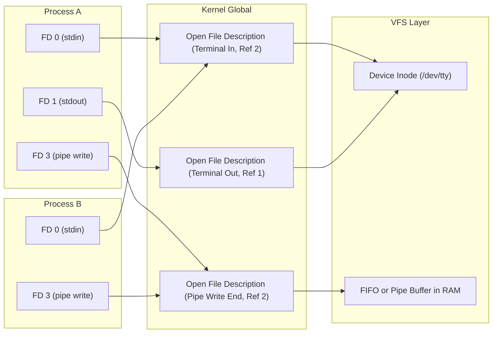

# Deep Dive: 프로세스 생명주기, 파일 디스크립터(FD), 그리고 IPC 파이프라인의 원리

> **Navigation**: [[index|Hub: Index]] | **Architecture**: [[wiki/architecture/02_execution_engine_and_ipc|Phase 2 Execution Engine & IPC]]  
> **Related Architecture**: [[wiki/architecture/03_signal_dispatcher_and_state_machine|Phase 3 Signal Dispatcher]]  
> **Allowed Functions**: [[wiki/concepts/allowed_functions_matrix|Allowed Functions Matrix]]  
> **Target Audience**: 시스템 프로그래머, OS 커널 및 백엔드 인프라 이해를 지향하는 엔지니어  
> **Topic**: `fork()` 시 커널 메모리 모델, 파일 디스크립터 테이블 3단계 구조, 파이프라인 Deadlock(Hang)의 수학적 원인

---

## 1. 운영체제 프로세스 모델과 가상 메모리: `fork()`의 실체

UNIX 계열 운영체제에서 모든 프로세스는 부모-자식의 트리 계층 구조를 형성합니다.

### 1.1 `fork()` 시스템 콜 호출 시 커널 내부 동작
프로세스가 `fork()`([[wiki/concepts/allowed_functions_matrix|fork 시스템 콜]])를 호출하면 Linux/macOS 커널은 다음 작업을 수행합니다:
1. **태스크 구조체(PCB, Process Control Block) 복제**:
   - 자식 프로세스에게 새로운 고유 PID를 부여합니다.
   - 부모의 레지스터 상태, 시그널 마스크, 사용자/그룹 ID, 열린 파일 디스크립터 테이블을 복제합니다.
2. **가상 메모리 주소 공간 복제와 Copy-on-Write (CoW)**:
   - 과거에는 부모의 물리 메모리 전체를 그대로 자식에게 복제(Deep Copy)했으나, 이는 엄청난 메모리 낭비와 지연을 유발했습니다.
   - 현대 OS는 **Copy-on-Write (CoW)** 기법을 사용합니다:
     - 부모와 자식의 가상 메모리 페이지 테이블이 **동일한 물리 메모리 프레임을 가리키도록 설정**하고, 해당 페이지들을 **읽기 전용(Read-Only)**으로 마킹합니다.
     - 부모 또는 자식 중 어느 한쪽이 특정 메모리 페이지에 **쓰기(Write)를 시도하는 순간**, CPU가 페이지 폴트(Page Fault) 예외를 발생시키고 커널이 개입하여 해당 4KB 페이지만을 새로 복제하여 독립적인 쓰기 공간을 제공합니다.

### 1.2 왜 `cd`나 `export`는 자식에서 실행하면 부모에게 전달되지 않는가?
- 자식 프로세스가 `chdir()`를 호출하면 자식 PCB의 `fs_struct->pwd`만 변경됩니다.
- 자식 프로세스가 환경변수를 수정하면 CoW에 의해 자식만의 복제된 메모리 페이지에만 값이 쓰여집니다.
- **부모 프로세스의 메모리와 PCB는 완벽히 격리(Isolation)**되어 있으므로, 셸의 상태(현재 경로, 환경변수)를 바꾸는 빌트인은 **반드시 부모 프로세스 자체에서 직접 실행**되어야만 합니다. (아키텍처 적용: [[wiki/architecture/02_execution_engine_and_ipc|단일 빌트인의 부모 실행]])

---

## 2. 파일 디스크립터(FD) 테이블 3단계 구조

파일 디스크립터(FD)는 단순한 양의 정수(`0, 1, 2, ...`)에 불과하지만, 커널 내부에서는 3단계의 포인터 인디렉션(Indirection)을 거칩니다.



1. **프로세스별 FD 테이블 (`Descriptor Table`)**:
   - 프로세스마다 존재하는 배열입니다. 인덱스가 바로 우리가 아는 `fd` 정수 번호입니다.
   - 각 엔트리는 시스템 전역 **열린 파일 설명(Open File Description)**을 가리키는 포인터입니다.
2. **시스템 전역 열린 파일 설명 테이블 (`Open File Description Table`)**:
   - 시스템 전체에서 현재 열려 있는 파일/파이프의 상태를 저장합니다.
   - **현재 파일 오프셋(File Offset)**, **파일 상태 플래그(O_RDONLY, O_APPEND 등)**, 그리고 **참조 카운트(Reference Count)**를 보유합니다.
3. **VFS Inode 테이블 (`Inode Table`)**:
   - 디스크의 실제 파일 메타데이터(크기, 권한, 디스크 블록 위치) 또는 메모리 상의 IPC 파이프 버퍼를 가리킵니다.

### `dup`과 `dup2`가 실제로 하는 일
- `dup(oldfd)` 또는 `dup2(oldfd, newfd)`는 새로운 파일을 디스크에서 여는 것이 아닙니다.
- 단지 프로세스 FD 테이블의 `newfd` 슬롯이 `oldfd`가 가리키고 있던 동일한 **Open File Description 포인터를 가리키도록 연결**하고, 해당 Open File Description의 **참조 카운트를 1 증가**시키는 시스템 콜입니다. ([[wiki/concepts/allowed_functions_matrix|dup2 시스템 콜]])

---

## 3. 파이프라인 무한 행(Deadlock / Hang)의 수학적 원인: EOF의 법칙

파이프라인(`cat | grep a`)을 구현할 때 학생들이 가장 많이 겪는 결함은 명령어가 끝나지 않고 영원히 멈추는(Hang) 현상입니다. (검증: [[wiki/requirements/evaluation_matrix|평가 매트릭스 Pipes 검증]])

### 3.1 커널의 파이프 버퍼와 EOF(End-Of-File) 조건
- 파이프(`int fd[2]`)는 커널 메모리 내의 원형 큐(Circular Buffer, 기본 64KB)입니다.
- 프로세스가 `read(pipe_read_end, buf, size)`를 호출했을 때:
  1. 버퍼에 읽을 데이터가 있으면: 즉시 데이터를 복사하고 읽은 바이트 수를 반환.
  2. 버퍼가 비어있고, **파이프의 쓰기 끝(`write-end`)을 열어둔 프로세스가 시스템 어딘가에 단 하나라도 존재하면**: "앞으로 데이터가 더 들어올 수 있다"고 판단하여 **블로킹(대기) 상태**에 들어감.
  3. 버퍼가 비어있고, **파이프의 쓰기 끝을 가리키는 모든 Open File Description의 참조 카운트가 정확히 0이 되면**: 커널은 "더 이상 데이터를 쓸 프로세스가 없다"고 확신하고, 비로소 **EOF(0)를 반환**합니다.

### 3.2 Hang이 발생하는 결정적 시나리오
명령어 파이프라인 `cmd1 | cmd2`가 실행될 때:
- 부모 셸이 `pipe(fds)`를 호출하여 파이프를 열었습니다. (`fds[1]`의 참조 카운트 = 1)
- `cmd1`을 포크했습니다. (`fds[1]`의 참조 카운트 = 2)
- `cmd2`를 포크했습니다. (`fds[1]`의 참조 카운트 = 3)
- `cmd1`이 출력을 모두 마치고 `exit(0)`하여 종료했습니다. (`cmd1`이 쥐고 있던 `fds[1]`은 닫힘 -> 참조 카운트 = 2)
- 이제 `cmd2`는 `cmd1`의 출력을 다 읽고 종료되어야 하는데, `read()`에서 멈춰있습니다!
  - **이유**: **부모 셸**과 **`cmd2` 자기 자신**이 `fds[1]`(쓰기 끝)을 닫지 않고 여전히 열어두고 있기 때문입니다! (참조 카운트가 2로 남아있음)
  - `cmd2` 커널은 "아직 쓰기 끝을 쥐고 있는 놈(부모 셸 또는 cmd2)이 있으니 데이터가 또 올 수 있다"고 믿고 영원히 잠들어 버립니다.

### 3.3 해결의 절대 법칙: 엄격한 Close 프로토콜
$$\text{자식은 자신의 stdin/stdout에 연결되지 않은 모든 파이프 FD를 즉시 close해야 한다.}$$
$$\text{부모는 모든 자식을 fork한 즉시 자신이 가진 모든 파이프 FD를 예외 없이 close해야 한다.}$$

이 법칙을 철저히 지켜야만 1번 프로세스가 끝났을 때 쓰기 끝의 참조 카운트가 0이 되어, 다음 프로세스가 정상적으로 EOF를 만나 루프를 빠져나올 수 있습니다. (아키텍처 구현: [[wiki/architecture/02_execution_engine_and_ipc|파이프라인 엔진 FD 라이프사이클]])

---

## 4. 프로세스 동기화: Zombie, Orphan, Concurrency의 본질

### 4.1 Zombie 프로세스의 위험성
- 자식 프로세스가 `exit()`를 호출하면 대부분의 자원(메모리, FD)은 해제되지만, 최소한의 정보(종료 상태 코드, PID, 리소스 사용 통계)가 담긴 PCB 슬롯은 커널에 유지됩니다.
- 부모 프로세스가 `wait()` 또는 `waitpid()`를 호출하여 이 종료 정보를 회수해 가기 전까지의 자식 프로세스 상태를 **좀비(Zombie)**라고 부릅니다.
- 부모가 자식을 `wait`하지 않고 루프를 계속 돌면, 시스템의 PID 테이블이 고갈되어 더 이상 새 프로세스를 생성할 수 없게 됩니다.

### 4.2 직렬 실행(Sequential)의 함정: Concurrency 파괴
일부 잘못된 구현에서는 파이프라인을 루프로 돌면서 다음과 같이 코딩합니다:
```c
/* 잘못된 파이프라인 구현 */
while (cmd) {
    pipe(fd);
    pid = fork();
    if (pid == 0) { ... execve(); }
    waitpid(pid, &status, 0); /* 치명적인 실수! */
    cmd = cmd->next;
}
```
- 한 자식을 포크하고 부모가 바로 `waitpid`로 기다리면, 1번 프로세스가 완전히 죽기 전까지 2번 프로세스는 태어나지도 못합니다.
- 이는 파이프라인의 핵심인 **병렬 스트리밍(Concurrent Streaming)**을 완전히 파괴하는 행위입니다.
- 만약 1번 프로세스가 파이프 버퍼(64KB)보다 큰 대용량 데이터를 쓰려고 하면, 읽어줄 2번 프로세스가 아직 실행되지 않았으므로 1번 프로세스는 `write()`에서 멈추고 부모는 `waitpid`에서 멈추어 **영구적인 교착 상태(Deadlock)**에 빠집니다.

### 4.3 올바른 파이프라인 동기화 패턴
1. **Phase 1: 모든 파이프와 모든 자식 프로세스를 한 번에 연쇄 생성 (`fork` Fan-out)**.
2. **Phase 2: 부모가 소유한 파이프 FD 전수 회수 (`close`)**.
3. **Phase 3: 모든 자식 프로세스가 종료될 때까지 `waitpid`로 차례대로 수거 (`waitpid` Fan-in)**.
4. **Phase 4: 파이프라인의 맨 마지막 자식 프로세스의 종료 상태를 추출하여 `$?`에 세팅**. (연계: [[wiki/architecture/03_signal_dispatcher_and_state_machine|종료 상태 동기화]])

이 패턴이 UNIX 시스템 프로그래밍의 정석이며, 어떠한 대용량 파이프라인 입력에서도 교착 상태 없는 완벽한 동시성을 보장합니다.
