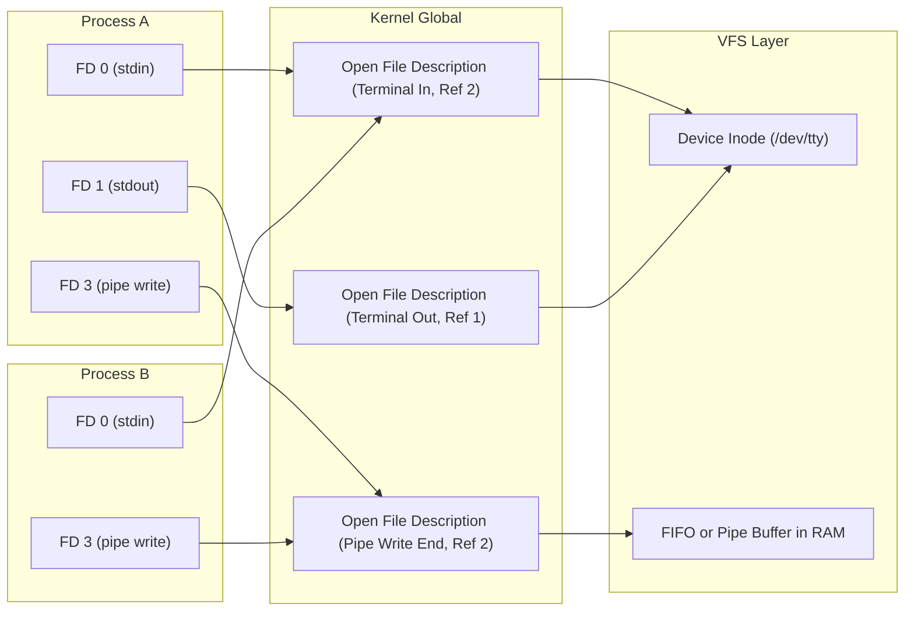

# Deep Dive: 프로세스 생명주기, 파일 디스크립터(FD), IPC 파이프라인 원리

> **Navigation**: [[index|Hub: Index]] | **Architecture**: [[wiki/architecture/02_execution_engine_and_ipc|Phase 2 Execution Engine & IPC]]  
> **Related Architecture**: [[wiki/architecture/03_signal_dispatcher_and_state_machine|Phase 3 Signal Dispatcher]]  
> **Allowed Functions**: [[wiki/concepts/allowed_functions_matrix|Allowed Functions Matrix]]  
> **Target Audience**: 시스템 프로그래머, OS 커널 및 백엔드 인프라 엔지니어  
> **Topic**: `fork()` 커널 메모리 모델, FD 테이블 3단계 구조, 파이프라인 Deadlock(Hang)의 수학적 원인

---

## 1. 운영체제 프로세스 모델과 가상 메모리: `fork()`의 실체

UNIX 계열 OS 프로세스 전체의 부모-자식 트리 계층 구조 형성

### 1.1 `fork()` 시스템 콜 호출 시 커널 내부 동작
`fork()`([[wiki/concepts/allowed_functions_matrix|fork 시스템 콜]]) 호출 시 Linux/macOS 커널 동작:
1. **태스크 구조체(PCB, Process Control Block) 복제**:
   - 자식 프로세스 고유 PID 할당
   - 부모 레지스터 상태, 시그널 마스크, 사용자/그룹 ID, 열린 파일 디스크립터 테이블 복제
2. **가상 메모리 주소 공간 복제 및 Copy-on-Write (CoW)**:
   - 물리 메모리 전체 즉시 복제(Deep Copy) 대신 지연 복제 방식 사용
   - **Copy-on-Write (CoW)**:
     - 부모·자식 가상 메모리 페이지 테이블이 **동일 물리 프레임 참조**, 해당 페이지 **읽기 전용(Read-Only)** 마킹
     - 어느 한쪽의 메모리 페이지 **쓰기(Write) 시도 순간** CPU Page Fault 예외 발생 -> 커널 개입 후 해당 4KB 페이지만 복제하여 독립 쓰기 공간 제공

### 1.2 `cd`/`export`의 자식 실행 시 부모 비전파 이유
- 자식 `chdir()` 호출 시 자식 PCB의 `fs_struct->pwd`만 변경
- 자식 환경변수 수정 시 CoW에 의해 자식 복제 페이지에만 기록
- **부모 메모리·PCB 완전 격리(Isolation)** -> 셸 상태 변경 빌트인의 **부모 프로세스 직접 실행 필수** (아키텍처 적용: [[wiki/architecture/02_execution_engine_and_ipc|단일 빌트인의 부모 실행]])

---

## 2. 파일 디스크립터(FD) 테이블 3단계 구조

단순 양의 정수(`0, 1, 2, ...`)인 FD 번호의 커널 내부 3단계 포인터 인디렉션(Indirection) 구조



1. **프로세스별 FD 테이블 (`Descriptor Table`)**:
   - 프로세스마다 존재하는 배열 (인덱스 = `fd` 정수 번호)
   - 각 엔트리는 시스템 전역 **열린 파일 설명(Open File Description)** 포인터 보유
2. **시스템 전역 열린 파일 설명 테이블 (`Open File Description Table`)**:
   - 시스템 전체 현재 열린 파일/파이프 상태 저장
   - **현재 파일 오프셋(File Offset)**, **상태 플래그(O_RDONLY, O_APPEND 등)**, **참조 카운트(Reference Count)** 보유
3. **VFS Inode 테이블 (`Inode Table`)**:
   - 디스크 실제 파일 메타데이터(크기, 권한, 디스크 블록) 또는 RAM 상 IPC 파이프 버퍼 지칭

### `dup`과 `dup2`의 실제 동작
- 디스크 파일 신규 오픈이 아닌 FD 슬롯 복제 연산
- 프로세스 FD 테이블 `newfd` 슬롯이 `oldfd`의 **Open File Description 포인터 공유** + **참조 카운트 1 증가** ([[wiki/concepts/allowed_functions_matrix|dup2 시스템 콜]])

---

## 3. 파이프라인 무한 행(Deadlock / Hang)의 수학적 원인: EOF의 법칙

파이프라인(`cat | grep a`) 구현 시 빈번한 무한 대기(Hang) 현상의 커널 수준 원인 (검증: [[wiki/requirements/evaluation_matrix|평가 매트릭스 Pipes 검증]])

### 3.1 커널 파이프 버퍼와 EOF(End-Of-File) 조건
- 파이프(`int fd[2]`): 커널 메모리 내 원형 큐(Circular Buffer, 기본 64KB)
- `read(pipe_read_end, buf, size)` 호출 시 분기:
  1. 버퍼 내 데이터 존재 시 즉시 복사 및 읽은 바이트 수 반환
  2. 버퍼 공백 + **쓰기 끝(`write-end`)을 열어둔 프로세스 1개 이상 잔존 시**: 추가 데이터 유입 가능성으로 판단 -> **블로킹(대기) 상태 진입**
  3. 버퍼 공백 + **쓰기 끝 Open File Description 참조 카운트 == 0 달성 시**: 추가 쓰기 불가능 확정 -> **EOF(0) 반환**

### 3.2 Hang 발생 결정적 시나리오
파이프라인 `cmd1 | cmd2` 실행 과정:
- 부모 셸 `pipe(fds)` 호출 (`fds[1]` 참조 카운트 = 1)
- `cmd1` 포크 (`fds[1]` 참조 카운트 = 2)
- `cmd2` 포크 (`fds[1]` 참조 카운트 = 3)
- `cmd1` 출력 완료 및 `exit(0)` (`cmd1`의 `fds[1]` 종료 -> 참조 카운트 = 2)
- `cmd2`의 입력 소비 완료 후에도 `read()` 블록 지속:
  - **원인**: **부모 셸**과 **`cmd2` 자기 자신**의 `fds[1]`(쓰기 끝) 미해제 (참조 카운트 = 2 잔존)
  - 커널은 쓰기 끝 보유 프로세스 잔존을 근거로 `cmd2`를 무기한 대기 상태로 유지

### 3.3 해결 절대 법칙: 엄격한 Close 프로토콜
$$\text{자식은 stdin/stdout 외 미연결 파이프 FD 전부 즉시 close 필수}$$
$$\text{부모는 모든 자식 fork 직후 보유 파이프 FD 예외 없이 전부 close 필수}$$

규칙 준수 시 1번 프로세스 종료와 동시에 쓰기 끝 참조 카운트 0 도달 -> 후속 프로세스 정상 EOF 수신 및 종료 (아키텍처 구현: [[wiki/architecture/02_execution_engine_and_ipc|파이프라인 엔진 FD 라이프사이클]])

---

## 4. 프로세스 동기화: Zombie, Orphan, Concurrency 본질

### 4.1 Zombie 프로세스 위험성
- 자식 `exit()` 후 메모리·FD는 해제되나 종료 상태·PID·리소스 통계용 PCB 슬롯은 커널에 잔존
- 부모 `wait()` / `waitpid()` 수거 전까지 **좀비(Zombie)** 상태 유지
- 미수거 누적 시 시스템 PID 테이블 고갈 -> 신규 프로세스 생성 불가

### 4.2 직렬 실행(Sequential) 함정: Concurrency 파괴
잘못된 파이프라인 루프 예시:
```c
/* 잘못된 파이프라인 구현 */
while (cmd) {
    pipe(fd);
    pid = fork();
    if (pid == 0) { ... execve(); }
    waitpid(pid, &status, 0); /* 치명적인 실수! */
    cmd = cmd->next;
}
```
- 자식 포크 직후 부모가 즉시 `waitpid` 대기 시 1번 종료 전까지 2번 미생성 -> **병렬 스트리밍(Concurrent Streaming) 파괴**
- 1번 프로세스가 64KB 초과 데이터 기록 시 수신측 2번 미실행 상태로 `write()`·`waitpid` 상호 교착(Deadlock)

### 4.3 올바른 파이프라인 동기화 패턴
1. **Phase 1**: 모든 파이프 및 자식 프로세스 일괄 연쇄 생성 (`fork` Fan-out)
2. **Phase 2**: 부모 소유 파이프 FD 전수 회수 (`close`)
3. **Phase 3**: 모든 자식 종료까지 `waitpid` 순차 수거 (`waitpid` Fan-in)
4. **Phase 4**: 마지막 자식 종료 상태 추출 후 `&#36;?` 세팅 (연계: [[wiki/architecture/03_signal_dispatcher_and_state_machine|종료 상태 동기화]])

대용량 파이프라인 입력에서도 교착 없는 동시성 보장
