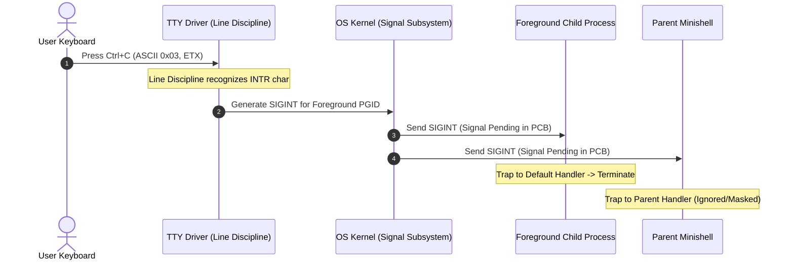

# Deep Dive: 비동기 시그널(Signal), 재진입성(Reentrancy), 그리고 프로세스 그룹 제어

> **Target Audience**: 시스템 프로그래머, 백엔드 및 분산 시스템 엔지니어  
> **Topic**: 하드웨어 인터럽트에서 소프트웨어 시그널까지의 여정, 비동기 시그널 안전성, Self-Deadlock의 원리

---

## 1. 시그널의 본질: 소프트웨어 인터럽트의 생명주기

시그널(Signal)은 커널이 프로세스에게 비동기적으로 사건(Event)을 통지하는 **소프트웨어 인터럽트(Software Interrupt)** 메커니즘입니다.

### 1.1 `Ctrl + C`가 프로세스에 도달하는 물리적 경로



1. **하드웨어 입력**: 사용자가 키보드로 `Ctrl+C`를 누르면 키보드 컨트롤러가 CPU 인터럽트를 발생시키고, OS의 TTY 드라이버(Line Discipline)로 문자 코드 `0x03`이 전송됩니다.
2. **인터럽트 문자 감지**: Line Discipline은 `0x03`이 제어 문자 `INTR`임을 인식하고, 터미널의 현재 **포그라운드 프로세스 그룹(Foreground Process Group)** 전체에 `SIGINT` 시그널을 발행하도록 커널에 요청합니다.
3. **시그널 펜딩(Pending)**: 커널은 해당 프로세스들의 PCB(Task Struct) 내 `sigpending` 비트마스크에 `SIGINT` 비트를 1로 설정합니다.
4. **시그널 디스패치(Dispatch)**: 프로세스가 커널 모드(시스템 콜 수행 중 등)에서 **유저 모드로 복귀(Return from Trap)하는 바로 그 순간**, 커널이 펜딩된 시그널을 검사하고, 유저 스택 프레임을 변조하여 미리 등록된 **시그널 핸들러 함수로 점프(Trap)**시킵니다.

---

## 2. 비동기 시그널 안전성 (Async-Signal-Safety)과 재진입성 (Reentrancy)

시그널 핸들러를 작성할 때 주니어 엔지니어들이 가장 많이 저지르는 치명적인 실수는 **핸들러 내부에서 `printf`, `malloc`, `free`를 호출하는 것**입니다.

### 2.1 Self-Deadlock의 메커니즘
프로세스가 힙 메모리를 할당하기 위해 `malloc()`을 호출했다고 가정합시다:
```
[User Thread]
1. malloc(1024) 호출
2. 힙 메모리 관리자 내부의 글로벌 뮤텍스 락(Lock) 획득
   --------------------> [갑자기 키보드에서 Ctrl+C 시그널 발생!]
3. CPU가 즉시 User Thread의 실행을 중단하고 시그널 핸들러로 점프
   [Signal Handler]
4. printf("Ctrl+C pressed!\n") 또는 free(ptr) 호출
5. printf/free 내부에서 또다시 힙 할당기 락(Lock) 획득 시도!
6. 이미 2번에서 자기가 락을 쥐고 있으므로 영원히 대기 (Deadlock!)
   ===> 프로그램이 영원히 멈추고 크래시 발생!
```

이것이 바로 **재진입 불가(Non-Reentrant)** 함수를 시그널 핸들러에서 호출했을 때 발생하는 **자기 교착 상태(Self-Deadlock)**입니다.

### 2.2 POSIX 비동기 시그널 안전 함수(Async-Signal-Safe Functions)란?
- 시그널 핸들러가 언제 어떤 코드의 실행 도중에 끼어들더라도(Interleaved execution), 데이터 오염이나 락 경합 없이 **안전하게 완료될 수 있는 함수**를 의미합니다.
- **특징**: 내부적으로 글로벌 정적 버퍼를 쓰지 않으며, 뮤텍스 락을 잡지 않고, 상태를 가지지 않는 원자적 시스템 콜(`write`, `close`, `dup2`, `sigaction` 등)입니다.
- **Minishell의 예외**: 서브젝트에서 허용해 준 `rl_on_new_line`, `rl_replace_line`, `rl_redisplay`는 Readline 라이브러리 함수지만 42 과제의 대화형 프롬프트 시그널 재출력을 위해 특별히 공식 허용된 케이스입니다.

---

## 3. `volatile sig_atomic_t`의 하드웨어/컴파일러 관점의 본질

Minishell 전역 변수는 왜 반드시 `volatile sig_atomic_t`로 선언해야 하는가?

```c
volatile sig_atomic_t g_signal_num = 0;
```

### 3.1 `sig_atomic_t`: 원자적 연산 보장
- 32비트 또는 64비트 CPU에서, 크기가 큰 구조체나 64비트 정수를 32비트 아키텍처에서 수정할 때는 CPU 인스트럭션이 2번에 걸쳐 실행될 수 있습니다(예: 상위 32비트 쓰기 후 하위 32비트 쓰기).
- 만약 상위 32비트를 쓴 직후 시그널이 끼어들면 데이터가 찢어지는(Torn Read/Write) 오염이 발생합니다.
- `sig_atomic_t`는 **단 하나의 CPU 머신 인스트럭션(Single CPU Instruction)으로 완전히 읽거나 쓸 수 있음이 보장되는 정수 타입**입니다.

### 3.2 `volatile`: 컴파일러 최적화 방지
현대 컴파일러는 루프 최적화 시 변수를 레지스터에 올려두고 캐싱합니다:
```c
while (g_signal_num == 0) {
    /* do something */
}
```
- 만약 `volatile`이 없으면, 컴파일러는 "루프 내부에서 `g_signal_num`을 변경하는 코드가 없네?"라고 판단하여 `g_signal_num`을 CPU 레지스터에 캐싱해버립니다.
- 시그널 핸들러가 메모리 상의 `g_signal_num`을 `SIGINT`로 바꿔도, 메인 루프는 레지스터의 옛날 값(0)만 계속 바라보므로 **루프를 영원히 탈출하지 못하는 버그**가 생깁니다.
- `volatile` 키워드는 컴파일러에게 **"이 변수는 하드웨어나 비동기 루틴에 의해 언제든 바뀔 수 있으니 절대 레지스터에 캐싱하지 말고, 매번 실제 메모리 주소에서 직접 읽어라"**고 강제합니다.

---

## 4. 시스템 콜 인터럽트와 `EINTR`의 딜레마

프로세스가 `read(STDIN_FILENO, buf, 1024)`나 `waitpid(pid, &status, 0)`처럼 무기한 대기하는 **슬로 시스템 콜(Slow System Call)**을 수행 중일 때 시그널이 도착하면 커널은 어떻게 하는가?

### 4.1 `EINTR` 에러의 발생
- 커널은 대기 중이던 시스템 콜을 즉시 중단하고, 시그널 핸들러를 실행한 뒤, 해당 시스템 콜이 `-1`을 반환하도록 만듭니다.
- 이때 전역 에러 변수 `errno`는 `EINTR` (Interrupted system call)로 세팅됩니다.

### 4.2 `SA_RESTART` 플래그의 명암
- `sigaction` 등록 시 `sa_flags = SA_RESTART`를 주면:
  - 시스템 콜이 시그널에 의해 중단되어도 커널이 핸들러 실행 후 **해당 시스템 콜을 자동으로 재시작(Restart)**합니다.
- **Minishell에서의 선택**:
  - 대화형 셸의 `readline()`이나 `Here-doc` 입력 대기 중에 `Ctrl+C`가 들어왔을 때는 **대기를 즉시 깨고 빠져나와야** 합니다. 따라서 이때는 `SA_RESTART`를 끄거나, Readline의 이벤트 루프 플래그를 정교하게 제어해야 프롬프트 멈춤 현상을 방지할 수 있습니다.

---

## 5. 포그라운드 프로세스 그룹과 시그널 브로드캐스팅

대화형 셸에서 명령어를 실행할 때:
```bash
minishell$ cat
```
이 상태에서 사용자가 `Ctrl+C`를 누르면 어떤 일이 일어나는가?

- 터미널 드라이버는 터미널에 연결된 포그라운드 프로세스 그룹의 모든 프로세스에게 `SIGINT`를 동시 브로드캐스트합니다.
- 즉, **`cat` 프로세스뿐만 아니라 부모인 `minishell` 프로세스도 동일한 `SIGINT`를 수신**합니다!

### 부모 셸의 방어 전략:
1. 만약 부모 셸도 대화형 핸들러(`handle_sigint_interactive`)를 켜둔 채로 자식을 기다리면:
   - `cat`도 죽고, 부모도 새 프롬프트를 화면에 뿌려버려 **프롬프트가 2중으로 겹치거나 화면이 깨지는 레이스 컨디션**이 발생합니다.
2. 따라서 부모 셸은 자식을 `fork`한 직후, 자신의 시그널 처리를 `SIG_IGN`(무시)으로 변경하고 오직 `waitpid()`를 통해서만 자식의 종료 상태(`WIFSIGNALED`, `WTERMSIG`)를 관찰해야 합니다.
3. 자식이 시그널로 죽었음이 확인되면 비로소 부모 셸은 개행(`\n`)을 한 번 출력하고 종료 코드를 $128 + 2 = \mathbf{130}$으로 설정한 뒤 대화형 모드로 복귀합니다.

이것이 Bash가 구현하고 있는 완벽한 시그널 제어의 표준 아키텍처입니다.
