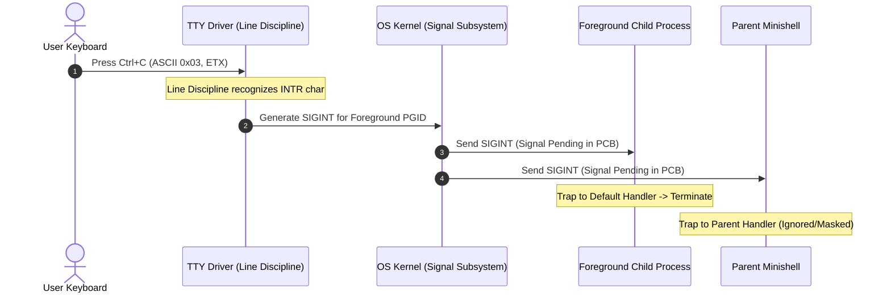

# Deep Dive: 비동기 시그널(Signal), 재진입성(Reentrancy), 프로세스 그룹 제어

> **Navigation**: [[index|Hub: Index]] | **Architecture**: [[wiki/architecture/03_signal_dispatcher_and_state_machine|Phase 3 Signal Dispatcher Architecture]]  
> **Related Architecture**: [[wiki/architecture/02_execution_engine_and_ipc|Phase 2 Execution Engine & Waitpid]]  
> **Allowed Functions**: [[wiki/concepts/allowed_functions_matrix|Allowed Functions Matrix]]  
> **Target Audience**: 시스템 프로그래머, 백엔드 및 분산 시스템 엔지니어  
> **Topic**: 하드웨어 인터럽트~소프트웨어 시그널 경로, 비동기 시그널 안전성, Self-Deadlock 원리

---

## 1. 시그널의 본질: 소프트웨어 인터럽트 생명주기

커널이 프로세스에게 비동기 사건(Event)을 통지하는 **소프트웨어 인터럽트(Software Interrupt)** 메커니즘

### 1.1 `Ctrl + C`의 프로세스 도달 물리 경로



1. **하드웨어 입력**: `Ctrl+C` 입력 -> 키보드 컨트롤러 CPU 인터럽트 발생 -> OS TTY 드라이버(Line Discipline)로 `0x03` 전송
2. **인터럽트 문자 감지**: Line Discipline의 `INTR` 제어 문자 인식 -> 현재 터미널 **포그라운드 프로세스 그룹(Foreground Process Group)** 전체에 `SIGINT` 발행 요청
3. **시그널 펜딩(Pending)**: 커널이 대상 프로세스 PCB(`task_struct`) 내 `sigpending` 비트마스크 `SIGINT` 비트 `1` 설정
4. **시그널 디스패치(Dispatch)**: 프로세스의 커널 모드 -> **유저 모드 복귀(Return from Trap) 순간**, 펜딩 시그널 확인 및 유저 스택 프레임 변조로 등록된 **시그널 핸들러 점프(Trap)** (구현: [[wiki/architecture/03_signal_dispatcher_and_state_machine|sigaction 핸들러]])

---

## 2. 비동기 시그널 안전성 (Async-Signal-Safety) & 재진입성 (Reentrancy)

핸들러 내부 **`printf`, `malloc`, `free` 호출 금지의 근거**

### 2.1 Self-Deadlock 메커니즘
힙 메모리 할당 중(`malloc()`) 시그널 발생 시나리오:
```
[User Thread]
1. malloc(1024) 호출
2. 힙 메모리 관리자 내부의 글로벌 뮤텍스 락(Lock) 획득
   --------------------> [갑자기 키보드에서 Ctrl+C 시그널 발생!]
3. CPU가 즉시 User Thread의 실행을 중단하고 시그널 핸들러로 점프
   [Signal Handler]
4. printf("Ctrl+C pressed!\n") 또는 free(ptr) 호출
5. printf/free 내부에서 또다시 힙 할당기 락(Lock) 획득 시도!
6. 이미 2번에서 자기가 락을 쥐고 있으므로 영원히 대기 (Deadlock!)
   ===> 프로그램이 영원히 멈추고 크래시 발생!
```

**재진입 불가(Non-Reentrant)** 함수를 핸들러에서 호출할 때 발생하는 **자기 교착 상태(Self-Deadlock)**

### 2.2 POSIX 비동기 시그널 안전 함수(Async-Signal-Safe Functions)
- 임의 실행 시점에 끼어들더라도(Interleaved execution) 데이터 오염·락 경합 없이 완료 보장되는 함수군
- **특징**: 내부 전역 정적 버퍼·뮤텍스 미사용, 무상태 원자적 시스템 콜(`write`, `close`, `dup2`, `sigaction` 등) (전수 목록: [[wiki/concepts/allowed_functions_matrix|허용 함수 매트릭스 Safety 판정]])
- **Minishell 예외**: `rl_on_new_line`, `rl_replace_line`, `rl_redisplay`는 Readline 함수이나 과제 대화형 프롬프트 재출력 목적상 공식 허용

---

## 3. `volatile sig_atomic_t`의 하드웨어/컴파일러 본질

단일 전역 변수의 `volatile sig_atomic_t` 선언 이유 (아키텍처 규격: [[wiki/architecture/03_signal_dispatcher_and_state_machine|단일 전역 변수 선언]])

```c
volatile sig_atomic_t g_signal_num = 0;
```

### 3.1 `sig_atomic_t`: 원자적 연산 보장
- 32/64비트 CPU에서 비원자적 크기의 구조체·정수 수정 시 2회 이상 메모리 접근 분할 가능 (상위/하위 비트 분리 쓰기)
- 분할 쓰기 중간에 시그널 개입 시 Torn Read/Write 오염 발생
- `sig_atomic_t`: **단일 CPU 머신 인스트럭션으로 읽기/쓰기 완료가 보장되는 정수 타입**

### 3.2 `volatile`: 컴파일러 최적화 방지
컴파일러의 루프 레지스터 캐싱 최적화 사례:
```c
while (g_signal_num == 0) {
    /* do something */
}
```
- `volatile` 누락 시 컴파일러가 루프 내 `g_signal_num` 변경 부재로 판단해 CPU 레지스터 캐싱 수행
- 핸들러의 메모리 갱신 후에도 메인 루프는 캐시 값(0)만 참조 -> **무한 루프 결함**
- `volatile`: 비동기 변경 가능성 고지로 레지스터 캐싱 금지 및 매 접근 시 실제 메모리 주소 직접 참조 강제

---

## 4. 시스템 콜 인터럽트와 `EINTR` 딜레마

`read`, `waitpid` 등 무기한 대기형 **슬로 시스템 콜(Slow System Call)** 수행 중 시그널 도착 시 커널 처리:

### 4.1 `EINTR` 에러 발생
- 대기 중 시스템 콜 즉시 중단 -> 시그널 핸들러 실행 -> 시스템 콜 `-1` 반환
- 전역 `errno` = `EINTR` (Interrupted system call) 설정

### 4.2 `SA_RESTART` 플래그 선택
- `sa_flags = SA_RESTART`: 핸들러 종료 후 중단되었던 시스템 콜 자동 재시작
- **Minishell 선택**:
  - 대화형 `readline()` 또는 `Here-doc` 대기 중 `Ctrl+C` 유입 시 **대기 상태 즉시 탈출 필수** -> `SA_RESTART` 미설정 및 Readline 이벤트 루프 플래그 제어로 프롬프트 멈춤 방지 (아키텍처: [[wiki/architecture/03_signal_dispatcher_and_state_machine|대화형 시그널 플래그]])

---

## 5. 포그라운드 프로세스 그룹과 시그널 브로드캐스팅

대화형 `cat` 실행 중:
```bash
minishell$ cat
```
`Ctrl+C` 입력 시 터미널 드라이버 동작:
- 포그라운드 프로세스 그룹 내 모든 프로세스에 `SIGINT` 동시 브로드캐스트
- **`cat` 프로세스뿐 아니라 부모 `minishell`도 동일 `SIGINT` 수신**

### 부모 셸 방어 전략:
1. 부모 셸이 대화형 핸들러(`handle_sigint_interactive`) 유지 상태로 자식 대기 시 `cat` 종료와 동시에 새 프롬프트 중복 출력 -> **프롬프트 2중 겹침 및 레이스 컨디션** 발생
2. 부모 셸은 `fork` 직후 `SIG_IGN`(무시) 전환 후 `waitpid()`([[wiki/architecture/02_execution_engine_and_ipc|실행 엔진 wait_pipeline]])로만 자식 종료 상태(`WIFSIGNALED`, `WTERMSIG`) 관찰
3. 자식의 시그널 종료 확인 시 개행(`\n`) 1회 출력 및 종료 코드 $128 + 2 = \mathbf{130}$ 설정 후 대화형 모드 복귀 ([[raw/specs/bash_signals|Bash Signals Spec]] 표준 동작)
