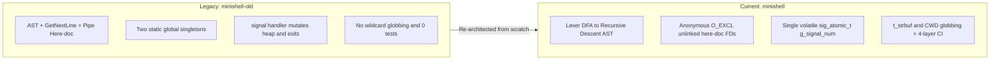

# Legacy Comparison Retrospective: `minishell-old` vs `minishell`

> **Navigation**: [[index|Hub: Index]] | [[CLAUDE|Schema & Rules]] | [[roadmap_and_issues|Dual-Repo Roadmap]]  
> **Related Specs**: [[evaluation_matrix|Evaluation Matrix]] | [[allowed_functions_matrix|Allowed Functions Matrix]] | [[github_engineering_standards|GitHub Engineering Standards]]  
> **Reference Implementation**: `42GS/minishell` (`main` @ `7d231e4`) vs Archived Legacy `42GS/minishell-old`

---

## 1. Executive Summary

본 문서는 `42GS/minishell`이 Mandatory, 코드 리뷰 안정화(`#41`~`#45`), Bonus(`#31`, `#32`), 그리고 13종 Valgrind 메모리·FD QA 게이트(`#33` PR `#53`)를 100% 통과한 직후, 봉인 규칙([[CLAUDE]] Section 1.1)을 해제하고 과거 구현(`42GS/minishell-old.git`)과 정량적·정성적으로 대조한 최종 엔지니어링 회고 보고서입니다.

핵심 성과로 프로덕션 코어 코드 규모를 **`7,883` LOC에서 `3,896` LOC(`-50.6%`)** 로 절반 가까이 축소하면서도, 5대 E2E 차등 스위트 통과율을 **`20/37 (54.1%, 3 timeouts)`에서 `37/37 (100.0%, 0 crashes, 0 timeouts)`** 로 끌어올렸으며, 금지 외부 심볼과 숨겨진 전역 싱글턴 의존성을 완전히 제거했습니다.

---

## 2. Quantitative Comparison (정량 비교)

두 저장소의 실제 소스 트리, 컴파일 심볼(`nm -u`, `nm -g`), 42evalhub 차등 스위트(5개 JSON, 총 37개 케이스, `LC_ALL=C` 기준 Bash 1:1 대조)를 동일 머신에서 직접 계측한 결과입니다.

| 지표 (Metric) | `minishell-old` (Legacy) | `minishell` (New) | 변화 / 개선율 |
| :--- | :--- | :--- | :--- |
| **전체 프로덕션 코드 (`libft` 포함)** | 110 `.c` / 13 `.h` (`9,283` LOC) | 51 `.c` / 7 `.h` (`4,476` LOC) | **-51.8% LOC** |
| **코어 코드 (`libft` 제외)** | 66 `.c` / 12 `.h` (`7,883` LOC) | 39 `.c` / 6 `.h` (`3,896` LOC) | **-50.6% LOC** |
| **전체 함수 수 / Norm 준수** | 263개 (25줄/5함수 초과 0건) | 189개 (25줄/5함수 초과 0건) | **-28.1% 함수 수**, 42 Norm 100% |
| **전역 상태 관리 (`nm -g`)** | 숨겨진 `static` 싱글턴 2개 (`shell_data`, `shell_input`) | 단일 `volatile sig_atomic_t g_signal_num` 1개 | **서브젝트 단일 전역변수 제약 100% 준수** |
| **외부 심볼 준수 (`nm -u`)** | 금지 심볼 링크 (`_getpid`, `_strcmp`) | 허용 심볼 33종 (금지 심볼 **0건**) | **평가 실격 요인 제거** |
| **와일드카드 `*` 지원** | 미구현 (`NO_WILDCARD_IN_LEGACY`) | 인용 마스크 기반 CWD `*` Globbing 구현 | **보너스 스펙 완전 달성** |
| **자동화 테스트 / CI 파일** | 테스트 **0개** / `.github` 템플릿 4개 (CI 없음) | 테스트 파일 **18개** / CI 게이트 2개 Job | **자동 회귀·Valgrind QA 구축** |
| **42evalhub 5대 E2E 벤치마크** | **20 / 37 (54.1%)**, 3건 타임아웃 | **37 / 37 (100.0%)**, 0 크래시/타임아웃 | **+45.9%p 향상** |

### 2.1 스위트별 E2E 차등 실행 결과 상세 (`LC_ALL=C`, Bash 대조)

| 스위트 (Suite) | `minishell-old` | `minishell` (New) | 비고 |
| :--- | :---: | :---: | :--- |
| `01_mandatory_basic.json` | 5 / 7 | **7 / 7** | 기본 실행 및 종료 상태 전파 |
| `02_quotes_and_expansions.json` | 7 / 7 | **7 / 7** | 따옴표 보존 및 환경변수 확장 |
| `03_redirections_and_pipes.json` | 3 / 6 | **6 / 6** | 구버전 Pipe/Here-doc 비정상 동작 해소 |
| `04_builtins.json` | 2 / 8 | **8 / 8** | 7대 빌트인, `cd -`, 64비트 `exit` 정확도 확보 |
| `05_bonus.json` | 3 / 9 | **9 / 9** | `&&`/`&#124;&#124;`, 서브셸, 와일드카드 `*` 완전 통과 |

---

## 3. Qualitative Architectural Improvements (정성 개선 분석)

### 3.1 비동기 시그널 안전성(Async-Signal-Safe) 및 전역 상태 격리
- **Legacy (`minishell-old`)**: `shell_data.c`와 `shell_input.c`가 함수 내부 `static` 싱글턴 포인터를 반환해 외형상 전역 변수를 회피했으나, 실제로는 2개의 전역 상태를 공유했습니다. 더 심각하게 `srcs/shell/shell_signal.c`는 `signal()`을 혼합 사용했고, `heredoc_sigint_handler()`가 시그널 핸들러 컨텍스트 안에서 non-async-signal-safe 함수인 `clear_shell_input()`(`free`), `rl_replace_line()` 등을 직접 호출해 힙 손상 및 Self-Deadlock 위험을 안고 있었습니다.
- **New (`minishell`)**: [[03_signal_dispatcher_and_state_machine]] 명세에 따라 `sigaction()`과 단일 전역 변수 `volatile sig_atomic_t g_signal_num` 1개만 사용해 시그널 번호만 기록하고, 모든 힙 해제·상태 동기화(`130`/`131`)·`termios` `ECHOCTL` 복원은 이벤트 루프의 안전한 컨텍스트에서 처리했습니다. 추가로 `ctx->interrupted`를 도입해 `cat || echo ...` 실행 중 `SIGINT` 수신 시 Bash와 동일하게 후속 조건 리스트를 중단합니다.

### 3.2 Here-doc 파이프 데드락 및 `Ctrl+D` 크래시 구조 제거
- **Legacy (`minishell-old`)**: `eval_heredoc_utils.c`에서 파이프로 자식의 입력을 `waitpid()` 이후에 읽는 구조(`receive_heredoc` -> `waitpid` -> `read_heredoc_pipe`) 때문에 64KB 커널 파이프 버퍼 초과 시 부모-자식 교착(Deadlock) 위험이 있었으며, `read_input()`에서 `Ctrl+D` (`readline`이 `NULL` 반환) 시 `ft_strncmp(NULL, ...)` 호출로 크래시 위험이 존재했고, `ft_strjoin` 반복으로 본문을 이어 붙여 $O(N^2)$ 재할당이 발생했습니다.
- **New (`minishell`)**: `executor_heredoc.c`에서 `O_CREAT | O_EXCL`(`0600`)으로 익명 임시 파일 FD 쌍을 생성하고 즉시 `unlink()`하여 64KB 버퍼 제한과 임시 파일 경쟁·잔여물 문제를 동시에 해결했습니다. 또한 `close_ast_heredocs(node, skip)`를 통해 파이프 형제 자식과 서브셸이 자신의 대상 외 Here-doc FD를 즉시 닫아 `--track-fds=yes` 기준 FD 누수 0건을 달성했습니다.

### 3.3 확장 파이프라인 정합성 및 $O(N)$ 가변 버퍼 (`t_strbuf`)
- **Legacy (`minishell-old`)**: 확장 모듈이 `expand/` 전체에 복잡하게 분산되어 있었으나, 비인용 `PATH`/`IFS` 단어 분할·`ambiguous redirect`와 `*` 와일드카드가 미비했고 문자열 누적에 반복 결합을 사용했습니다.
- **New (`minishell`)**: `libft/src/ft_strbuf.c`에 용량 2배 확장 버퍼(`t_strbuf`)를 구현해 비대화형 stdin 읽기와 확장기 전반을 $O(N)$으로 전환했습니다. 또한 `t_exp_buf`의 병렬 와일드카드 마스크(`mask`)로 `'*'`/`"*"`/`"$VAR"` 억제를 정확히 처리하면서 Word Splitting -> CWD `*` Globbing -> Quote Removal 순서를 단일 패스로 통합했습니다.

### 3.4 허용 외부 함수 준수 및 에러 경로 방어
- **Legacy (`minishell-old`)**: `nm -u` 검사에서 과제 허용 목록 외 심볼인 `_getpid`와 `_strcmp`를 외부 링크했으며, `exit` 인자 파싱·빌트인 출력 실패(`write()`)·POSIX 빈 `PATH` 세그먼트(`::`) 등에서 Bash와 차이를 보여 `04_builtins.json`에서 2/8에 머물렀습니다.
- **New (`minishell`)**: `nm -u` 기준 33개 외부 함수 모두 53종 허용 목록([[allowed_functions_matrix]]) 내부로 제한했고, 코드 리뷰 안정화 배치(`#41`~`#45`)를 통해 `&&&` 구문 오류(`TOK_AMP`), `dup2`/`write` 오류 전파, `ft_strdup(NULL)` 가드, 64비트 `LLONG_MAX`/`LLONG_MIN` `exit` 파서까지 완전히 보강했습니다.

### 3.5 이중 저장소 LLM Wiki + 다층 CI 품질 게이트 방법론
- **Legacy (`minishell-old`)**: 자동화된 단위·통합 테스트 파일이 0개이고 CI 워크플로우가 없어 회귀 결함을 사전에 차단하기 어려웠습니다.
- **New (`minishell`)**: `42GS/minishell-wiki`에 요구사항·컴파일러·OS 이론과 ADR을 먼저 설계한 뒤 `42GS/minishell`을 구현·검증하고, GitHub Actions에서 `norminette`, `Strict Build + No-Relink`, **7종 Valgrind C 단위 테스트**, **47종 E2E 스모크**, **37종 42evalhub 스위트**, **8종 PTY 인터랙티브 시그널 테스트**, **13종 Mandatory+Bonus+Error Valgrind 메모리/FD QA**가 PR마다 자동 실행되는 엔지니어링 파이프라인을 구축했습니다.

---

## 4. Lessons Learned & Retrospective Summary

1. **선(先) 아키텍처 명세와 후(後) 구현의 효과**: 구현 전 [[01_parser_and_ast|Phase 1]]~[[04_builtins_and_env_table|Phase 4]] 설계와 [[evaluation_matrix|평가 매트릭스]]를 확정함으로써 전체 코드량을 절반으로 줄이면서도 기능 완성도(37/37)를 확보할 수 있었습니다.
2. **도구 기반 방어적 QA의 필요성**: Valgrind 3.26 `--track-fds=yes`, PTY 기반 인터랙티브 시그널 테스트, 코드 리뷰 기반 안정화 배치(`#41`~`#45`)가 숨겨진 형제 FD 누수·`&&&` 파싱·`||` 리스트 `SIGINT` 전파 결함을 실제로 찾아내고 근본 원인을 해결해 주었습니다.
3. **엄격한 제약 조건 내 표준 추상화**: `realloc`/`memcpy` 금지 및 파일당 5함수·25줄 제약 속에서도 `t_strbuf`와 `step_quote()`·`parse_single_redir()` 같은 소형 경량 추상화로 중복과 $O(N^2)$ 병목을 깔끔히 제거할 수 있었습니다.

---

## 5. Cross References (상호 참조)
- **위키 허브**: [[index]]
- **스키마**: [[CLAUDE]]
- **로드맵 및 이슈**: [[roadmap_and_issues]]
- **평가 체크리스트**: [[evaluation_matrix]]
- **허용 함수 매트릭스**: [[allowed_functions_matrix]]
