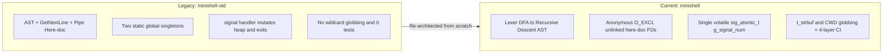

# Legacy Comparison Retrospective: `minishell-old` vs `minishell`

> **Navigation**: [[index|Hub: Index]] | [[CLAUDE|Schema & Rules]] | [[roadmap_and_issues|Dual-Repo Roadmap]]  
> **Related Specs**: [[evaluation_matrix|Evaluation Matrix]] | [[allowed_functions_matrix|Allowed Functions Matrix]] | [[github_engineering_standards|GitHub Engineering Standards]]  
> **Reference Implementation**: `42GS/minishell` (`main` @ `7d231e4`) vs Archived Legacy `42GS/minishell-old`

---

## 1. Executive Summary

`42GS/minishell`의 Mandatory, 코드 리뷰 안정화(`#41`~`#45`), Bonus(`#31`, `#32`), 13종 Valgrind 메모리·FD QA 게이트(`#33` PR `#53`) 100% 통과 이후, 봉인 규칙([[CLAUDE]] Section 1.1) 해제 및 과거 구현(`42GS/minishell-old.git`) 대비 정량·정성 대조 회고 보고서.

프로덕션 코어 코드 **`7,883` LOC -> `3,896` LOC(`-50.6%`)** 축소, 5대 E2E 차등 스위트 통과율 **`20/37 (54.1%, 3 timeouts)` -> `37/37 (100.0%, 0 crashes, 0 timeouts)`** 달성, 금지 외부 심볼 및 숨겨진 전역 싱글턴 의존성 완전 제거.

---

## 2. Quantitative Comparison (정량 비교)

두 저장소 소스 트리, 컴파일 심볼(`nm -u`, `nm -g`), 42evalhub 차등 스위트(5개 JSON, 총 37개 케이스, `LC_ALL=C` 기준 Bash 1:1 대조) 동일 머신 계측 결과:

| 지표 (Metric) | `minishell-old` (Legacy) | `minishell` (New) | 변화 / 개선율 |
| :--- | :--- | :--- | :--- |
| **전체 프로덕션 코드 (`libft` 포함)** | 110 `.c` / 13 `.h` (`9,283` LOC) | 51 `.c` / 7 `.h` (`4,476` LOC) | **-51.8% LOC** |
| **코어 코드 (`libft` 제외)** | 66 `.c` / 12 `.h` (`7,883` LOC) | 39 `.c` / 6 `.h` (`3,896` LOC) | **-50.6% LOC** |
| **전체 함수 수 / Norm 준수** | 263개 (25줄/5함수 초과 0건) | 189개 (25줄/5함수 초과 0건) | **-28.1% 함수 수**, 42 Norm 100% |
| **전역 상태 관리 (`nm -g`)** | 숨겨진 `static` 싱글턴 2개 (`shell_data`, `shell_input`) | 단일 `volatile sig_atomic_t g_signal_num` 1개 | **서브젝트 단일 전역변수 제약 100% 준수** |
| **외부 심볼 준수 (`nm -u`)** | 금지 심볼 링크 (`_getpid`, `_strcmp`) | 허용 심볼 33종 (금지 **0건**) | **평가 실격 요인 제거** |
| **와일드카드 `*` 지원** | 미구현 (`NO_WILDCARD_IN_LEGACY`) | 인용 마스크 기반 CWD `*` Globbing 구현 | **보너스 스펙 완전 달성** |
| **자동화 테스트 / CI 파일** | 테스트 **0개** / `.github` 템플릿 4개 (CI 없음) | 테스트 파일 **18개** / CI 게이트 2개 Job | **자동 회귀·Valgrind QA 구축** |
| **42evalhub 5대 E2E 벤치마크** | **20 / 37 (54.1%)**, 3건 타임아웃 | **37 / 37 (100.0%)**, 0 크래시/타임아웃 | **+45.9%p 향상** |

### 2.1 스위트별 E2E 차등 실행 결과 상세 (`LC_ALL=C`, Bash 대조)

| 스위트 (Suite) | `minishell-old` | `minishell` (New) | 비고 |
| :--- | :---: | :---: | :--- |
| `01_mandatory_basic.json` | 5 / 7 | **7 / 7** | 기본 실행 및 종료 상태 전파 |
| `02_quotes_and_expansions.json` | 7 / 7 | **7 / 7** | 따옴표 보존 및 환경변수 확장 |
| `03_redirections_and_pipes.json` | 3 / 6 | **6 / 6** | 구버전 Pipe/Here-doc 비정상 동작 해소 |
| `04_builtins.json` | 2 / 8 | **8 / 8** | 7대 빌트인, `cd -`, 64비트 `exit` 정확도 확보 |
| `05_bonus.json` | 3 / 9 | **9 / 9** | `&&`/`&#124;&#124;`, 서브셸, 와일드카드 `*` 완전 통과 |

---

## 3. Qualitative Architectural Improvements (정성 개선 분석)

### 3.1 비동기 시그널 안전성(Async-Signal-Safe) 및 전역 상태 격리
- **Legacy (`minishell-old`)**: `shell_data.c`와 `shell_input.c` 내부 `static` 싱글턴 포인터 2개로 외형상 전역 변수 회피 (실질적 전역 상태 공유). `srcs/shell/shell_signal.c`의 `signal()` 혼용 및 `heredoc_sigint_handler()` 내부 non-async-signal-safe 함수(`clear_shell_input()` 내 `free`, `rl_replace_line()` 등) 호출에 의한 힙 손상·Self-Deadlock 위험 존재
- **New (`minishell`)**: [[03_signal_dispatcher_and_state_machine]] 명세 기반 `sigaction()` + 단일 `volatile sig_atomic_t g_signal_num`으로 시그널 번호만 기록, 힙 해제·상태 동기화(`130`/`131`)·`termios` `ECHOCTL` 복원은 이벤트 루프 컨텍스트로 격리. `ctx->interrupted` 플래그를 통한 `cat || echo ...` 중 `SIGINT` 수신 시 Bash 호환 후속 조건 리스트 중단 처리

### 3.2 Here-doc 파이프 데드락 및 `Ctrl+D` 크래시 구조 제거
- **Legacy (`minishell-old`)**: `eval_heredoc_utils.c` 내 `waitpid()` 후 파이프 읽기(`receive_heredoc` -> `waitpid` -> `read_heredoc_pipe`) 구조로 64KB 커널 파이프 버퍼 초과 시 부모-자식 교착 위험. `read_input()`의 `Ctrl+D`(`readline` `NULL` 반환) 시 `ft_strncmp(NULL, ...)` 크래시 위험 및 `ft_strjoin` 반복에 따른 `O(N^2)` 재할당 발생
- **New (`minishell`)**: `executor_heredoc.c`의 `O_CREAT | O_EXCL`(`0600`) 익명 임시 파일 FD 쌍 생성 + 즉시 `unlink()`로 64KB 버퍼 제한과 임시 파일 경쟁·잔여물 동시 제거. `close_ast_heredocs(node, skip)`를 통한 파이프 형제·서브셸의 타 브랜치 Here-doc FD 즉시 해제로 `--track-fds=yes` FD 누수 0건 달성

### 3.3 확장 파이프라인 정합성 및 `O(N)` 가변 버퍼 (`t_strbuf`)
- **Legacy (`minishell-old`)**: `expand/` 전반에 분산된 확장 로직, 비인용 `PATH`/`IFS` 단어 분할·`ambiguous redirect`·`*` 와일드카드 미비 및 반복 문자열 결합
- **New (`minishell`)**: `libft/src/ft_strbuf.c`의 용량 2배 확장 버퍼(`t_strbuf`) 기반 비대화형 stdin 및 확장기 `O(N)` 전환. `t_exp_buf` 병렬 와일드카드 마스크(`mask`)로 `'*'`/`"*"`/`"$VAR"` 억제 및 Word Splitting -> CWD `*` Globbing -> Quote Removal 단일 패스 통합

### 3.4 허용 외부 함수 준수 및 에러 경로 방어
- **Legacy (`minishell-old`)**: `nm -u` 검사 시 금지 심볼(`_getpid`, `_strcmp`) 외부 링크. `exit` 인자 파싱·빌트인 출력 실패(`write()`)·POSIX 빈 `PATH` 세그먼트(`::`) 처리 차이로 `04_builtins.json` 2/8 기록
- **New (`minishell`)**: `nm -u` 기준 33개 외부 함수 전부 53종 허용 목록([[allowed_functions_matrix]]) 내 제한. 코드 리뷰 안정화(`#41`~`#45`)로 `&&&` 구문 오류(`TOK_AMP`), `dup2`/`write` 오류 전파, `ft_strdup(NULL)` 가드, 64비트 `LLONG_MAX`/`LLONG_MIN` `exit` 파서 보강

### 3.5 이중 저장소 Knowledge Base + 다층 CI 품질 게이트 방법론
- **Legacy (`minishell-old`)**: 자동화 단위·통합 테스트 0개, CI 워크플로우 부재
- **New (`minishell`)**: `42GS/minishell-wiki` 사전 설계 후 `42GS/minishell` 구현·검증. GitHub Actions 내 `norminette`, `Strict Build + No-Relink`, **7종 Valgrind C 단위 테스트**, **47종 E2E 스모크**, **37종 42evalhub 스위트**, **8종 PTY 인터랙티브 시그널 테스트**, **13종 Mandatory+Bonus+Error Valgrind 메모리/FD QA** PR별 자동 실행 파이프라인 구축

---

## 4. Lessons Learned & Retrospective Summary

1. **선(先) 아키텍처 명세와 후(後) 구현 효과**: [[01_parser_and_ast|Phase 1]]~[[04_builtins_and_env_table|Phase 4]] 설계 및 [[evaluation_matrix|평가 매트릭스]] 선행 확정으로 전체 코드량 절반 축소 및 37/37 기능 완성도 동시 확보
2. **도구 기반 방어적 QA 효용**: Valgrind 3.26 `--track-fds=yes`, PTY 시그널 테스트, 코드 리뷰 안정화(`#41`~`#45`)를 통한 형제 FD 누수·`&&&` 파싱·`||` 리스트 `SIGINT` 전파 결함 조기 식별 및 근본 원인 제거
3. **엄격한 제약 조건 내 표준 추상화**: `realloc`/`memcpy` 금지 및 5함수·25줄 제약 속 `t_strbuf`, `step_quote()`, `parse_single_redir()` 소형 추상화로 코드 중복 및 `O(N^2)` 병목 해소

---

## 5. Cross References (상호 참조)
- **위키 허브**: [[index]]
- **스키마**: [[CLAUDE]]
- **로드맵 및 이슈**: [[roadmap_and_issues]]
- **평가 체크리스트**: [[evaluation_matrix]]
- **허용 함수 매트릭스**: [[allowed_functions_matrix]]
