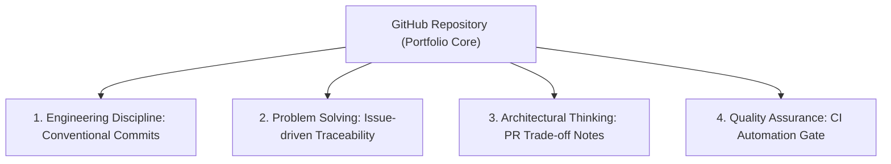
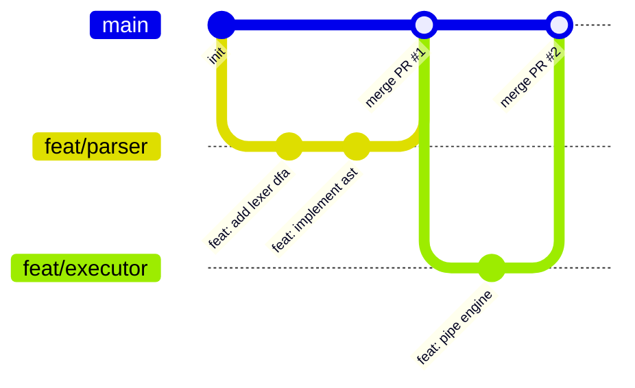
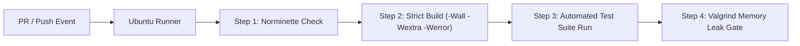

# GitHub Engineering Standards & Portfolio Strategy

> **Navigation**: [[index|Hub: Index]] | [[CLAUDE|Schema & Rules]] | [[wiki/process/roadmap_and_issues|Dual-Repo Roadmap]]  
> **Code Repository**: `git@github.com:42GS/minishell.git` | **Wiki Repository**: `git@github.com:42GS/minishell-wiki.git`  
> **Templates**: `templates/github/` (Issue/PR Templates, CI Workflow)  
> **Purpose**: 단순한 과제 제출용 리포지토리를 넘어, 테크 기업 백엔드/시스템 소프트웨어 엔지니어 채용 관점에서 기술적 깊이와 협업 역량을 증명하는 레퍼런스 포트폴리오 구축 전략입니다.

---

## 1. Portfolio Philosophy: What Recruiters Look For

채용 담당자와 시니어 엔지니어가 지원자의 깃허브 리포지토리를 평가할 때 가장 주목하는 4대 핵심 역량은 다음과 같습니다:



1. **공학적 규율 (Engineering Discipline)**:
   - 무의미한 커밋 메시지(`fix`, `update`, `asdf`)를 배제하고, 원자적(Atomic) 단위의 커밋과 일관된 커밋 컨벤션을 유지하는가?
2. **문제 정의와 추적성 (Traceability)**:
   - 모든 코드 변경의 발단(이슈)과 해결 과정(PR), 그리고 최종 결과(머지)가 링크로 100% 추적 가능한가?
3. **설계 의도와 트레이드오프 설명력 (Architectural Communication)**:
   - PR 본문에 단순 코드 설명이 아닌 "왜 이 방식을 선택했는지(Why)", "어떤 대안을 고려하고 배제했는지(Trade-off)"를 명시하는가?
4. **품질 자동화 (Quality Automation)**:
   - 사람의 수동 검증에 의존하지 않고, CI를 통해 코드 컨벤션(Norminette), 빌드 무결성, 메모리 누수를 자동으로 게이팅(Gatekeeper)하는가?

---

## 2. Git Branching Strategy: GitHub Flow

복잡한 Git Flow 대신, 가볍고 명확하며 현대적인 **GitHub Flow**를 적용합니다.



### 2.1 브랜치 명명 규칙
- **기능 개발**: `feat/<issue-number>-<short-description>` (예: `feat/12-ast-parser`)
- **버그 수정**: `fix/<issue-number>-<short-description>` (예: `fix/25-heredoc-signal-leak`)
- **리팩토링**: `refactor/<short-description>` (예: `refactor/unify-fd-closing`)
- **문서화**: `docs/<short-description>` (예: `docs/update-readme-c4-diagram`)

### 2.2 메인 브랜치 (`main`) 보호 원칙
- `main` 브랜치는 **상시 정상 컴파일, Norm 통과, 릭 제로, 평가 통과 상태**를 유지해야 합니다.
- `main` 브랜치로의 직접 푸시(`git push origin main`)는 금지되며, 반드시 **PR(Pull Request)을 통해서만 머지**합니다.

---

## 3. Conventional Commits Specification

모든 커밋 메시지는 [Conventional Commits 1.0.0](https://www.conventionalcommits.org/) 표준을 따릅니다.

### 3.1 커밋 메시지 포맷
```text
[#<issue>] <type>(<scope>): <subject>

[optional body: Why this change was made, technical details]

[optional footer: Closes #issue-number]
```

### 3.2 허용 Type 및 Minishell Scope 목록
| Type | 설명 | 허용 Scope 예시 |
| :--- | :--- | :--- |
| `feat` | 새로운 기능 추가 | `lexer`, `parser`, `ast`, `pipe`, `redir`, `builtin`, `signal`, `bonus` |
| `fix` | 버그 및 결함 수정 | `leak`, `heredoc`, `exit-code`, `quote`, `signal-race` |
| `refactor` | 기능 변경 없는 코드 구조 개선 | `cleanup`, `norm`, `fd-table`, `ast-walker` |
| `test` | 테스트 케이스 및 하네스 추가/수정 | `unit`, `e2e`, `eval`, `fuzz` |
| `docs` | README 및 문서 추가/수정 | `readme`, `adr`, `architecture`, `schema` |
| `ci` | GitHub Actions 워크플로우 수정 | `actions`, `lint`, `valgrind` |
| `chore` | 빌드 스크립트, Makefile 수정 | `makefile`, `gitignore` |

### 3.3 우수한 커밋 메시지 예시
```text
[#27] feat(executor): implement multi-command pipeline execution engine

- Resolve command list from AST and allocate (N - 1) pipes
- Implement strict pipe-closing protocol in child and parent to prevent hangs
- Wait for all children and propagate the rightmost command exit status to $?

Closes #27
```

---

## 4. Milestone & Label Architecture

프로젝트의 진행 상황을 한눈에 파악할 수 있도록 5단계 마일스톤과 라벨 체계를 구성합니다.

### 4.1 마일스톤 (Milestones)
1. **M1: Architecture & Scaffolding** (인프라, 뼈대, 자료구조, 빌드 시스템)
2. **M2: Lexer & AST Parser** (어휘 분석, 정형 문법, AST 트리 빌더)
3. **M3: Execution & IPC Engine** (프로세스 생명주기, 파이프라인, 리다이렉션)
4. **M4: Signals & Builtin Utilities** (3대 상태 머신, 7대 빌트인, 환경변수)
5. **M5: Bonus Features & Final Hardening** (`&&`, `||`, `( )`, `*`, 릭 제로 검증)

### 4.2 라벨 체계 (Issue & PR Labels)
- **우선순위**: `P0: Critical`, `P1: High`, `P2: Normal`
- **영역(Scope)**: `area:infra`, `area:parser`, `area:executor`, `area:signals`, `area:builtins`, `area:bonus`
- **유형(Type)**: `type:architecture`, `type:concept`, `type:feature`, `type:bug`, `type:refactor`, `type:docs`, `type:test`, `type:lint`
- **안정성(Safety)**: `safety:memory-leak`, `safety:fd-leak`, `safety:norminette`

---

## 5. GitHub Actions CI Pipeline Specification

모든 PR이 생성되거나 `main`에 코드가 푸시될 때 자동으로 실행되는 품질 게이트웨이 파이프라인입니다.



### CI 검증 항목
1. **Norminette Check**: 최신 42 Norminette 파이썬 패키지를 설치하고 전체 소스코드의 컨벤션 위반을 검사합니다.
2. **Strict Compilation**: `cc -Wall -Wextra -Werror` 플래그 및 `make`, `make re`, `make bonus` 무결점 빌드를 검사합니다.
3. **Memory Leak Gate**: Valgrind 환경에서 파이프라인, 리다이렉션, 에러 상황 테스트 시 힙 릭 0바이트(`definitely lost: 0`, `indirectly lost: 0`)를 검증합니다.
