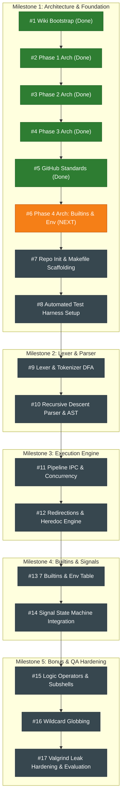

# Minishell Project Roadmap & GitHub Issues

> **GitHub Issues & Milestone Roadmap for 42GS/minishell**  
> GitHub 리포지토리([42GS/minishell](https://github.com/42GS/minishell))에 등록된 마일스톤(M1~M5)과 17개 표준 이슈의 추적 매핑 및 이행 로드맵입니다.  
> 모든 구현 작업은 이 로드맵의 이슈 번호(Issue #)를 기반으로 GitHub Flow 브랜치 및 Conventional Commits로 추적 관리됩니다.

---

## 1. Project Milestone Overview

| Milestone | Title | Scope & Target | Issues | Status |
| :--- | :--- | :--- | :--- | :--- |
| **M1: Architecture & Foundation** | 시스템 설계 및 빌드/CI 인프라 구축 | 사전 설계, 린트/위키, 템플릿, Makefile, 테스트 슈트 뼈대 | #1, #2, #3, #4, #5, #6, #7, #8 | **진행 중 (5/8 완료)** |
| **M2: Lexer & Recursive Descent Parser** | 어휘 분석 및 구문 트리 구축 | 토크나이저 DFA, AST 파서, 문법 검증 및 메모리 트리 해제 | #9, #10 | 대기 (M1 완료 후) |
| **M3: Execution Engine & IPC Pipeline** | 프로세스 트리 및 IPC 파이프라인 | 파이프라인, 리다이렉션, 파일 디스크립터 생명주기 관리 | #11, #12 | 대기 (M2 완료 후) |
| **M4: Builtins & Signal State Machine** | 내장 명령어 및 비동기 시그널 | 7대 빌트인, 환경변수 사전, 3대 셸 상태 머신 | #13, #14 | 대기 (M3 완료 후) |
| **M5: Bonus & Full QA Hardening** | 보너스 및 최종 통합 품질 검증 | 논리 연산자, 서브셸, 와일드카드, Valgrind 제로 누수 | #15, #16, #17 | 대기 (M4 완료 후) |

---

## 2. GitHub Issue Tracking & Wiki Mapping Table

| Issue # | Type / Priority | Title | Milestone | Status | Related Wiki Spec |
| :---: | :--- | :--- | :--- | :---: | :--- |
| **#1** | `feat` &#124; P1: High | [FEAT] Knowledge Base & LLM Wiki Bootstrap | M1 | **CLOSED** | [CLAUDE](../../CLAUDE.md), [mandatory](../../wiki/requirements/mandatory.md) |
| **#2** | `arch` &#124; P0: Critical | [ARCH] Phase 1: Lexer, Parser & AST Architecture Design | M1 | **CLOSED** | [01_parser_and_ast](../architecture/01_parser_and_ast.md), [deep_dive_lexer_parser_ast](../concepts/deep_dive_lexer_parser_ast.md) |
| **#3** | `arch` &#124; P0: Critical | [ARCH] Phase 2: Execution Engine & IPC Pipeline Design | M1 | **CLOSED** | [02_execution_engine_and_ipc](../architecture/02_execution_engine_and_ipc.md), [deep_dive_process_ipc_and_fd](../concepts/deep_dive_process_ipc_and_fd.md) |
| **#4** | `arch` &#124; P0: Critical | [ARCH] Phase 3: Asynchronous Signal Dispatcher Design | M1 | **CLOSED** | [03_signal_dispatcher_and_state_machine](../architecture/03_signal_dispatcher_and_state_machine.md), [deep_dive_signals_and_concurrency](../concepts/deep_dive_signals_and_concurrency.md) |
| **#5** | `infra` &#124; P1: High | [INFRA] GitHub Engineering Infrastructure & Standards | M1 | **CLOSED** | [github_engineering_standards](github_engineering_standards.md) |
| **#6** | `arch` &#124; P0: Critical | [ARCH] Phase 4: 7 Builtin Utilities & Env Table Design | M1 | **OPEN (Next)** | [04_builtins_and_env_table](../architecture/04_builtins_and_env_table.md) (예정) |
| **#7** | `infra` &#124; P1: High | [INFRA] Project Repository Initialization, Norminette CI, Makefile | M1 | **OPEN** | [github_engineering_standards](github_engineering_standards.md) |
| **#8** | `test` &#124; P1: High | [TEST] Automated Test Suite Setup (FIRST / AAA / Leak Detector) | M1 | **OPEN** | [evaluation_matrix](../requirements/evaluation_matrix.md) |
| **#9** | `feat` &#124; P0: Critical | [FEAT] Implement Lexer & Tokenizer DFA Engine | M2 | **OPEN** | [01_parser_and_ast](../architecture/01_parser_and_ast.md) |
| **#10** | `feat` &#124; P0: Critical | [FEAT] Implement Recursive Descent Parser & AST Builder | M2 | **OPEN** | [01_parser_and_ast](../architecture/01_parser_and_ast.md) |
| **#11** | `feat` &#124; P0: Critical | [FEAT] Implement Pipeline Execution & Multi-Process Concurrency | M3 | **OPEN** | [02_execution_engine_and_ipc](../architecture/02_execution_engine_and_ipc.md) |
| **#12** | `feat` &#124; P0: Critical | [FEAT] Implement Redirection & Heredoc Engine | M3 | **OPEN** | [02_execution_engine_and_ipc](../architecture/02_execution_engine_and_ipc.md) |
| **#13** | `feat` &#124; P1: High | [FEAT] Implement 7 Builtin Utilities & Environment Table | M4 | **OPEN** | [04_builtins_and_env_table](../architecture/04_builtins_and_env_table.md) (예정) |
| **#14** | `feat` &#124; P0: Critical | [FEAT] Implement Asynchronous Signal Dispatcher & State Machine | M4 | **OPEN** | [03_signal_dispatcher_and_state_machine](../architecture/03_signal_dispatcher_and_state_machine.md) |
| **#15** | `bonus` &#124; P1: High | [BONUS] Implement Logical Operators (&&, &#124;&#124;) & Subshell ( ) | M5 | **OPEN** | [bonus](../requirements/bonus.md) |
| **#16** | `bonus` &#124; P1: High | [BONUS] Implement Wildcard Expansion (*) via opendir/readdir | M5 | **OPEN** | [bonus](../requirements/bonus.md) |
| **#17** | `test` &#124; P0: Critical | [QA] Full Memory Leak (Valgrind) & FD Leak Automated Verification | M5 | **OPEN** | [evaluation_matrix](../requirements/evaluation_matrix.md), [allowed_functions_matrix](../concepts/allowed_functions_matrix.md) |

---

## 3. Workflow Progression & Execution Order

---

## 4. Next Immediate Steps (다음 착수 작업)

1. **Issue #6: Phase 4 아키텍처 및 심화 학습 문서 작성**:
   - `wiki/architecture/04_builtins_and_env_table.md`:
     - 7대 빌트인(`cd`, `export`, `unset`, `exit`, `pwd`, `echo`, `env`) 동작 명세 및 POSIX 엣지 케이스 분석.
     - `exit`의 64비트 정수 오버플로(`LLONG_MAX`/`LLONG_MIN`) 및 비수치 인자 예외 처리.
     - 단일 빌트인의 부모 셸 실행 시 FD 백업/복원(`dup`, `dup2`, `close`) 프로토콜.
     - 환경 변수 사전(Trie / Hash Table vs String Array) 구조 및 `envp` 직렬화(`export` 알파벳 정렬).
   - `wiki/concepts/deep_dive_builtins_and_environment.md`:
     - 유닉스 프로세스 가상 메모리 내 `environ` 포인터 배열의 배치와 CoW 한계.
     - 셸 내장 명령어(Builtin)가 반드시 부모 프로세스에서 실행되어야 하는 구조적 이유.
2. **Issue #7 & #8: 프로젝트 코드 저장소 초기화 및 테스트 프레임워크 구축**:
   - 아키텍처 4개 단계가 100% 완료된 직후, `~/Projects/gdtknight/42/minishell` 초기화 및 Makefile/CI 연동.
   - 단위 테스트(AAA / FIRST) 및 42evalhub 평가 시트 기반 누수 자동 점검 하네스 구현.

---

## 5. Cross References (상호 참조)
- **위키 스키마**: [[CLAUDE]]
- **전체 색인**: [[index]]
- **히스토리 저널**: [[log]]
- **GitHub 엔지니어링 표준**: [[github_engineering_standards]]
- **평가 매트릭스**: [[evaluation_matrix]]
