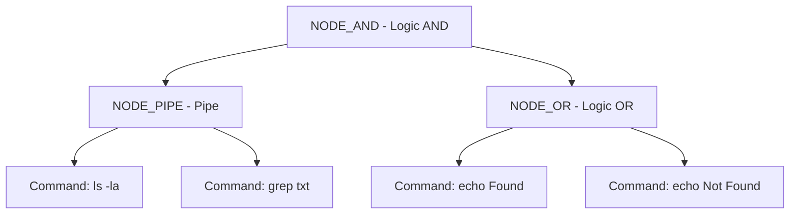

# Minishell Bonus Requirements Specification

> **Navigation**: [[index|Hub: Index]] | [[wiki/requirements/mandatory|Mandatory Spec]] | [[wiki/requirements/evaluation_matrix|Evaluation Matrix]]  
> **Architecture Mappings**: [[wiki/architecture/01_parser_and_ast|Phase 1: AST Parser]] | [[wiki/architecture/02_execution_engine_and_ipc|Phase 2: Subshell & Logical Lists]]  
> **Deep Dive Theory**: [[wiki/concepts/deep_dive_lexer_parser_ast|Context-Free Grammar & AST Deep Dive]]  
> **Raw Specs**: [[raw/specs/bash_lists|Bash Lists Spec]] | [[raw/specs/bash_compound_commands|Bash Subshell Spec]] | [[raw/specs/bash_expansions_and_wildcards|Bash Wildcard Spec]]  
> **Evaluation Precondition**: Mandatory 파트가 **완벽(PERFECT)**하게 통과해야만 평가 대상이 됨.

---

## 1. Bonus Features Overview

서브젝트에서 지정한 보너스 요구사항은 다음 세 가지 핵심 시스템 기능으로 요약된다:
1. **Logical Lists (`&&` 및 `||`)**: 단락 평가(Short-circuit evaluation) 및 조건부 커맨드 실행.
2. **Parentheses Priority (`( )`)**: 소괄호를 통한 실행 우선순위 지정 및 서브셸(Subshell) 격리 실행.
3. **Wildcards (`*`)**: 현재 작업 디렉토리(Current Working Directory) 대상 파일명 패턴 매칭(Globbing).

---

## 2. Logical Operators (`&&`, `||`) & AST Design

### 2.1 Bash 문법 규격
- `command1 && command2`: `command1`의 종료 상태가 0(Success)인 경우에만 `command2`를 실행.
- `command1 || command2`: `command1`의 종료 상태가 0이 아닌 경우(Failure)에만 `command2`를 실행.
- **결합 법칙**: 왼쪽에서 오른쪽으로의 결합(Left-to-right associativity).
- **연산자 우선순위**: `&&`와 `||`는 동등한 우선순위를 가지며, 파이프(`|`)보다는 우선순위가 낮다.
  $$\text{Redirection} > \text{Pipe } (|) > \text{Logical Lists } (\&\&, ||)$$
- 관련 스펙: [[raw/specs/bash_lists|Bash Lists Reference]]

### 2.2 파서 아키텍처 요구사항
단순한 1차원 커맨드 배열로는 `&&`, `||`, `|`, `( )`의 혼합 구문을 처리할 수 없다.  
따라서 **추상 구문 트리(AST, Abstract Syntax Tree)** 구조가 필연적으로 요구된다:

- 파서 구현 상세: [[wiki/architecture/01_parser_and_ast|재귀 하향 파서 설계]]
- 이론적 증명: [[wiki/concepts/deep_dive_lexer_parser_ast|문맥 자유 문법(CFG)과 트리 구조의 필연성]]

---

## 3. Subshell Parentheses (`( )`)

### 3.1 명세 및 동작 원리
- `( list )`: 괄호 안의 커맨드 리스트를 **독립된 서브셸(자식 프로세스)** 환경에서 실행.
- **환경 격리 보장**:
  - 서브셸 내부에서 실행된 `cd`, `export`, `unset` 등 셸 환경 변경 작업은 **부모 셸에 반영되지 않고 서브셸 종료와 함께 소멸**해야 함.
  - 예시: `(cd /tmp && pwd) && pwd` -> 첫 번째 pwd는 `/tmp`, 두 번째 pwd는 원래 작업 디렉토리.
  - 관련 OS 개념: [[wiki/concepts/deep_dive_process_ipc_and_fd|Copy-on-Write 및 프로세스 메모리 격리]]
- **리다이렉션 결합**: `(ls; echo hello) > output.txt` 형태의 복합 리다이렉션 지원.
- **종료 상태**: 괄호 내부의 마지막으로 실행된 명령어의 종료 상태를 반환.
- 구현 상세: [[wiki/architecture/02_execution_engine_and_ipc|서브셸 노드 실행 디스패치]]

---

## 4. Wildcards (`*` Globbing)

### 4.1 적용 범위
- **현재 작업 디렉토리(`.` / CWD)** 내의 파일 및 디렉토리 대상.
- `opendir`, `readdir`, `closedir` 시스템 콜을 사용하여 디렉토리 엔트리를 스캔.
- 관련 시스템 콜: [[wiki/concepts/allowed_functions_matrix|디렉토리 함수군]]

### 4.2 매칭 및 치환 규칙 (POSIX/Bash 규격)
1. **패턴 매칭**:
   - `*`: 숨김 파일(dotfile)을 제외한 모든 파일명과 매칭.
   - `*.c`: `.c`로 끝나는 모든 파일.
   - `ft_*`: `ft_`로 시작하는 모든 파일.
   - `a*b*c`: 복수 와일드카드 매칭.
2. **사전순 정렬 (Lexicographical Sort)**: 매칭된 결과는 반드시 ASCII/사전순으로 정렬되어 인자로 전달되어야 함.
3. **따옴표 내부 무효화**: `'*'` 또는 `"*"`는 와일드카드로 확장되지 않고 문자 그대로의 별표(`*`)로 전달.
4. **매칭 실패 시 폴백**: 매칭되는 파일이 하나도 없을 경우, 패턴 문자열 자체(예: `nonexistent*`)를 그대로 유지하여 명령어 인자로 전달.
5. **숨김 파일(Dotfiles) 예외**: 파일명이 `.`으로 시작하는 파일은 패턴이 명시적으로 `.`으로 시작하지 않는 한 `*`와 매칭되지 않음.
- 스펙 원문: [[raw/specs/bash_expansions_and_wildcards|Bash Pathname Expansion]]
