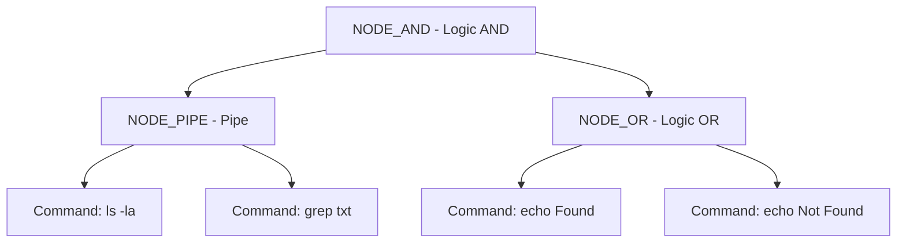

# Minishell Bonus Requirements Specification

> **Navigation**: [[index|Hub: Index]] | [[wiki/requirements/mandatory|Mandatory Spec]] | [[wiki/requirements/evaluation_matrix|Evaluation Matrix]]  
> **Architecture Mappings**: [[wiki/architecture/01_parser_and_ast|Phase 1: AST Parser]] | [[wiki/architecture/02_execution_engine_and_ipc|Phase 2: Subshell & Logical Lists]]  
> **Deep Dive Theory**: [[wiki/concepts/deep_dive_lexer_parser_ast|Context-Free Grammar & AST Deep Dive]]  
> **Raw Specs**: [[raw/specs/bash_lists|Bash Lists Spec]] | [[raw/specs/bash_compound_commands|Bash Subshell Spec]] | [[raw/specs/bash_expansions_and_wildcards|Bash Wildcard Spec]]  
> **Evaluation Precondition**: Mandatory 파트 감점 없는 전수 통과 시에만 평가 대상

---

## 1. Bonus Features Overview

서브젝트 지정 보너스 핵심 시스템 기능 3종:
1. **Logical Lists (`&&` 및 `||`)**: 단락 평가(Short-circuit evaluation) 및 조건부 커맨드 실행
2. **Parentheses Priority (`( )`)**: 소괄호 기반 실행 우선순위 지정 및 서브셸(Subshell) 격리 실행
3. **Wildcards (`*`)**: 현재 작업 디렉토리(Current Working Directory) 파일명 패턴 매칭(Globbing)

---

## 2. Logical Operators (`&&`, `||`) & AST Design

### 2.1 Bash 문법 규격
- `command1 && command2`: `command1` 종료 상태 `0`(Success)일 때만 `command2` 실행
- `command1 || command2`: `command1` 종료 상태 비정상(`!= 0`, Failure)일 때만 `command2` 실행
- **결합 법칙**: 왼쪽->오른쪽 결합 (Left-to-right associativity)
- **연산자 우선순위**: `&&`와 `||`는 동등 우선순위, 파이프(`|`)보다 하위
  > **연산자 우선순위 계층**: Redirection (`<`, `>`, `>>`, `<<`) > Pipeline (`|`) > Logical Lists (`&&`, `||`)
- 관련 스펙: [[raw/specs/bash_lists|Bash Lists Reference]]

### 2.2 파서 아키텍처 요구사항
단순 1차원 커맨드 배열로는 `&&`, `||`, `|`, `( )` 혼합 구문 처리 불가  
**추상 구문 트리(AST, Abstract Syntax Tree)** 구조 필수:

- 파서 구현 상세: [[wiki/architecture/01_parser_and_ast|재귀 하향 파서 설계]]
- 이론적 증명: [[wiki/concepts/deep_dive_lexer_parser_ast|문맥 자유 문법(CFG)과 트리 구조의 필연성]]

---

## 3. Subshell Parentheses (`( )`)

### 3.1 명세 및 동작 원리
- `( list )`: 괄호 내부 커맨드 리스트의 **독립 서브셸(자식 프로세스)** 실행
- **환경 격리 보장**:
  - 서브셸 내부 `cd`, `export`, `unset` 등 환경 변경의 **부모 비반영 및 종료 시 소멸**
  - 예시: `(cd /tmp && pwd) && pwd` -> 첫 `pwd`는 `/tmp`, 두 번째 `pwd`는 기존 작업 디렉토리
  - 관련 OS 개념: [[wiki/concepts/deep_dive_process_ipc_and_fd|Copy-on-Write 및 프로세스 메모리 격리]]
- **리다이렉션 결합**: `(ls; echo hello) > output.txt` 형태 복합 리다이렉션 지원
- **종료 상태**: 괄호 내부 마지막 실행 명령어 종료 상태 반환
- 구현 상세: [[wiki/architecture/02_execution_engine_and_ipc|서브셸 노드 실행 디스패치]]

---

## 4. Wildcards (`*` Globbing)

### 4.1 적용 범위
- **현재 작업 디렉토리(`.` / CWD)** 내 파일·디렉토리 대상
- `opendir`, `readdir`, `closedir` 시스템 콜을 통한 디렉토리 엔트리 스캔
- 관련 시스템 콜: [[wiki/concepts/allowed_functions_matrix|디렉토리 함수군]]

### 4.2 매칭 및 치환 규칙 (POSIX/Bash 규격)
1. **패턴 매칭**:
   - `*`: 숨김 파일(dotfile) 제외 모든 파일명 매칭
   - `*.c`: `.c` 확장자 파일 매칭
   - `ft_*`: `ft_` 접두사 파일 매칭
   - `a*b*c`: 복수 와일드카드 매칭
2. **사전순 정렬 (Lexicographical Sort)**: 매칭 결과 ASCII/사전순 정렬 후 인자 전달
3. **따옴표 내부 무효화**: `'*'`, `"*"`의 와일드카드 확장 억제 및 문자 `*` 그대로 전달
4. **매칭 실패 시 폴백**: 매칭 파일 0건 시 원문 패턴 문자열(`nonexistent*`) 인자 유지
5. **숨김 파일(Dotfiles) 예외**: `.` 시작 파일명은 패턴 앞 `.` 명시 시에만 매칭
- 스펙 원문: [[raw/specs/bash_expansions_and_wildcards|Bash Pathname Expansion]]
